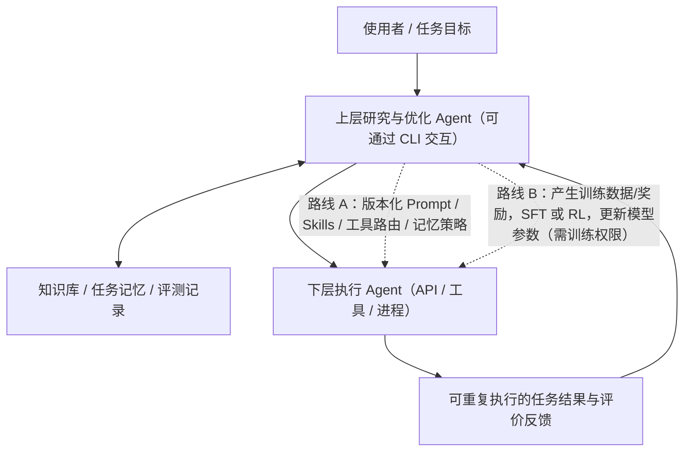

# 方向 B｜AI 优化 AI：Agent 自动改进与模型训练（AI Improves AI）

> **状态：2026-10-22 更新研究问题（研究者明确的目标场景）**。已批准作为研究方向；**T001 Promptbreeder 与 T005 Self-Rewarding 已归档客观骨架，T002–T004 已认领；后续并行研究以本方向实时论文 Index 为准。尚未批准具体创新或选定工程路线**。这里记录的是研究目标，不是已证实的方法或实现承诺。

## 核心研究问题：AI 应该优化什么？

**目标场景（研究者提出的设想，尚未作为技术方案定稿）**：一个可通过 CLI 等界面与使用者沟通的上层 AI，具有长期记忆/知识库，能够理解需求、安排实验并审查下层执行 Agent（通过 API、工具或独立进程完成任务）的结果；利用可验证的执行反馈，持续改善下层 Agent 的配置和工作能力。**CLI 只是交互/控制接口示例，不是必须采用的产品形态。**

**研究焦点是“谁在利用什么反馈优化谁、实际被更新的对象是什么”，而不是默认必须训练神经网络权重。** 必须同时研究并比较：

1. **外部 Agent 优化（Prompt / Agentic Optimization）**：上层 AI 根据任务成功率、质量、成本、失败类型等反馈，搜索/修改/挑选下层 Agent 的 System Prompt、任务模板、Skills、工具选择策略、记忆读取与工作流配置；通过版本、固定测试集、回滚机制检验效果。**此类不修改基础模型权重**，但可形成持续的系统级性能改进。
2. **参数层模型训练（Model Training）**：上层 AI 可能生成/筛选训练数据、奖励或轨迹，使用 **SFT**（监督微调）、**RL**（强化学习）或蒸馏等训练下层模型。**LoRA 是一种参数高效微调实现方式，不是与 SFT/RL 同一层级的独立训练目标**。训练需要相应模型权重/微调接口与数据计算预算。
3. **混合路线（待实证）**：先在可审计的外部配置/知识层优化；若发现稳固、可复现且难以通过 Prompt 解决的能力瓶颈，再验证是否用积累的轨迹做参数训练。**这是需要比较的假设，不是已经批准的系统架构。**

搜索文献时不要把“AI 生成合成数据训练 AI”视为唯一定义，也不要把**改 Prompt、记忆或调度策略**描述为“训练了模型权重”。尤其比较：优化的目标/损失函数、反馈/评测是否独立、成功是否跨任务泛化、自动修改是否可追踪、成本/风险/权限怎样约束。严格区分真实训练、外部搜索，以及一般提示词修改；不把普通 Agent 反馈直接叫作严格 RSI。

**本方向暂用的研究提问，不是固定技术分类**：Prompt 自动改进、自动化 Agent 设计/工作流搜索、经验记忆与技能优化、训练数据/奖励生成、SFT/RL/蒸馏、以及两者组合。具体是否适用于用户设想，要按原论文与实验证据逐篇判断。

## 文件导航（仅本方向）

| 位置 | 用途 |
|---|---|
| [papers/INDEX.md](papers/INDEX.md) | 方向 B 论文认领/去重/最小状态；[T001 Promptbreeder](papers/T001/README.md) 已归档骨架；**T002 GEPA、T003 ADAS、T004 Agent Lightning 已认领，T005 Self-Rewarding 已完成[客观架构及原文方法核验](papers/T005/README.md)**；其他并行认领以实时 Index 为准 |
| `papers/T00X/README.md` | 单篇原文依据的自绘架构与输入/反馈/训练路径（归档后才出现） |
| `papers/T00X/PAPER.md` | 原文及查证范围 |
| `papers/T00X/ARCHITECTURE.md` | **逐项经研究者确认**的特色机制；不强制每篇都有 |
| `papers/T00X/IDEAS.md` | **逐项经研究者确认**的具体不足/待验问题 |
| [knowledge/DELTA_INDEX.md](knowledge/DELTA_INDEX.md) | 本方向的机制增量索引（`TD001` 起） |
| `knowledge/deltas/TD00X_*.md` | 获批并与已有机制去重的机制卡；暂无机制时不创建 |
| [synthesis/README.md](synthesis/README.md) | 仅放后续经确认的跨论文综合结论 |

## 与方向 A 的关系

- 方向 A **AI Agent 因子挖掘**保留仓库根目录现有 [papers/](../papers/INDEX.md)、[knowledge/](../knowledge/DELTA_INDEX.md)、[synthesis/](../synthesis/README.md)，**不移动旧文件、不重编号**。
- B 论文从 **T001** 开始，机制卡从 **TD001** 开始；与 A 的 P001–P010、D001–D020 分开管理。
- 同一原文涉及两个方向时，先查**两边索引**，优先交叉引用、解释不同研究问题，避免重复整篇复制。跨方向不因措辞不同重复声称创新。
- **共享规范**：[AGENTS.md](../AGENTS.md)、[RESEARCH_WRITING_STANDARD.md](../RESEARCH_WRITING_STANDARD.md)、[RESEARCH_PLAN.md](../RESEARCH_PLAN.md)。新论文骨架经原文核实可归档；创新/特化不足/原创研究想法/Delta **仍须研究者逐项批准与严格语义去重**，非论文来源须先批准来源本身。每次归档**同一回合同步本方向两份索引**。

**安全边界**：本仓库公开；不放入公司材料、账户/密钥、受限制代码/数据或未获授权再分发的 PDF。
