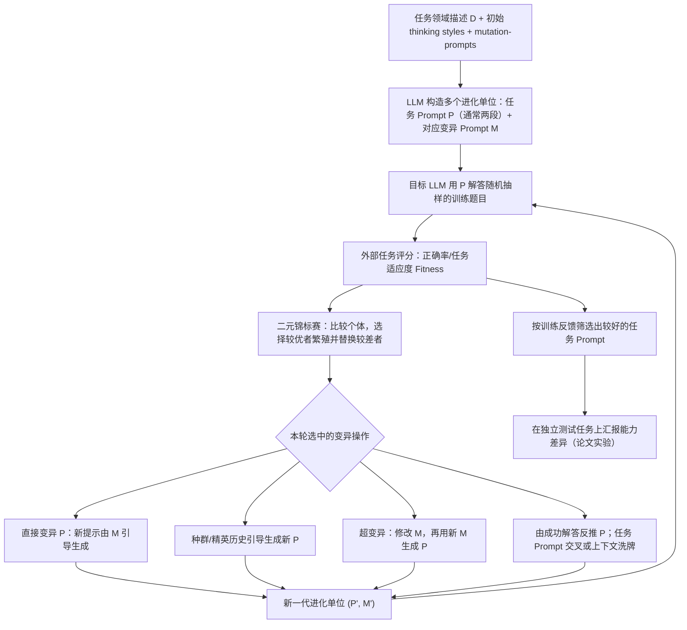

# T001｜Promptbreeder：让修改任务 Prompt 的方法也随实验反馈进化

> **归档状态（2026-10-22）**：正式论文的**客观系统骨架**已按 arXiv 原始全文 §1–6、相关图与部分附录核实；ICML 2024 正式题录可核。**没有经过研究者对特色创新、特化不足和知识 Delta 的逐项审批，因此不创建评价文件或 TD 卡；也不声称完整复现。**

[原文及证据范围](PAPER.md) · [ICML 2024 / PMLR 官方记录](https://proceedings.mlr.press/v235/fernando24a.html) · [arXiv 原文](https://arxiv.org/pdf/2309.16797)

## 一分钟看懂“Prompt 套娃”｜通俗骨架（已核对原文 Fig.2、§3.2）

- **P = 员工的工作指令**：真正给目标 LLM 做数学题/分类任务用的 Prompt，论文典型执行两段 P。
- **M = 教练的改写指令**：用来告诉 LLM“怎样改进 P”。模型把 M 和旧 P 组合起来，就能生成新的 P′。
- **H = 教练的教练**：一条由人预先给定的元指令，用来让 LLM 改进 M，得到 M′；新 M′ 再修改 P。
- **外部裁判 = 真实任务评分**：运行 P′ 做题，用正确率等任务适应度比较候选；**分数选择的是进化个体，而不是由“教练”口头断言好坏**。
- **停止套娃的位置**：P 和 M 的自然语言内容可以变化；H（这里用于一阶超变异的固定指令）、遗传搜索算法拓扑和评价目标没有再逐层递归自我修改。作者还有从领域描述重新生成 M 的零阶超变异，并不全都通过 H 修改旧 M。
- **同一个基础 LLM 可多次担任不同角色**：生成指令、按指令完成任务，并不要求每层由独立模型或新训练出的神经网络承担；**不更新模型权重**。

一句话：**“员工做题 → 裁判看成绩 → 教练改变员工指令；必要时教练的教练再改变教练的改法 → 下一轮继续考核。”** 这属于有限层次的 Prompt 自指搜索，**不是无限递归训练模型权重**。

> 对应原文：§3.2.1（M 修改 P）、§3.2.3（H 修改 M / 从领域描述生成 M）、Figure 2（P/M/H 三层关系）、§4–5（任务评价与比较）。这只是方便理解的类比，不表示原论文实现了 CLI、长期记忆库或工具执行 Agent。

## 论文解决什么问题？

对给定领域的任务，已有 LLM 的**模型参数固定**，系统通过实验评估、进化更有用的自然语言提示。与简单“写一个好 Prompt”不同，论文同时维护：

- **任务 Prompt（task-prompt，P）**：交给目标 LLM 以影响其解答；原文实验中通常一次使用两段顺序执行的任务 Prompt。
- **变异 Prompt（mutation-prompt，M）**：交给 LLM，指挥它如何把旧任务 Prompt 改成新任务 Prompt。
- **训练任务与评分函数**：用于判定变异后的任务 Prompt 是否在该领域的答案任务上表现更好。**评价规则本身不是进化对象**。

## 自绘运行骨架（根据原文 Fig.1、§3.1–3.2）

**信息流和更新对象**：

1. 初始化时，领域描述 + 随机 thinking style + 种子变异 Prompt 生成多种 `P`；每个进化单位关联 `P`、`M`，few-shot 实验还会带正确解答示例组成的上下文。论文采用**二元锦标赛遗传搜索**，不是对 LLM 做梯度下降。
2. **直接 Prompt 变异**近似 `P′ = LLM(M + P)`；**超变异**近似 `M′ = LLM(H + M)`，其中 `H` 是指导“如何改造变异 Prompt”的元指令。M 影响下一代 P 的质量，而 P 的任务适应度决定其所属进化单位的选择命运。
3. 论文定义五类变异操作：**直接变异**、**估计分布/种群历史变异**、**超变异（M 的变异）**、**由成功解答反向归纳 P**、**Prompt 交叉与 few-shot 上下文洗牌**。它们不是五种可训练模型，而是既定算法内的不同操作分支。
4. **反馈更新了什么**：`P` 文本、`M` 文本、种群与谱系/精英状态，部分情形还更新 few-shot 正确示例上下文。基础 LLM 的**权重不更新**；任务评价/奖励函数、进化算法总体拓扑也**没有自动改写**。

## 作者报告的实验（不是我们的复现）

- 原始全文 §4 采用**50 个进化单位、通常 20–30 代**，从训练集抽取 **100 个问答对**评估候选 Prompt 的任务适应度；包含算术、常识推理、Instruction Induction 与 ETHOS 分类任务。
- 原文 Table 1 的 **PaLM 2-L / GSM8K 零样本**结果：Promptbreeder **83.9%**，同表列出的 OPRO **80.2%**；一些其他基线使用不同模型，不可把所有表格数字当作严格同模型对照。
- 作者在 ETHOS 上报告两段 Prompt 方案 **89%**，对照简短手工 Prompt **80%**。原文还报告不同变异算子的消融；但这不等于证实它能普适改善代码执行 Agent 或长期在线记忆系统。

## 本阶段研究边界

- **本文原型只覆盖提示内容与改变提示的元指令**，不是完整的上层 CLI / 下层多工具 Executor；没有论文依据支持把通用 Skills/工具路由/外部知识库也说成 Promptbreeder 已经优化。
- **严格区分“会优化自己的提示修改方式”与“递归改写模型权重”**：它是自然语言层的自指式优化，非 LoRA/SFT/RL 模型微调。
- **单篇特色、特化不足、跨论文 TD 增量仍待研究者审查**。尤其要与旧方向 P002 的代码因子种群进化、P009 的评分器代码进化区分更新对象；这里只给出读图事实，不入库创新比较结论。
