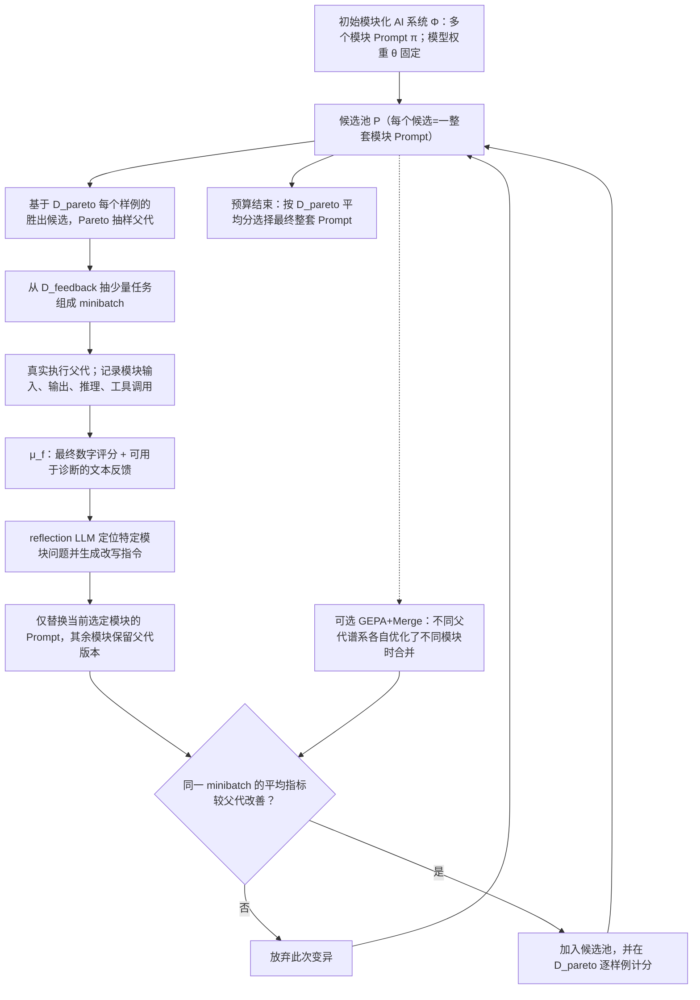

# T002｜GEPA：反思式 Prompt 演化与逐样例 Pareto 搜索

**论文**：GEPA: Reflective Prompt Evolution Can Outperform Reinforcement Learning（ICLR 2026）  
[官方完整论文 PDF](https://proceedings.iclr.cc/paper_files/paper/2026/file/0e9e708b6f48e14fd0ac29e167413f76-Paper-Conference.pdf) · [原文来源与核查边界](PAPER.md) · [已审特色（3 项）](ARCHITECTURE.md) · [对应不足（3 项）](IDEAS.md)

> **本页保留经原文核实的客观骨架与作者报告数据**；研究者已于 2026-10-22 批准 **[三项特色机制](ARCHITECTURE.md) + [各自对应的三项特化问题](IDEAS.md)**，分别入库 [TD003](../../knowledge/deltas/TD003_trace_guided_module_prompt_reflection.md)、[TD004](../../knowledge/deltas/TD004_instancewise_pareto_parent_selection.md)、[TD005](../../knowledge/deltas/TD005_lineage_aware_module_merge.md)。项目内机制辨识度不等于学术首创，问题不等于已证实失效；未独立复现。

**一句话**：冻结执行模型权重，只让一个 reflection LLM 使用实际任务执行轨迹、工具/评测器的文本诊断与数值分数，**定向改写整套 AI 系统中某一个模块的 Prompt**；用小批量测试过滤改动，再根据不同验证样例上的各自最佳候选执行 Pareto 式父代采样；可选进行跨模块的家族合并。最终输出**聚合验证表现最佳的一整套 Prompt**，不是 LLM 权重检查点。

## 一眼看懂（原文 Figure 3、§2–3、Appendix C/D）

## 运行链路中的严格区分

1. **优化对象**：作者将复合 AI 系统写成 `Φ=(M,C,X,Y)`。一个完整候选是所有模块提示 `Π=(π1,...,πm)` 的一种组合；基本 GEPA 的**模型参数 θ、已有工具、控制流 C 不因反思而改写**。不能把本篇称为 SFT/LoRA/GRPO 微调。
2. **输入与两种反馈**：系统、任务训练集、数值评价函数 `μ`、能返回更多文字诊断的 `μ_f`、执行预算 `B`。**execution trace** 来自执行模块的输入输出/调用与文本推理；**evaluation trace** 包括编译/测试/规则检查等评测器在压缩为一个分数之前产生的信息。缺乏详细反馈时也可反思，但诊断能力更有限。
3. **两个优化分组**：论文 Algorithm 1 将 `D_train` 分为 `D_feedback` 与 `D_pareto`。前者供具体例子反思与小批量改写，后者供存活候选逐样例评分、Pareto 父代选择和最后选优。作者另使用最终 held-out test 报告泛化，不得把验证集评分等同未来可见标签。
4. **一轮反思式变异**：从 Pareto 选择一个候选（父代）→ 选择一个待改模块（实现中可轮换）→ 在小批量任务跑原候选→ `μ_f` 给分数和具体文本证据→ 反思 LLM 依据旧 Prompt、输入输出和反馈写出新 Prompt→ 只替换该模块→ 在同一批任务评测；**仅当新平均得分高于旧版**，才将其纳入候选池并在 `D_pareto` 完整评价。后代记录来源关系。
5. **Pareto 的具体定义**：这里不是「准确率/成本/速度」三指标的传统多目标图，而是**验证集每个样例都可独立视作一个维度**。候选只要在至少一个样例上与最佳分数并列领先，且未被其他候选严格支配，就可留在候选选择集。抽父代时，胜出样例数量越多，采样机会越大。**最终交付仍按 `D_pareto` 聚合平均分选择单一候选**，不是交付多个分支。
6. **可选跨模块合并**：`GEPA+Merge` 寻找有共同祖先且优化模块互补的两个候选，以祖先为底，把各家系不同模块上的改进取回；合并按家族谱系和表现过滤，**不是盲目把两个大段 Prompt 文本拼接**。合并不保证收益，Table 1 中该变体整体分数低于无 merge GEPA。

## 论文中确实出现的真实例子

Figure 2 的多跳 QA 模块，最初指令基本只说「根据 question 与第一跳 summary_1 写查询」。反思后的版本增加了明确策略：**识别第一跳已经回答的部分，针对仍缺的信息寻找相关但不同的实体或上下文，不要只改写原问题**。从运行错误总结为下一次可直接执行的通用提示规则，而不是在外部知识库记一条“失败了”。

## 原文结果与限定

- Table 1（Qwen3-8B、六任务聚合）：未优化系统 **45.23**，GRPO **48.91**，MIPROv2 **47.84**，GEPA **54.85**，GEPA+Merge **52.40**；作者报告 GEPA 在**五/六**任务超过 GRPO，**AIME-2025 例外**（GEPA 32.00、GRPO 38.00）。GRPO 实验使用 **LoRA**（论文脚注），GEPA 不训练生成模型权重。
- 作者称六任务平均较 GRPO 提升约 **6 个百分点**、最多 **19 个百分点**，最优测试表现对应的 rollout 使用量最多减少 **35 倍**；这是给定任务、模型、预算下的结果，并非「Prompt 搜索普遍胜过 RL」。
- Table 3（Qwen3-8B 四任务、固定同一反思式候选生成框架）比较父代选择：GEPA Pareto 的**聚合 improvement +12.44**，仅挑全局最佳是 **+6.05**，Top-4 beam 是 **+5.11**，较能隔离**父代选择方式**的贡献。这些是聚合表现提升数字，不是因子收益率。
- 费用/预算必须完整看：论文特别指出 **多数 GEPA rollout 花在验证候选，而不是获得反思学习信号**，且额外 reflection LLM token/算力成本不能直接由“rollout 数”衡量。
- 真实适用门槛：必须能够执行任务、保留足够的可解释轨迹、提供可比较的结果评价；详细文本反馈越可操作，反思越可能有价值。**本论文的主算法并不让上层 AI 自主修改训练算法、任意重写 Agent 控制流程或提升 LLM 自身权重**。作者另在 §5/Appendix E 试验 inference-time 代码搜索，不要与主要提示优化混为一谈。

**来源定位**：主文 §2–4、Figure 2–3、Table 1、Table 3；Appendix C（reflection meta-prompt）、D（Algorithms 1–4），以及 §5/Appendix E（扩展应用）。[证据和未核范围](PAPER.md)。
