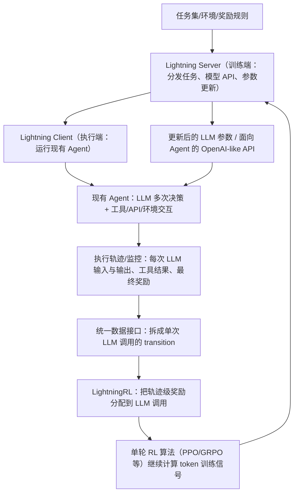

# T003｜Agent Lightning：让现有 Agent 的执行记录成为模型 RL 训练数据

> **状态（2026-10-22）**：2025 年原论文 [arXiv:2508.03680](https://arxiv.org/abs/2508.03680) 的 **§1、§3–4 与关键算法/系统结构**已核实并建立**客观骨架**；特色创新、特化不足与 TD 卡**尚待研究者逐项讨论批准**。未实际训练模型、未复现实验。

[原文与版本核查边界](PAPER.md) · [原论文 HTML 全文](https://arxiv.org/html/2508.03680) · [Microsoft Research 项目](https://www.microsoft.com/en-us/research/project/agent-lightning/)

## 一句话讲明白

**Promptbreeder（T001）改的是执行 Agent 的指令（Prompt），基础模型权重不动；Agent Lightning 把现有 Agent 真实执行任务时的 LLM 调用、工具反馈与最终结果收集起来，用 RL 更新模型参数。** 其核心是将**复杂 Agent 应用的执行过程**与**负责更新权重的训练器**分开，使两者能通过统一数据接口协作。

## 自绘系统骨架（依据原文 Fig.1–4、§3.1–3.4）

## 每个组件究竟负责什么？

1. **Agent Runtime / Client**：原有 Agent 继续按其自己的框架和工具链执行任务。系统借 OpenAI 风格推理 API 及可观测性/trace 捕捉实际的 LLM 输入、输出、工具调用与终端任务结果。作者目标是最大限度避免重写现有 Agent 逻辑。
2. **统一数据接口**：一段任务可能涉及“生成搜索词→搜索工具→二次回答”等多次调用。论文把每次需要训练的 **LLM 调用**抽成 `(input_t, output_t, reward_t)` 作为 transition；运行中的非 LLM 工具结果可以进入当前输入上下文，但**不直接把工具输出作为模型生成 token 来训练**。
3. **LightningRL（层级 RL）**：先在**不同 LLM 调用之间**分配完整任务的奖励，再让已有单轮 RL 算法在某次调用的 token 之间进行学习。**2025 原论文现有实验的最简实现：每次调用统一收到本次任务相同的最终回报 R**；“能精细判断哪一步贡献更大”是可扩展接口和后续方向，**不是本论文已证明的高级 credit-assignment 算法**。
4. **Lightning Server / Trainer**：管理训练/推理模型、任务调度、数据与 RL 参数更新。通过 OpenAI-like API 与 Agent 端连接。**最终被更新的对象是模型参数 `θ`，而不是当前 Agent 的 System Prompt**（虽然作者认为同一数据接口未来也能支持 Prompt 优化）。

## 论文实际报告什么？

| 原文实验（§4） | Agent 框架 | 数据与任务 | 调优对象 |
|---|---|---|---|
| Text-to-SQL | LangChain | Spider，自然语言→SQL→执行→检查/改写 | 3 个角色中选择训练 SQL writer 与 rewriter；同一基础 LLM 在不同 Prompt 下承担角色 |
| 开放域多跳问答/RAG | OpenAI Agents SDK | MuSiQue、Wikipedia 检索→回答 | 1 个 LLM |
| 数学题工具调用 | AutoGen | Calc-X，调用计算器并生成答案 | 1 个 LLM |

作者在三组实验中报告训练/测试奖励曲线逐步改善。**这属于论文作者实验结果**；并不直接证明“任何闭源 API Agent 都可以直接做权重训练”，也不是我们完成的独立复现。

## 本轮只保留的研究边界

- **更贴近用户研究中的“权重训练”路线**：它研究怎样复用执行 Agent 的交互轨迹，真正训练可更新的模型，而非搜索 Prompt 文本。上层 CLI + 下层 Executor 是用户目标场景，**不是这篇论文已经实现的通用产品**。
- **不要混淆论文和仓库版本**：2025 原始 Agent Lightning 论文和微软 GitHub 2026 年的 **Agent Lightning v1.0** 有设计迭代；当前 `main` 已全面重构，不能用 v1.0 的训练指标冒充 2025 原论文 §4 的结果。
- **正式贡献、特化不足、TD 是否新增**仍未审批。本档不将训练/执行分离、奖励分配、监控等先行视为学术首次发明。

