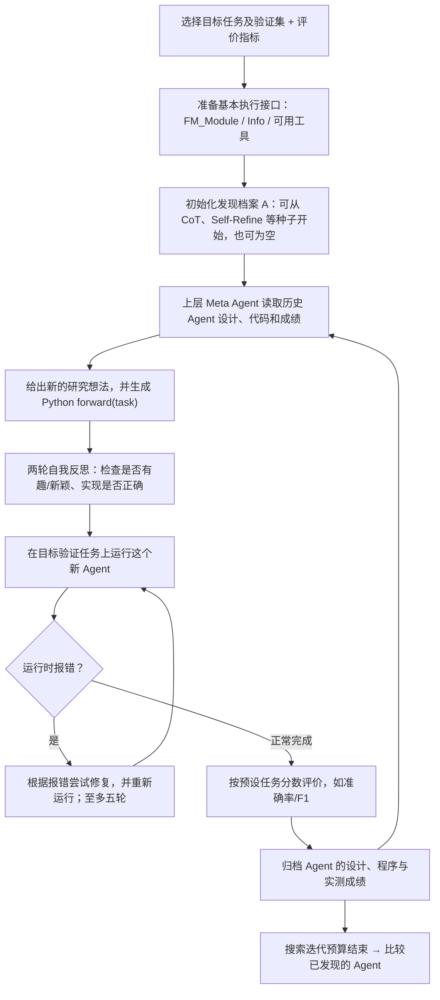

# T004｜Automated Design of Agentic Systems（ADAS）｜Meta Agent Search

**原题**：Automated Design of Agentic Systems。Shengran Hu、Cong Lu、Jeff Clune；**ICLR 2025 正式会议论文**。  
[正式会议题录](https://proceedings.iclr.cc/paper_files/paper/2025/hash/36b7acf6f6010652b3f2a433774a66fe-Abstract-Conference.html) · [官方 PDF](https://proceedings.iclr.cc/paper_files/paper/2025/file/36b7acf6f6010652b3f2a433774a66fe-Paper-Conference.pdf) · [arXiv:2408.08435](https://arxiv.org/abs/2408.08435) · [原文与证据界限](PAPER.md) · [已审特色（2 项）](ARCHITECTURE.md) · [对应特化不足（2 项）](IDEAS.md)

> **已核实的客观骨架获研究者认可**；2026-10-22 进一步批准 **[TD010 代码级 Agent 结构搜索](../../knowledge/deltas/TD010_executable_agent_program_search.md)** 与 **[TD011 历史 Agent 设计档案回流](../../knowledge/deltas/TD011_agent_design_archive_stepping_stones.md)**，以及各自一项**[对应特化不足](IDEAS.md)**。项目级机制辨识度不代表学术首创；两条待核归因问题不等于已证实故障；未独立复现。

## 一句话抓住不同

方向 B 此前 T001/T002 主要让上层搜索器修改下层**自然语言 Prompt**；**本篇 Meta Agent Search 让设计者 LLM 生成下层 Agent 的完整 `forward(task)` Python 程序**，因此能够改变 Prompt、角色/模块、调用次序、并行分支、反馈循环、组合与工具调用结构（在已有接口允许的范围内）。**模型权重没有被训练**；在论文具体实现中，允许的代码环境和 API 由外层提供，Meta Agent 本身的研究/生成策略也没有被重新训练。

## 完整客观运行图（原文 Figure 1–2、§3、Appendix C/D/I）

## 每一步的实际职责

1. **目标、搜索空间、评价**：作者将广义 ADAS 分为 Search Space（能表达什么设计）、Search Algorithm（怎样找设计）、Evaluation Function（如何评分）。这篇的实例选择**Python 代码空间 + LLM 元智能体 + 固定的真实任务表现评估**；广义 ADAS 可多目标，但本文实验主要用任务表现。
2. **Meta Agent 不是 Executor**：Meta Agent（实验中 GPT-4）看历史档案、提出高层机制、写 `forward()`；它不负责替新 Agent 直接回答基准问题。**下层候选 Agent** 是运行这个程序时对具体任务调用基础模型/工具的系统（实验使用 GPT-3.5）。
3. **写的是什么代码**：框架给出不足 100 行的基础功能（如 FM_Module、统一信息封装及 API 调用）；候选编写 `forward(taskInfo)`，可构造多个基础模型模块、串行或并行执行、评审与集成输出，不是随意修改系统环境中的一切代码，更不是训练基础模型。
4. **创新候选的内部两轮反思**：候选设计先生成 `thought/name/code`，再经过两轮设计/实现反思，以减少不合理、重复或格式问题。**运行时报错后的修复循环**是另一回事，原文最多试五轮；不能把两者混成模型 RL 更新。
5. **外部实证反馈的回流**：新候选在目标任务验证集上执行，指标（例如准确率/F1）和代码设计一起进入持续增长的档案；下一轮 Meta Agent 借此前有用或尚未领先的设计作为构件和踏脚石（stepping stones）。**档案是代码/设计和分数层的经验积累，不是模型权重、也不是已经批准的自主演化 Meta Agent 训练**。
6. **输出**：本轮算法输出完整已发现 Agent 档案；研究者可以从中选择验证表现较好的 Agent 设计进行独立测试。论文没有证明它会在真实部署后自动持续更新生产 Agent，也未自动改变评价规则。

## 一个直观但非原文任务的示意

最早的 Agent 可能是「用单个 LLM 一次性作答」。Meta Agent 根据已有成绩尝试设计为「三个 LLM 独立推理 → 专家检查不同错误 → 评审模块综合答案」。此时改变的是**下层智能体的组织方式和 Python 调用流程**；同一个底层 FM 不需要变成新参数模型。这类“多份答案 + 多种评论家 + 再集成”的结构与论文 Figure 3b 展示的 ARC 最佳 Agent 同类；例子表述为解释，不冒充代码逐字复刻。

## 原文实验的可核事实（作者报告，非复现）

**Table 1（分别在各目标域搜索，再独立测试）**：

| 域 | 最好人工设计基线 | Prompt 优化基线 OPRO | Meta Agent Search |
|---|---:|---:|---:|
| DROP 阅读理解，F1 | 65.8 | 69.1 | **79.4** |
| MGSM 多语言数学，准确率% | 39.0 | 30.6 | **53.4** |
| MMLU 多任务，准确率% | 65.9 | 67.6 | **69.6** |
| GPQA 科学问答，准确率% | 31.6 | 32.9 | **34.6** |

- 搜索：ARC 使用 25 轮（选 20 个验证题、60 个测试题，简单子集且 5 次重复评价）；DROP/MGSM/MMLU/GPQA 每个域**分别独立搜索 30 轮**。论文在特定 GPT-4 作元 Agent、GPT-3.5 作执行 FM 的设置下报告成绩，不等于所有任务上的全面胜利。
- **可迁移性**：作者将 MGSM 发现的部分 Agent 直接测试在 GSM8K、GSM-Hard、MMLU、DROP，并将 ARC 发现的 Agent 更换到多个 FM 上测试；部分跨域成绩保持强势，但不表示所有模型、任务、成本条件都能直接迁移。
- **初始化影响值得记录为事实**：Appendix J Table 6：有人工种子时 MGSM **53.4**，空档案启动却达 **67.5**；其余三域整体是带种子更好。**不能从“档案越丰富一定越好”推断单调收益。** 这一条目前只作为客观结果，不先登记为已审的特化不足。
- 论文 §6 明言其当前目标主要是**性能**，并未在主实验中同时优化成本、延时、安全。Appendix K 报告 ARC 单次搜索及测试 API 成本约 **$500**，其他推理域约 **$300**（论文当时的定价/模型），不能视为当前市场价格。
- **执行安全**：论文 §6 说明在隔离环境运行、人工检查模型生成代码；自动生成任意 Python 仍须处理不可信代码执行风险。

## 与已研究单篇的客观身份区别

- T001 Promptbreeder：搜索任务 Prompt P、mutation Prompt M 与示例；
- T002 GEPA：根据执行与评价轨迹**改模块 Prompt**，选择/合并多个 Prompt 候选；
- T003 Agent Lightning：隔离执行器和 RL 训练器、用轨迹/奖励更新**模型参数**；
- **T004 ADAS**：搜索的候选是**整个 Agent 的可执行 Python 设计**，允许改变 Agent 流程/模块拓扑，不是只改文字提示或训练权重。与方向 A 的 P002 代码变异不同：P002 演化的是**金融因子计算程序**，本篇演化的是**使用基础模型解决任务的 Agent 程序**。

**阶段与审批**：T004 客观骨架以及两项特色与各自配对不足已于 2026-10-22 获批，并完成双方向语义去重、归档于 [ARCHITECTURE](ARCHITECTURE.md)、[IDEAS](IDEAS.md) 和 TD010/TD011。仍属方向 B 阶段一；不宣称完整学术首创查新或独立复现。更多证据见 [PAPER.md](PAPER.md)。
