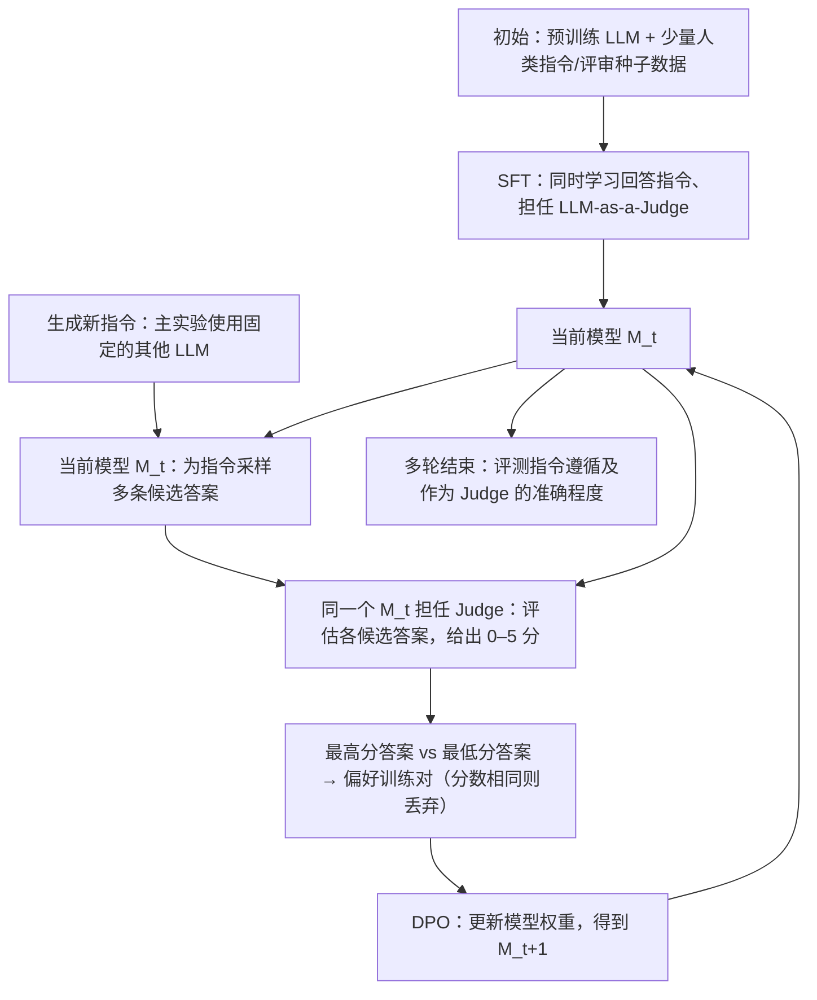

# T005｜Self-Rewarding Language Models：模型自己评价，再训练自身参数

> **研究阶段**：方向 B 阶段一；2026-10-22 已核 [ICML 2024 正式题录](https://proceedings.mlr.press/v235/yuan24d.html) 及 [arXiv 原文 HTML](https://arxiv.org/html/2401.10020) 的 §1–3、§6。以下骨架是作者方法与实验事实；**研究者已另行批准 2 项特色设计与对应 2 项特化不足**（[评价](ARCHITECTURE.md) / [问题](IDEAS.md)）。非学术首创认证，尚未独立复现。

[原文入口及核验范围](PAPER.md) · [两项已审创新与不足](ARCHITECTURE.md) · [对应研究问题](IDEAS.md) · [ICML 2024 正式论文](https://proceedings.mlr.press/v235/yuan24d.html) · [arXiv 全文](https://arxiv.org/html/2401.10020)

## 一句话

**同一个 LLM 既生成答案又评价答案，利用自身产生的偏好数据执行多轮 DPO 微调，使下一代 LLM 的模型参数得到真实更新。** 这研究的是模型参数层面的自我改进，不是只修改外部 System Prompt。

## 自绘方法骨架（据原文 Fig. 1、§2）

## 读懂这篇最重要的三个事实

- **真正更新的对象是模型权重**：初始用 IFT（指令微调）和 EFT（评价微调）种子数据做 SFT，之后以模型自己的 AI Feedback Training（AIFT）偏好对反复做 **DPO**；原文实验依次构造 `M1 → M2 → M3`。
- **“自己评价自己”有精确边界**：当前模型提出回答也担任 Judge，但主实验中的**新任务指令由另外一个固定 Llama-2-Chat-70B 生成**；起点也依赖人类提供或筛选的种子数据。不能描述成完全不需要外部输入的无边界自我训练。
- **它优化的是一般指令遵循和评价能力**，不是直接执行 CLI 工具任务的 Agent，也没有证明可以无缝用于所有多工具 Executor。

## 作者报告的实验及边界

- 原文采用 **Llama 2 70B**；Table 1 的 AlpacaEval 2.0 对 GPT-4 Turbo 的胜率（论文当时的评价口径）从 **M1: 9.94% → M2: 15.38% → M3: 20.44%**。这是作者报告的对照，不是我们独立验证的现今通用模型排名。
- 作者在 §3.2 同时报告其 Judge 与人类偏好一致性指标有改善；它不等于模型的评价绝对无偏差。
- **作者 §6 直接承认的范围**：只实验三个迭代、一个主要模型设置；需要进一步理解长度偏好、奖励投机、模型参与训练和评估带来的偏差及安全性。上述原文观察与作者局限**已作为两项经研究者批准的特化问题之证据边界**，详见[逐项配对](IDEAS.md)。并不表示 Reward Hacking 已经发生。

## 所属方向与去重定位（事实性）

本篇属于方向 B 的**参数训练**路线。它不同于 [T001 Promptbreeder](../T001/README.md) 的外部 Prompt 种群变异，以及 [方向 A：P002/P008](../../../papers/INDEX.md) 面向 Alpha 因子搜索的具体任务；本篇 **TD006（Actor/Judge 同权重自评分 + DPO）**、**TD007（IFT/EFT 双任务初始化 + Judge 跨任务迁移）**已按研究者明确审批及跨方向去重登记；机制卡不代表 DPO、Judge 或多任务学习的全球首次发明。见 [TD006](../../knowledge/deltas/TD006_shared_actor_judge_self_reward_dpo.md) 与 [TD007](../../knowledge/deltas/TD007_dual_task_judge_transfer.md)。
