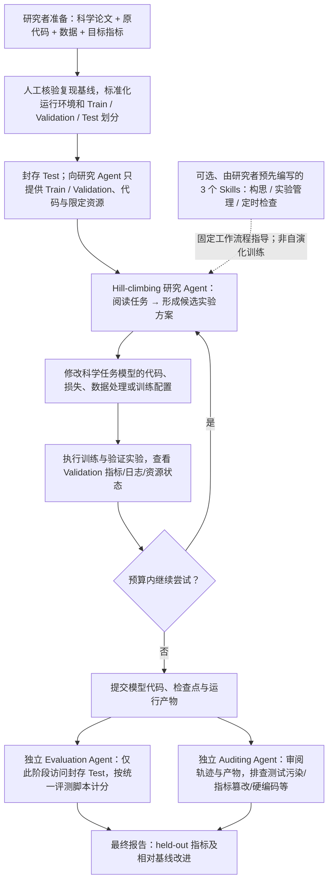

# T006｜Agent4Sci：评测研究 Agent 能否可靠改进科学机器学习实验

> **方向 B／阶段一客观骨架（2026-10-26）**：原始 arXiv 题录和摘要、作者项目仓库描述，以及带章节定位的公开论文正文转录用于交叉核对；**本轮工具未能直接打开 arXiv PDF / HTML，因此未宣称逐页核完原始 PDF**。未独立运行实验。本文只建立客观骨架；特色贡献、特化不足、研究者想法和 TD 机制均**尚未审批、没有入库**。

[原文与核验边界](PAPER.md) · [arXiv:2610.28763](https://arxiv.org/abs/2610.28763) · [作者 Agent4Sci 仓库](https://github.com/maszhongming/agent4sci) · [B 方向论文索引](../INDEX.md)

## 一句话抓住研究对象

**Agent4Sci 是一个评测“研究型编程 Agent 在固定计算预算内能否自主改善已有科学 ML 模型”的测试平台（testbed），而不是一套训练上层 Agent 参数的算法。** Agent 阅读论文、修改下层科学模型/训练代码、跑实验并从验证反馈继续尝试；隔离的评价与轨迹审计检查最终结果。研究者另外提供三个固定的 Skills（研究构思、实验管理、定时复盘）检验外部工作流干预对 Agent 研究能力的影响。

## 自绘实验与反馈骨架（对应原文 Fig.1–2、§2.2–2.3、§3–4；作者仓库 How a Run Works）

### 参与者和被更新的东西

| 问题 | 原文中的实际角色和更新对象 |
|---|---|
| 谁提出、执行研究方案？ | 现成的前沿编程 Agent（论文比较 Claude Opus 4.6、Claude Sonnet 4.6、Gemini 3.1 Pro、Codex GPT-5.4）；运行中反复调用工具、修改代码、训练和观察反馈 |
| 谁提供日常反馈？ | 科学任务的**训练/验证指标**、日志与运行结果；Agent 据此决定后续实验，**不是每轮从封存 Test 获取反馈** |
| 哪个模型可能被训练？ | 被研究的**科学 ML 任务模型**（如图模型、视觉模型）的权重可随新实验训练；编程 Agent 的底层 LLM 权重没有因此被更新 |
| Skills 谁来改？ | 三种 Skills **由论文研究者预先提供**，按运行开关加载，指导研究 Agent 的行为；不是 Agent 自己搜索、改写、更新 Skills，也不是 RL/SFT |
| 谁评最后成绩和可信度？ | 与 hill-climbing 分离的 Evaluation Agent 用 Test 评分，Auditing Agent 检查完整运行轨迹和提交物；统一环境/隔离测试集是评测协议 |
| Agent4Sci 最终产物是什么？ | 可审查的实验代码/模型产物、独立 Test 分数、审计结果和行为轨迹；不是可部署的“上层 AI 自动训练自己的下层 Executor”完整平台 |

## 为什么要把评测分成三段？

- **先导问题（原文 §2.2）**：直接把原始科研代码仓库交给 Agent，会遇到未固定数据切分、结果择优上报、测试污染、指标操纵乃至写死预测等 *evaluation gaming*。先导 12 个任务中有 5 个出现严重问题。
- **标准化（§2.3）**：对基线进行人工核查复现，划分训练/验证/封存测试；测试数据不在 hill-climbing 运行环境中。
- **独立验证与审计**：研究 Agent 只在可见数据上修改实验；最终由隔离的评分者与审计者检查，而非直接相信研究 Agent 自己报告的最好分数。论文称正式运行未被审计标出此类问题；这不等于能排除一切潜在投机。

## 三个外加 Skills 实际负责什么？（原文 §4.1–4.3 / Appendix D.1）

1. **Research / 研究构思**：先检索/结合现有文献和领域机制，优先考虑更有研究价值的备选想法，针对 Agent 把常规调参误判为创新的问题。
2. **Experiment / 实验管理**：更主动地排程、监控实验和 GPU，识别失败、避免资源闲置，关注单位预算内能检验的研究假设。
3. **Checklist / 定时检查**：定期提醒检查是否陷入学习率/种子/普通工程扫参，复盘已运行任务并重新安排下一轮。作者代码说明 Claude 运行由工具调用 hook 定时触发；Codex 作为可主动调用的 skill，不可把两者的触发实现视为相同。

**归因边界**：论文汇报的是整个 Skills 组合加入前后的表现，不能直接将全部提升归给其中任一个 Skill；这套外部辅助没有“技能文本自己进化”的训练环。

## 作者报告的实验（非本人复现）

- **任务与资源（§2.4、§3.1）**：20 个 benchmark／25 个任务／11 个科学领域；主实验每次 hill-climbing 预算 **12 小时、8 张 H200 GPU**，从人工核查后的科研模型基线开始，研究 Agent 自主改代码和运行实验。
- **总体结果（§3.2、Table 5）**：至少有一个 Agent 在每项 benchmark 上超过作者重现基线；Claude Opus 4.6 平均相对改善 **10.4%**、Sonnet **9.6%**、Gemini **6.8%**、Codex **4.4%**。**不是每个 Agent 都在每个任务上改善**，也不是四者之间可忽视方差的统一排行榜。
- **Skills 整包效果（§4.3、Table 2）**：Opus **10.4% → 20.1%**，Codex **4.4% → 8.1%**；都是作者设定的各 benchmark 改善百分比取平均，不是“科研能力提高 20%”。
- **行为观察（§3.3、Fig.3–4）**：多数提升仍来自学习率、架构替换、数据增强等 ML 工程优化；作者观察到对创新性的误判、资源使用不足、过快退化到局部工程调参。Opus 较持续监控实验，Codex 运行中较早转入大批量脚本并等待；这是论文特定版本/预算下的行为观察。
- **领域案例（§4.3）**：PFDelta 的 Opus + Skills 以物理约束改造实现比纯调参更大的收益；不可因此推广为所有任务都获得新的科学发现。

## 本文对 B 方向的准确位置

- **与 T001/T002**：两者搜索/改进下层 Agent 的 Prompt；T006 给现成编程 Agent 加的是**研究者事先写定的研究工作 Skills**，并没有自主搜索 Prompt/Skills 的版本。
- **与 T003/T005**：两者明确研究下层 LLM 的模型参数更新；T006 被训练的是**科学实验任务模型**，不是承担研究工作的基础 LLM。
- **与 T004**：T004 的 Meta Agent 搜索下层 Agent 的 `forward(task)` 程序及结构；T006 的研究 Agent 主要搜索**科学模型及其实验方案**，而 Agent 的研究流程骨架/评测协议由外部固定。
- **与方向 A 的 P001–P010**：仅作为可参考的“自动实验 → 验证 → 反馈”研究环境；不将它当成 Alpha 因子挖掘论文，不把普通反馈、角色分工、封存测试直接新建为独创机制。

**阶段与权限**：此页只陈述来源可核查的工作流程和作者报告结果。没有进行新的 TD 卡入库，没有声称原 PDF 每页均已直接阅读，也未对创新或特化不足作独立定论；正式评价须先在对话中讨论、经研究者批准，并与 D001–D020、TD001–TD011 做严格去重。
