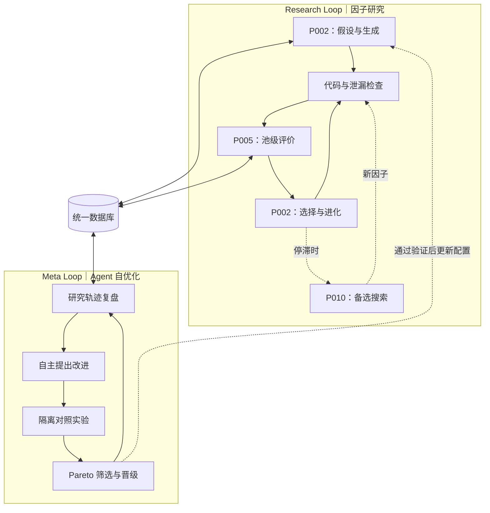

# V1.0.1 双 Loop 因子研究架构（讨论稿）

> 用途：向导师解释系统的核心流程与反馈关系。**尚未实现、尚未验证**；以下是我们的架构设计，不是任何单篇论文的原始系统。

## 双 Loop 骨架

## 讲解要点

**Research Loop（优化对象：因子）**

1. **P002 生成**：基于金融专题、知识和历史案例提出假设，统一 LLM Generator 生成 Python 因子。
2. **检查**：检查语法、接口、数值、未来信息泄漏；计算单因子诊断指标。
3. **P005 评价**：非负岭回归构建组合，使用池级边际贡献 `ΔΓ = Γ(P ∪ {f}) − Γ(P)` 衡量增量价值；采用时间隔离的样本外验证，注意多重搜索的伪显著。
4. **P002 进化**：选择父代、Mutation、Crossover，并持续注入新假设。**遗传种群不等于正式因子池**。
5. **P010 可选**：主搜索停滞时，将已有优秀因子提取为候选五维 Plan，使用语义组合、探索和 LightGBM 奖励代理搜索，结果返回统一检查与评价流程。不是必经步骤。

**Meta Loop（优化对象：Agent / 研究系统）**

1. 从共享数据库复盘 Research Loop 的有效发现率、池级贡献、失败模式、研究成本与搜索停滞。
2. Meta Agent **自主确定改进方向**：可以优化 Prompt、Mutation 策略、检索、Skills、工作流，**也允许提出改进 Meta 自身的方法**。
3. 把改进方案转为受控实验：保留基线，固定起点、数据、研究任务、模型及可比预算，运行新旧 Agent 版本。
4. 借鉴 T002 GEPA 的**逐研究任务 Pareto 候选选择**，保留不同任务上的潜力版本；经过独立验证才晋级。研究任务上的评价仍以 P005 的池级增益为核心，不把 Pareto 当成 ΔΓ 的另一种写法。

**统一数据库**

只维护一份持久化数据库，保存金融知识、因子代码和父子谱系、成功与失败实验、因子池状态、评价轨迹、Agent/Meta 版本及对照结果。Research 各环节按需检索；Meta 使用同一批记录分析与优化。

**固定边界**：评价规则不能由参评候选 Agent 自行修改；隔离最终测试数据，避免搜索和 Meta 版本选择反复过拟合；第一版不要求训练基础 LLM 权重。

## 双库数据模型｜已确定的 V1 最小边界（2026-10-28）

**保持双 Loop 框架不变。** “统一数据库”是**一个持久化系统、两类逻辑数据**，并非必须部署两套服务：

- **C 先验库**：① `Source`（学术论文/研报/原始版本和来源）、② `Knowledge`（金融现象、统计定义、公式、模型架构）、③ `Claim`（原文假设、作者观察、正负证据及范围），还可记载**④ 原文提出的 Factor**与**⑤ 原文报告的 Experiment**。原文报告不等于我们已经完成复现。
- **Research 经验库**：④ `Factor`（Agent 生成的因子、代码/公式、父代、引用知识）、⑤ `Experiment`（真实运行的参数、数据版本、质量检查、收益/Sharpe/MDD/Turnover/Score、错误及失败原因）。因子与实验分开：**一个因子可以有多次测试**，不能把一次结果固化为因子属性。
- **⑥ `Relation` 作为共用的关联层**：知识与因子之间的真实引用、因子父子进化关系，以及因子与评测记录之间的关系；区分 `external_reported`（外部文献报告）和 `internal_executed`（我们的真实运行）。

**统一检索外壳**（逻辑字段，不强制是同一张物理表）：`id`、`type`、`name`、`description`、`tags`、`required_data`、`time_info`、`source_refs`；具体计算公式/原文证据及实验代码/配置/指标分别放在各自专用字段。关联到相应原文/PDF 版本或实验代码和配置。

**不可混淆的边界**：C 的金融定义与作者结论不会因为我们某次回测好坏被自动重写或打分；本地经验按实际结果追加。与本项目 [单因子组合评分 V1](../../evaluation/PORTFOLIO_SCORING_STANDARD.md) 匹配的 Score 需要记录评价参数和版本；单因子 Score 与 P005 的池级边际增益是不同的评价层次。既有 A/B/C 原始文件夹和 PDF 保持原样，结构化数据是可查询的索引/知识层，并不替换来源。

**尚待确定（不视为已确认）**：查询时机、先验/经验混合检索策略、探索多样性与随机性、如何将检索内容交给生成 Agent。设计时需避免参考资料造成思路锚定，不能直接把“历史高分”变成原始金融知识的固有优先权。

## 论文机制来源

- [P002 CogAlpha](../../papers/P002/README.md)：专题生成与遗传进化。
- [P005 AlphaPilot](../../papers/P005/README.md)：池级边际贡献和组合评价（本方案暂不采用其 GRPO 权重训练）。
- [P010 AlphaSchema](../../papers/P010/README.md)：可选的五维语义探索路线。
- [T001 Promptbreeder](../../ai_trains_ai/papers/T001/README.md)：任务 Prompt / Mutation Prompt 自优化启发。
- [T002 GEPA](../../ai_trains_ai/papers/T002/README.md)：轨迹反思与逐任务 Pareto 候选选择。
- [T004 ADAS](../../ai_trains_ai/papers/T004/README.md)：Agent 工作流设计搜索启发。
- [T006 Agent4Sci](../../ai_trains_ai/papers/T006/README.md)：科研实验管理与独立评测启发；原文没有实现 Meta Agent 自我进化。
