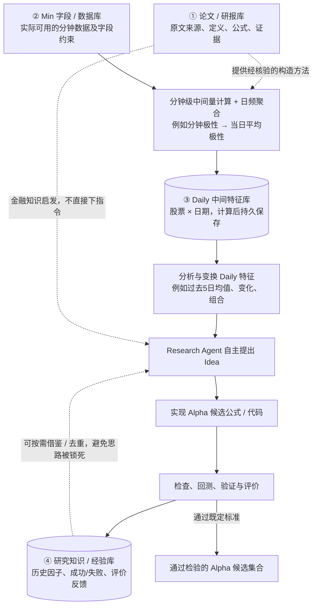

# Research Loop｜四库输入与中间特征 → Alpha（讨论草图 v0）

> 2026-10-28。**只讨论 Research Loop 的输入与特征层**；不是最终架构、不是实现说明。原有 `architecture/dual_loop_v1.0.1/` 保持不动，Meta Loop 暂不展开。按研究者后续讨论持续改这张图，不预先冻结具体技术。

## 当前流程图

## 当前先分清四件事

1. **论文库 ≠ Daily 库**：前者记录“来源提出了什么定义、需要什么字段、有什么证据”；后者存“我们实际算出来的哪只股票哪一天的数值”，有计算版本和来源指向，不能把作者报告当成我们已经复现。
2. **Min → Daily ≠ 自动得到 Alpha**：分钟级计算可先产生中间量，再按日聚合；日频结果缓存以免反复计算。即使论文称之为“因子”，在本项目中也不能未经研究与验证直接认定为最终 Alpha。
3. **Idea 与 Alpha 候选是下游研究产物**：Research Agent 可以分析 Daily 的历史分布、时间变化、跨特征联系，再提出新假设与公式；五日均值/变化也仅是候选构造，不保证有效。
4. **此图里的“知识库”暂专指研究经验**：因子公式/代码、真实试验、成功失败及反馈；论文中客观金融知识先由“论文/研报库”管理。与旧架构中的“C 先验知识”命名不同，后续可统一命名，**不据此改写旧档案**。

## 尚未拍板的两个边界

- **成功 Alpha 要不要回到 Daily 库？** 如果成功因子也按日输出，数值可以考虑作为 **Daily 的派生结果缓存**；但它的“Alpha 候选/验证身份”、父代及试验成绩仍留在研究经验层。**不能因为使用同一个物理缓存就把中间特征与已验证 Alpha 混为一类**。是否在 Daily 内分区、是否回写，待讨论。
- **Agent 怎样取用 Daily？** 当前只确认“不把中间特征直接当最终 Alpha”，以及需要按需分析、变换和验证；具体是字段查询、分析工具、独立检索 Agent，还是何时先自主构思，**暂未设计**。

> **数据边界**：挂单/买卖委托极性只是流程示例；若当前只有分钟 O/C/V/VWAP，则不能凭这些字段唯一恢复真实订单极性。实际 Min 字段可用性需核实。

**本文件只维护本轮新草图，不替换旧 V1.0.1 的主图，也不改变 A/B/C 资料档案、审批状态或既定 Evaluator V1。**
