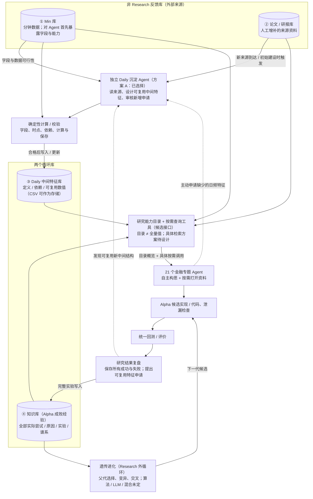

# Research Loop｜四库、独立 Daily 沉淀 Agent、21 专题 Agent（讨论草图 v3）

> 2026-10-28。用户本轮**明确选择方案 A：独立的 Daily 沉淀 Agent**。该职责划分作为当前设计选择；21 Agent 查询机制、检索技术和具体调度**仍是提案，未定稿**。只维护本独立草图；旧 `architecture/dual_loop_v1.0.1/` 和 Meta Loop 不改。

## 逻辑图（先保证边界正确，不追求最终排版）

## 确定的设计关系

- **四个库总数，没有第五个 Alpha 库**。Min 与论文/研报是外部来源，不因 Research 实验好坏直接被自动改写；Daily 与知识库是可被 Research 反馈更新的两个循环库。外部新数据或人工新论文仍可追加。
- **独立 Daily 沉淀 Agent（A）已作为当前设计选择**：初次建设时根据 Min 数据与论文构造一批 Daily 中间特征；后来新论文进入时可再次触发；21 Agent 或研究复盘发现值得复用的中间表达式时，**申请**沉淀 Agent 核验，不能由 Alpha 研究 Agent 自行直接修改 Daily。真正数值计算和时点检查交给程序工具，不仅凭 LLM 判定。
- **21 个专题 Agent 自主研究 Alpha**：不强制先后两批 21 Agent，不必每轮读取全部四个库。沉淀 Agent 与金融 Agent 职责分离，但可反复互相请求。是否需要单独协调角色、何时查库仍待讨论。
- **知识库留全量真实经验**：成功、失败、异常、候选定义、运行配置、评分、谱系都留档；不把失败自动等同金融知识无效。遗传操作使用经验库选父代、产生新候选，仍归 Research Loop，不是 Meta Loop。

## 冷启动与研究查询：本轮提出的设计候选，尚未拍板

### 冷启动
- 第一轮知识库可以完全为空，**不能伪造历史经验**。
- 沉淀 Agent 先从可用原始字段与来源构建**可计算、可用时间明确**的 Daily 中间特征。论文与 Daily 在**特征名称、定义、来源信息**上可能高度重合，但论文原始研究证据并不等于本系统已经计算的数据，更不等于 Alpha 有效性。
- 21 Agent 可以凭专题任务和自身已有知识提出独立假设；按需查看 Daily 能力目录、特征描述、数据统计与论文证据，而非只能复现已有文献。

### 不建议全量 Prompt，也不建议一刀切分库
**可选入口：一个统一的“研究能力目录 + 查询工具”**，不是第五个库、不是必然新增独立检索 Agent：
1. **总览（轻量）**：可用字段、已计算 Daily 特征的 ID/名称/定义/依赖/时间、论文主题与来源、历史实验概况及版本。资料越来越多时总览可分页/按层级汇总，不把全部条目塞入 Prompt。
2. **按需展开（工具）**：Agent 自主选择查看论文细节、相关特征的统计/小样本（Daily CSV 由计算工具读取）、某些因子及其失败原因、谱系与实验配置；原始分钟数据只交给程序处理。
3. **遗漏补查（候选机制）**：对提出的 Idea 用多种表达方式查相关与反例，沿“论文→Daily 特征→候选→失败实验”和父子依赖关系跳转；主动检查被主题分组遗漏的跨领域经验。分组是浏览方式而非禁止跨区检索。可设置跨主题探索入口，但不是固定随机比例。
4. **留住自由度**：支持“先独立构思，再检索已有经验去重/反证”，防止 Agent 只重写首批论文；也可按需让模型先查资料。固定 Top-K 或四库各取固定条数都未批准。
5. **审计缺漏，而非声称完整**：查询日志记录搜索范围、来源、漏检测试、无命中；没有任何有限检索能保证找出所有相关失败案例。后续应拿真实历史问题做召回率、跨专题发现率、无谓重复研究次数与成本的对照实验。

### CSV 注记
导师提议 Daily 可使用 CSV，本设计接受其作为**待落实的物理存储倾向**；CSV 本身不是知识检索或推理机制。对 LLM 暴露元数据及工具读回的统计/样本，**不能整库 CSV 输入 Prompt**。具体 CSV 文件布局、依赖版本与增量重算策略待工程设计。

## 本次新增外部研究启发（不冒充项目已有 A/B/C 正式归档）

- A-MEM（NeurIPS 2025）：通过记忆条目关系动态建立链接；启发知识库案例关系，而非固定主题分割。https://proceedings.neurips.cc/paper_files/paper/2025/hash/19909c36f51abc4856b4560aff3d36d6-Abstract-Conference.html
- HippoRAG 2（ICML 2025）：关联式检索与事实检索须兼顾；启发多跳补查而不是替换所有搜索。https://proceedings.mlr.press/v267/gutierrez25a.html
- Adaptive-RAG（NAACL 2024）：按查询难度决定是否检索、检索深度；启发“按需打开”，并非固定访问所有库。https://aclanthology.org/2024.naacl-long.389/
- Lost in the Middle（TACL 2024）：长上下文信息可能被遗漏，不能假定整库放进 Prompt 就能可靠使用。https://aclanthology.org/2024.tacl-1.9/
- Agentic Context Engineering（ICLR 2026）：对长期经验做结构化、增量更新，提醒不能把所有失败逐轮压缩成越来越短的一段总结。https://www.microsoft.com/en-us/research/publication/agentic-context-engineering-evolving-contexts-for-self-improving-language-models/

**仍未决定**：统一查询后端是字段过滤、全文索引、向量、图、多轮 LLM 检索还是组合；具体 Agent/API 数量与 Prompt；是否强制预检、查多少、如何采样；Alpha 入池规则。旧 Evaluator V1 和 Meta Loop 均不变。