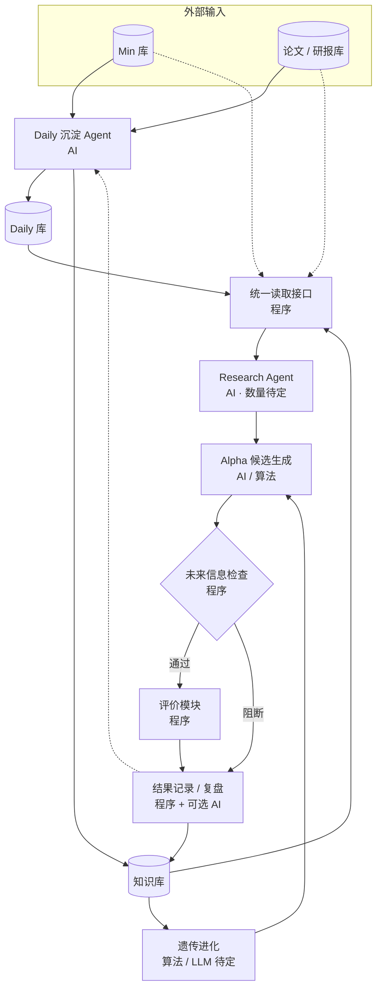
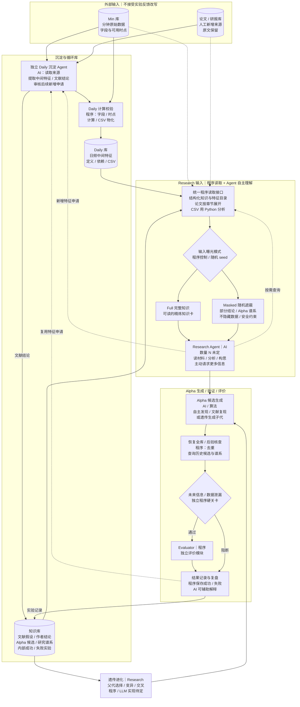

# Research Loop｜简明总览 + 完整机制：双流程图 v9

> **2026-10-28 · 暂行设计，不是已实现或验证。** 只维护本独立草图，不覆盖 `architecture/dual_loop_v1.0.1/`、不改 A/B/C 原始论文/研报档案，不启动 Meta Loop。**P002 的“21 个金融角色”不是本项目既定数量**；研究 Agent 数量及组织方式 N 待试验。本版统一采用[输入与随机遮蔽暂行协议](RESEARCH_INPUT_PROTOCOL_V1.md)，不再强制预设“材料组织 Agent”。

## 一、Research Loop 简明总览（上一版）

> **先看整体主干**：省略具体的 Full / Masked 随机遮蔽、恢复全库查重等内部环节；**不是删除这些机制**，它们完整保留在下面的第二张图中。

## 二、Research Loop 完整机制图（这一版）

> **再看细节**：在上述主干上展开独立沉淀、程序读取、Full / Masked 随机遮蔽、研究自主补查、后验全库去重、未来信息硬关卡、结果回流和遗传循环。

**图例说明**：实线表示主数据流、入库或反馈；虚线表示按需读取和向沉淀 Agent 申请新特征。**完整保留已讨论的随机遮蔽（Full / Masked）、Agent 自主补查、生成后恢复全库去重、独立未来信息检查、评价、双库回流和遗传进化**。图内使用显式 ` ` 换行控制行宽，不以删除模块或关键职责解决文字裁切。遗传子代与自主候选使用同一硬关卡；未通过未来信息检查不得进入评价。

**四库且仅四库**：
1. **Min 库（外部输入）**：实际分钟行情、字段、数据可用时间；Research 失败不会回写修改它。
2. **论文/研报库（外部输入）**：人工选择、增补的原始研究来源及可追溯摘要/索引；Research 的实验表现不改写作者原文。
3. **Daily 库（循环）**：独立沉淀 Agent 经程序核验后持续物化可复用的日频中间特征；可使用 CSV 储存数值，另外维护定义、依赖、版本、时点等索引。不是“所有日频 Alpha”的同义词。
4. **知识库（循环）**：从第一天就可保存沉淀 Agent 提取的**文献研究假设、候选、作者结论及外部证据**（明确 `external_reported / internally_unverified`），以及 Research Agent 的 Alpha 候选、公式/代码、父子关系、**每一次**真实内部实验、错误/失败与评价（`internal_executed`）。**不增加第五个 Alpha 库**，也绝不把作者报告当成我们的实测。

## 三、职责边界（不等于必须一职责配一个独立 API 模型）

| 职责 | LLM / Agent 判断 | 程序 / 工具执行 |
|---|---|---|
| **Daily 沉淀 Agent（独立）** | 初始建设、人工新增论文时提取可计算中间量；审查 Research 申请是否值得反复复用 | 核对 Min 字段、时间可用性、表达式依赖、聚合与 CSV 计算/版本；通过门槛才写 Daily |
| **研究 Agent（N 可配置）** | 读材料、提出问题、要求新数据观察、产生 Alpha 假设/变换、解释实验；可以申请新的 Daily 特征 | 按权限查询四库元数据/统计，生成可执行候选并提交独立安全关卡，不得自判通过 |
| **未来信息 / 数据泄漏关卡（独立模块）** | 不能用 LLM 自我保证没有未来信息；待具体工程实现再研究规则 | 对 Alpha 全链条信息可见时点与数据依赖做强制检查；通过后才能进入 Evaluator。失败 / 无法确认的尝试要记录，不许直接评价 |
| **统一 Evaluator（独立模块）** | 评价定义与细节本轮不展开 | 仅接受通过泄漏关卡的候选；既有 V1 单因子评价口径保持不变，池级评价关系后续再定 |
| **统一输入读取工具（非独立 Agent）** | 研究 Agent 自主选择读哪条记录、查哪一节、分析哪个 Daily；未来是否引入检索 LLM 再依实验定 | 把四库格式转换为结构化记录与按需访问；Min/CSV 数值由 Python 读取并返回分析结果，论文按章节展开 |
| **实验复盘及遗传进化** | 复盘为什么失败、是否有新谱系；LLM 可建议有金融逻辑的 mutation/crossover | 必须先记录真实实验；遗传算法管理父代/种群、调度候选并送回统一评测。遗传种群 ≠ 正式入选因子池 ≠ 长期知识库 |

**API 的分配不是先验决定**：一个模型 API 可承担多个逻辑角色，一个 Agent 也可以多次调用同一模型；研究 Agent 数量、模型、并行度和 API 预算要通过试验来定，不能把原论文的 21 固化为项目事实。

## 四、Research Agent 输入与知识偏置：暂行 V1

**单一权威流程**：[Research Agent 输入与可复现遮蔽协议](RESEARCH_INPUT_PROTOCOL_V1.md)。核心步骤：

1. **预处理**：独立 Daily 沉淀 Agent 将新增论文的中间统计量写 Daily，把原文的研究假设、候选结论、正负证据和适用条件写**同一个知识库**；原文保存作核验来源。首次内部实验可以为空，但知识库不必为空。
2. **正常开始研究**：Research Agent 通过一套统一**程序读取接口**，自己获取精炼的知识卡与 Daily 特征定义目录，早期规模允许时可全量阅读这些*结构化信息*；原论文全文、Min 全量数据、Daily CSV 数值不默认放进 LLM Prompt。数据由 Python 分析、原文按章节展开。不部署额外负责选材料的 LLM Agent。
3. **可复现的输入差异**：为探索知识引导偏置，研究回合可设 `full`（读全结构化知识卡）或 `masked`（随机种子遮蔽部分**研究结论/Alpha 谱系**，保留真实数据字段、计算定义、时间/泄漏与评价约束）。**遮蔽的比例和模式表现都尚未验证**，不能宣称能消除偏置。
4. **后验全库审查 + 独立泄漏硬关卡**：候选产生后恢复完整知识范围，查重及相似案例；然后进入**未来信息 / 数据泄漏检查模块**。只有核验通过才进入另一个独立的**评价模块**；泄漏或信息时点不明要阻断、记录问题并返回修正。这里既覆盖 Research Agent 直接生成，也覆盖遗传子代。去重不等于解决偏置；值得复用的中间结构仍交 Daily 沉淀 Agent 审核。
5. **记录与回溯**：固定 `run_id`、输入版本、曝光模式、随机种子、实际阅读的材料 ID、模型/预算与测试配置；先通过真实实验比较，未来 Meta 才能审慎优化策略。

## 五、Meta Loop 与 Research Loop 的失败分工

研究中的代码错误、数据缺字段、未来泄漏、时点/计算问题先在 **Research Loop 工具/流程内部调试**；Agent Prompt、知识输入曝光、搜索调度和策略选择出现系统性问题时，记录可复现的对照结果，未来交 **Meta Loop 优化**。Meta Loop 尚未启用，也不保证自动“调成功”。

## 六、只剩的骨架级衔接问题（留到下一轮）

**当前只提出两个必须在模块图上交代的接口，不抢先决定内部算法**：

- **评价后最终去向**：所有尝试都写入知识库，但其中哪些可成为正式保留的 Alpha / 因子池成员？这里可能需要一条“候选筛选 / 池管理”的出口。**正式因子池不是知识库，也不是遗传种群**；是否单独画成模块，下一轮讨论。
- **下一轮由谁触发**：从研究 Agent 再开新方向，还是知识库驱动遗传子代，抑或继续修正当前候选？Research Loop 需要一个**流程控制 / 调度位置**，但它可以是普通程序，不意味着要再设一个 LLM Agent。下一轮讨论它是否值得独立成模块。

**明确不再展开**：评价函数内部、泄漏检查器具体实现、Daily 审核 Prompt、N 个 Agent 角色和 Meta Loop 均不是此次骨架讨论的障碍。

## 七、设计边界与测试

**目前采用的暂行方案**：四库分工、独立 Daily 沉淀 Agent（同时输出文献结论到知识库）、统一读取接口、研究 Agent 自行阅读初期精炼材料、可选 `full/masked` 可复现曝光、后验全库查重、**独立未来信息检查硬关卡**、另一个**统一评价模块**、双回流和研究遗传进化。**只是 V1 工作方案，不是已验证的最终效果。**

**继续保持开放**：研究 Agent 数 N 与专题、Prompt、具体模型、遮蔽比例、材料量、CSV 组织形式、是否需要高级检索、遗传选拔与因子池晋级口径。

先以相同模型、数据快照、资源预算和既定 Evaluator V1 对比 `full` 与 `masked`，记录可执行率、严格重复、底层特征/研究谱系分布、信号相关性、样本外表现与调用成本；如果遮蔽失败可以调整或关闭，**无需推翻四库和评价框架**。

## 八、外部启发（仅供本独立架构讨论，不是新论文正式归档）

- [SciMON（ACL 2024）](https://aclanthology.org/2024.acl-long.18/)：文献作为想法的启发来源，并以已有论文对照新颖性；非金融实证。
- [MIR（ACL 2025）](https://aclanthology.org/2025.acl-long.1390/)：研究方法启发检索可不同于表面语义相似检索；给跨主题发现以参考。
- [Adaptive-RAG（NAACL 2024）](https://aclanthology.org/2024.naacl-long.389/)：按问题复杂度调整是否检索与检索深度；不是金融因子实证。
- [Lost in the Middle（TACL 2024）](https://aclanthology.org/2024.tacl-1.9/)：长上下文不保证所有中间信息得到可靠利用。
- [Exploring the Design of Multi-Agent LLM Dialogues for Research Ideation（SIGDIAL 2025）](https://aclanthology.org/2025.sigdial-1.26/)：多 Agent 人数、角色与交互深度会影响构思的多样性与可行性；**不能据此固定本项目 N=21**。

本文件的新增设计是**本项目待检验的工程推断**，不是这些论文已经提出的单一完整架构，也不构成经研究者批准的新论文机制/Delta。原有 V1.0.1 单因子评分口径不在此修改。