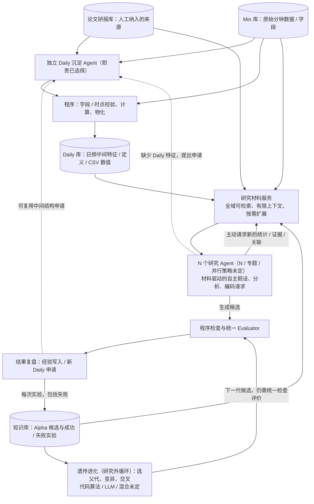

# Research Loop｜信息供给与双沉淀：可验证设计基线 v4

> **2026-10-28 · 架构讨论稿，不是已实现系统。** 只维护本独立草图，不覆盖 `architecture/dual_loop_v1.0.1/`、不改 A/B/C 原始论文/研报档案，不启动 Meta Loop。此文把已选择的职责、推荐的第一版工作协议、尚需通过实验选择的技术分开。**P002 的“21 个金融角色”不是我们承诺的 Agent 数量**；本项目研究角色数记作可配置的 **N**。

## 一、最小系统骨架：两个外源、两个循环库

**四库且仅四库**：
1. **Min 库（外部输入）**：实际分钟行情、字段、数据可用时间；Research 失败不会回写修改它。
2. **论文/研报库（外部输入）**：人工选择、增补的原始研究来源及可追溯摘要/索引；Research 的实验表现不改写作者原文。
3. **Daily 库（循环）**：独立沉淀 Agent 经程序核验后持续物化可复用的日频中间特征；可使用 CSV 储存数值，另外维护定义、依赖、版本、时点等索引。不是“所有日频 Alpha”的同义词。
4. **知识库（循环）**：研究 Agent 的 Alpha 候选、公式/代码、父子关系、**每一次**真实实验、错误/失败及评价反馈；**它就是原来所说的 Alpha 成败经验库，不增加第五库**。不能把作者声称的收益写成内部实测结果。

## 二、职责边界（不等于必须一职责配一个独立 API 模型）

| 职责 | LLM / Agent 判断 | 程序 / 工具执行 |
|---|---|---|
| **Daily 沉淀 Agent（独立）** | 初始建设、人工新增论文时提取可计算中间量；审查 Research 申请是否值得反复复用 | 核对 Min 字段、时间可用性、表达式依赖、聚合与 CSV 计算/版本；通过门槛才写 Daily |
| **研究 Agent（N 可配置）** | 读材料、提出问题、要求新数据观察、产生 Alpha 假设/变换、解释实验；可以申请新的 Daily 特征 | 按权限查询四库元数据/统计，运行 Python，检查代码与未来信息泄漏，调用 Evaluator |
| **研究材料服务（工具职责，是否独立 LLM Agent 待定）** | 在复杂查询时可用 LLM 改写问题、找远缘/反向关联；**不可替研究 Agent 决定研究题目** | 跨四库检索、关系跳转、去重、返回来源/时间/数据版本及统计；不会把 CSV 全表注入上下文 |
| **实验复盘及遗传进化** | 复盘为什么失败、是否有新谱系；LLM 可建议有金融逻辑的 mutation/crossover | 必须先记录真实实验；遗传算法管理父代/种群、调度候选并送回统一评测。遗传种群 ≠ 正式入选因子池 ≠ 长期知识库 |

**API 的分配不是先验决定**：一个模型 API 可承担多个逻辑角色，一个 Agent 也可以多次调用同一模型；研究 Agent 数量、模型、并行度和 API 预算要通过试验来定，不能把原论文的 21 固化为项目事实。

## 三、关键机制：研究材料如何供应（推荐作为 V1 工作协议，非已实证）

### 1. 冷启动：先有材料，再有问题
Daily 沉淀 Agent 先从实际可得 Min 字段与人工论文构建**一批真实可计算**的日频中间特征。Knowledge 为空就是为空，不编造历史成功/失败。

每个 Research Agent 开始一个研究任务时收到一份**有限的研究起始材料包**，而不是空白 Prompt、全量论文或固定 Top-K：
- **能力**：已有 Daily 的简洁目录（特征名称、定义、来源、依赖、时点），以及 Min 字段能否支持新构造；
- **证据**：与任务相干的金融现象与论文来源，并标注“作者报告/理论假设/我们复现”身份；
- **数据观察**：Python 从 Daily 实值计算的基础分布、历史变化、分组或条件统计；这些是研究材料，不自动是预测 Alpha；
- **探索入口**：少数具有实际金融联系的异主题现象、矛盾/边界信息，**不强制固定数量、不预制 Alpha 公式**；
- **经验**：如 Knowledge 已非空，给予相关已试方向与失败原因的简要索引；冷启动为空时直接省略。

**重要**：材料包由研究材料服务根据实际任务组装；内容描述现象、限制和可用能力，**不替 Agent 写“请研究 XYZ 这个 Alpha”**。即使论文与 Daily 元数据相似，也需区分“原文定义”与“Daily 真实统计观察”，避免重复拷贝同一文本。

### 2. 研究中：允许主动增补，不预先全量读四库
Agent 得到材料后自主解释与提出问题，可连续调用以下**逻辑接口**（具体 API 技术不在此选定）：

- `discover(query, perspective?)`：跨四库发现相关现象、不同主题的金融联系和可能反例；输出摘要、记录 ID、可追溯来源、未覆盖范围；
- `inspect_feature(feature_id, analysis_request)`：查 Daily 定义/依赖/时间，交给 Python 基于 CSV 计算分布、变化、关系；**不能将全量 CSV 直接发给 LLM**；
- `inspect_source(source_id)`：按需展开论文方法及原始证据；
- `inspect_experiments(candidate_or_question)`：跨专题按公式、依赖、机制、相关条件查历史成功和失败，展开后保留数据/评价版本；
- `request_daily_feature(definition, purpose)`：申请独立沉淀 Agent 审查；研究 Agent 不能自行未经验证写 Daily；
- `submit_candidate(code, hypothesis, evidence_refs)`：进入统一检查、回测与记录。

初期可用全局目录 + 结构化检索 + Python 工具实现，不承诺一定需要 RAG、知识图谱或专用 Retrieval LLM。复杂跨域查询时，LLM 可以为**查询工具**产生多个相关/反向/跨域检索意图，由工具真实查索引；不能靠模型记忆猜库中有哪些记录。

### 3. 研究后：两种不同沉淀
- **全量经验写 Knowledge**：候选本体、所有测试（包括语法错误/运行失败/性能差）、归因、原始评价指标和版本；后续研究可读取，不因此改变 C 论文客观知识。
- **可复用中间特征申请 Daily**：复盘发现子表达式有稳定定义、数据可得、时点正确且有潜在跨任务复用价值时，交 Daily 沉淀 Agent 审查；不要求母 Alpha 成功。成功 Alpha 也**不会自动**成为基础 Daily 特征。谱系记录在 Knowledge，Daily 记派生依赖/来源。

遗传进化另外读取 Knowledge 中的真实候选和评价，产生下一代**候选**回到统一评价；不可把历史高分直接当作原始金融事实。

## 四、防偏置与防漏检的最低设计

- **不让“纯想”和“纯读库”二选一**：起始材料提供金融与数据依据，Agent 有权改变任务视角、要求更多数据和文献、推翻最初假设。
- **相关性不是唯一检索目标**：除了同义/高相似记录，还可沿共享输入特征、计算依赖、金融机制、预测时点、失败条件、父子谱系做关联搜索；按具体问题扩大范围，不能只在一个金融主题分区内搜索。
- **不把“成功案例先展示”固定为默认**：还应看到负证据与适用条件，但不能机械规定四库各取固定 K 条。探索性材料的多样化与反例挖掘属于**待实验的排序策略**，不是已证明提高 Alpha 的模块。
- **候选执行前做二次查漏**：使用生成的具体公式/依赖/定义，自动检查全 Knowledge 的明显重复和历史相似失败；必要时模型再做语义解释。**不能声称有限检索保证零遗漏**，也不能因相似失败就直接拒绝候选。
- **检索结果保留出处**：每次记录任务、查询、召回的 ID、数据时间与版本及随机种子（若用到），可复盘“为什么拿到了这批材料”。

**允许不同研究角色收到不同启发材料，但角色数不决定信息隔离**。一个金融主题只是研究视角，不能限制其读其他专题的实验与文献。

## 五、哪些已选择，哪些是我提出的、哪些要靠实验？

**现阶段选择**：四库的外源/反馈区分；独立 Daily 沉淀 Agent；研究 Agent 负责 Alpha 自主发现；统一程序检查与 Evaluator；Alpha 全量成败进入 Knowledge、可复用中间量交 Daily 审核；Research 遗传进化与 Meta Loop 不混；Agent 数 N 未定而非 21。

**本版推荐但须验证**：有限起始研究材料包 + Agent 主动查询 + 候选前二次查漏；研究材料服务可作为工具层而非新增固定 Agent；经验库不按主题硬切割。不是已经由导师批准的实现要求。

**明确不规定**：N、研究专题表、要用几个 LLM API、模型、Token 配额、首次材料几条、检索后端（全文/向量/图/LLM）、初始 Daily 数量、CSV 文件分片方案、进化算法的调用比例、最终因子池晋级机制。

## 六、最低成本验证实验（先证明方向值得做）

在相同模型、专题、Min/Daily 数据快照、时间切分、执行预算及**固定 Evaluator V1**下比较：
1. **空材料**（只有工具和任务，校验“纯靠模型知识”基线）；
2. **简单同主题 Top-K 材料**（传统相似检索基线）；
3. **本版研究材料包 + 主动发现/展开**。

至少记录：无效/漏时点的候选占比、真实可运行率、重复因子率、不同底层特征谱系覆盖、跨专题发现率、离线评测与样本外指标，以及调用次数/成本。测试检索时额外构造“相关失败藏在另一主题”的历史案例，检查能否找回。**最终是否提高可用 Alpha 的发现率，只能由真实对照证明**；优化不能接触封存测试集。

## 七、外部启发（仅供本独立架构讨论，不是新论文正式归档）

- [SciMON（ACL 2024）](https://aclanthology.org/2024.acl-long.18/)：文献作为想法的启发来源，并以已有论文对照新颖性；非金融实证。
- [MIR（ACL 2025）](https://aclanthology.org/2025.acl-long.1390/)：研究方法启发检索可不同于表面语义相似检索；给跨主题发现以参考。
- [Adaptive-RAG（NAACL 2024）](https://aclanthology.org/2024.naacl-long.389/)：按问题复杂度调整是否检索与检索深度；不是金融因子实证。
- [Lost in the Middle（TACL 2024）](https://aclanthology.org/2024.tacl-1.9/)：长上下文不保证所有中间信息得到可靠利用。
- [Exploring the Design of Multi-Agent LLM Dialogues for Research Ideation（SIGDIAL 2025）](https://aclanthology.org/2025.sigdial-1.26/)：多 Agent 人数、角色与交互深度会影响构思的多样性与可行性；**不能据此固定本项目 N=21**。

本文件的新增设计是**本项目待检验的工程推断**，不是这些论文已经提出的单一完整架构，也不构成经研究者批准的新论文机制/Delta。原有 V1.0.1 单因子评分口径不在此修改。