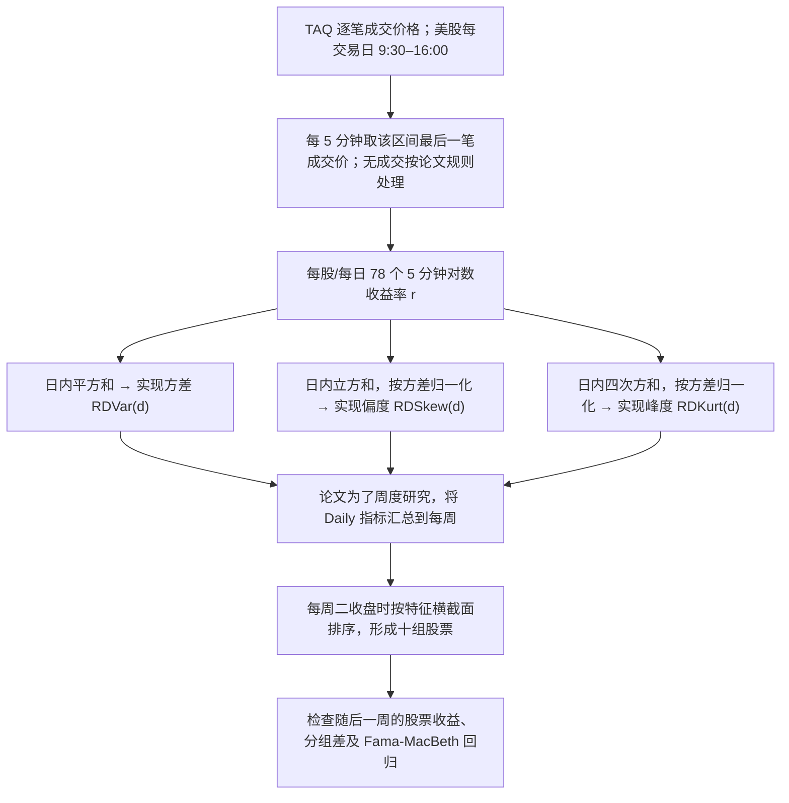

# C003｜5 分钟收益率构建每日实现偏度，再检验横截面未来收益

> **方向 C／阶段一（2026-10-27）**：已直接打开作者的 [2013 年 CREATES 原始工作论文 PDF](https://repec.econ.au.dk/repec/creates/rp/13/rp13_41.pdf)；核对了 §2.1–2.2 数据与公式（PDF 第 5–7 页）、§3.1–3.4 排序与回归结果、§4 稳健性讨论及 §6 结论的主要文字。**这不是已完整逐页核查 50 页论文、所有表格/附录的声明；未独立复现。** 2015 年 *JFE* 最终版的报告数字与 2013 工作版不同，明确区分。

[原始来源与核验边界](PAPER.md) · [2013 原始工作论文 PDF](https://repec.econ.au.dk/repec/creates/rp/13/rp13_41.pdf) · [2015 JFE 正式期刊 DOI](https://doi.org/10.1016/j.jfineco.2015.02.009) · [C 论文索引](../INDEX.md)

## 一句话与方向 C 的联系

作者用**个股 5 分钟成交价格**计算各股票**每日**的实现方差、实现偏度（skewness）和实现峰度（kurtosis）；为了论文的预测研究，再把日值汇总为**周度**特征，检验这周高低偏度能否解释**下周**股票横截面收益。

**频率严守边界**：原始数据 5 分钟 → 中间产物确实是 *Daily* 特征；**原文最终排序与持有周期是周频，不是验证过的日频调仓或次日收益预测策略**。

## 自绘分钟到日度／周度流程（2013 工作论文 §2、§3）

## 分钟数据如何确切算成一日三个数值？

在一天中记第 `j` 个 5 分钟**对数收益率**为 `r_j = ln(P_j) - ln(P_{j-1})`，正常美股交易时段 6.5 小时，`N=78`。

- **实现方差（RDVar）**：`sum(r_j²)`。越大说明这一天的分钟价格变动幅度总体越大。
- **实现偏度（RDSkew）**：`sqrt(N) * sum(r_j³) / RDVar^(3/2)`。负值表示负向的大幅 5 分钟变动在三次方总和中占上风；正值相反。它不是“股价今日下跌就一定为负”的指标。
- **实现峰度（RDKurt）**：`N * sum(r_j⁴) / RDVar²`。它对日内极端大幅波动特别敏感，不区分正负方向。

**可手算示例（为教学虚构，非论文实际数据）**：假设只有 3 段简单的近似对数收益 `-1%、-1%、+2%`，平方和 `0.0006`，三次方和 `0.000006`，则 `RDSkew = sqrt(3)×0.000006/(0.0006^1.5) ≈ +0.707`。换成 `+1%、+1%、-2%`，实现偏度约 `-0.707`。论文实际采用 **78 段**；示例仅解释计算方向。

**为什么论文还做周度合成？** 研究者在每周二收盘后用当周有效日的 Daily 偏度/峰度形成平均周度信号；正常完整五日，`RSkew_week = (1/5)sum(RDSkew_day)`，`RKurt_week` 同理。周度波动率采用 `sqrt((252/5) * sum(RDVar_day))` 的年化口径。原文写明只有部分有效日也能构造周度量，数据缺失时以可用日为准，不假设每周都完整五个有效值。

## 原文实际数据条件与使用时点

- **数据**：TAQ 美股逐笔交易，经作者采样成 5 分钟成交价格（而不是直接输入订单簿）；覆盖 1993-01-04 至 2008-09-30。每只股票股价必须至少 **5 美元**；构造当日指标要求至少 **80 次成交**。
- **无交易分钟**：原文 §2.1 规定无成交的 5 分钟收益记为零；这个规则是作者选择，移植到其他市场需重查缺失和停牌逻辑。
- **可见时间**：日指标使用全天 78 段，**只能在当日收盘之后完整计算**；原论文信号于周二收盘后确定，不能提前使用当天未出现的分钟成交价格。
- **验证标签**：论文目标是**下一周的股票收益**（周二收盘到下周二收盘）。并非直接预测下一个 5 分钟或下一天收益；股票市场、时区、交易日与中国 A 股不可机械套用。

## 论文实际报告的结果（仅作者报告，不是我们的回测）

- **2013 原始工作论文 §3 / Table 2**：对周度实现偏度从低到高排十组，**低偏度组后续周收益高于高偏度组**；低减高的市值加权组合平均约 **24 bps/周**（t=3.65）。实现峰度结果较弱，波动率与下一周收益关系不显著。
- **2015 正式 *Journal of Financial Economics* 摘要**：低偏度减高偏度的均值是 **19 bps/周**（t=3.70），**不能直接把 2013 的 24 bps 称为正式定稿结果**；二者可能涉及版本、筛选、测量等差异，本轮尚未核对正式全文以确定原因。
- **其他分析（原始工作论文 §3–4）**：使用 Fama–MacBeth 回归、控制规模与历史收益等变量、替代偏度定义、含跳跃稳健估计等；其主要方向在工作论文中保持。**不同版本结果及交易成本、可实施性不得自行动推到日度 Alpha 表现。**

## 研读状态与审批边界

- 本轮已掌握**计算路径和基准结果**，但原始 PDF 其余图表、理论性质和部分附录没有全部逐页复核，也未获取正式 *JFE* 全文对应的最终实验表。
- **仅客观骨架归档；不对创新、具体缺点、交易方案、机制 CD 做未经研究者逐项批准的定性判断。** 简单三阶矩统计量不能因首次进入本库就称为学术新发明。
