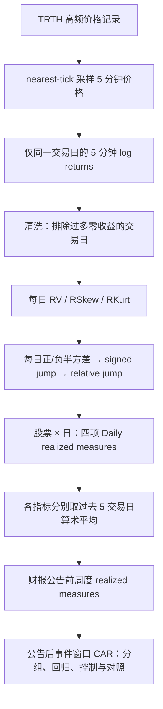

# C004｜Realized moments：五分钟价格生成日频已实现矩

> **原文 PDF 已归位（2026-10-28）**：研究者自行上传的 [PDF 原文](AM_Realized_moments_and_the_cross_sectional.pdf) 已放在本目录。文件归档**不等于本轮重新逐页核对**，下述既有核验范围及版本差异仍须保留。

> **方向 C／阶段一客观金融知识档案（2026-10-27，按最新中立知识规范调整）**：已核作者接受稿摘要、§1–4关键方法、数据及部分实证论述；本轮又核对 §2 Eq.(1)–(12)、§3 数据时间口径、§4.2–4.3 与部分扩展讨论。**未完整核对所有表格、附录或复现实验；下文仅记录原文事实、作者假设与报告结果，不包含给 AI Agent 的搜索指令、策略建议或衍生因子方向。**

**原题**：*Realized moments and the cross-sectional stock returns around earnings announcements*  
**作者**：Qingxia Wang, Robert Faff, Min Zhu · *International Review of Economics & Finance* 79 (2022), 408–427  
[DOI](https://doi.org/10.1016/j.iref.2022.02.036) · [Bond University 公开作者稿](https://pure.bond.edu.au/ws/files/190520552/AM_Realized_moments_and_the_cross_sectional.pdf) · [来源与核验范围](PAPER.md)

## 1. 研究对象与原文金融问题

本文研究**财报公告前的高频已实现矩（realized measures）**是否与股票**财报公告期间及之后的累计异常收益**有关。原文使用美股日内 5 分钟收益先生成每日指标，再平均为公告前 5 个交易日的周度指标，最后进行公告事件的横截面排序和回归。

**金融现象（原文研究背景，非本文独自证实的规律）**：
- 日线收益可能不能完整描述**一天内波动的幅度、收益分布不对称性、尾部变化**；高频收益可用于估计 realized variance、skewness、kurtosis 等。
- 财报公告是具有信息含量的公司事件；公告前的交易价格分布特征与公告后的异常收益是否有关，是原文的检验问题。
- 已实现偏度与正负半方差之差都刻画日内收益分布的某种**不对称性**，但统计定义不同。

**作者提出/援引的解释或待验假设（不可当成因果定论）**：
- 作者在 §1 预期：与非公告期间相比，带有财报信息事件的期间，已实现矩与后续收益的联系可能更强。
- 作者将正负半方差的差称为 signed jump，并结合既有文献讨论其与价格跳跃、日内分布不对称的关系；这**并不代表 Eq.(7) 本身执行了逐分钟跳跃检验**。
- 作者讨论投资者对公告前价格变动的**过度反应、信息不对称**等可能解释；论文所报告的横截面关联不等于这些解释都已被因果识别。

## 2. 原文数据及计算流程（§2–3）

| 维度 | 原文事实 |
|---|---|
| 股票和时段 | **1998-01-02 至 2015-12-31** 期间曾属于美国 **S&P 500** 的股票；常规时段 **09:30–16:00（美国东部时间）** |
| 高频来源 | **Thomson Reuters Tick History（TRTH）**；以 **nearest tick** 将逐笔价格转换为 5 分钟价格，计算**每个交易日 78 个 5 分钟收益率** |
| 价格清洗 | **排除隔夜收益**；某日连续零收益次数**超过 12**，或非连续零收益次数**超过 30**，则剔除该日 |
| 事件与控制数据 | **I/B/E/S**：财报发布日期/时点、实际与分析师预期 EPS；**CRSP**：日收益；**Compustat**：公司财务变量 |
| 形成时间 | 单日全日 realized measures 的计算依赖该交易日全部 5 分钟观测；回归解释变量使用**公告前**周度值，而非公告日之后的数据 |

## 3. 分钟 → Daily：公式和精确含义（§2，Eq.1–8）

设同一只股票某一交易日的 5 分钟对数收益为 `r_j = ln(P_(j+1))−ln(P_j)`，有效收益数为 `N`。

| 原文每日指标 | 计算式 | 统计含义 |
|---|---|---|
| **Daily RV**（realized variance） | `RV = Σ r_j²` | 日内平方收益之和 |
| **Daily RSkew**（realized skewness） | `sqrt(N) × Σ r_j³ / RV^(3/2)` | 日内收益分布的偏斜方向和程度 |
| **Daily RKurt**（realized kurtosis） | `N × Σ r_j⁴ / RV²` | 日内收益分布的四阶特征 |
| **Daily SV+ / SV−**（正/负半方差） | `Σ r_j² × 1(r_j>0)` / `Σ r_j² × 1(r_j<0)` | 上涨/下跌 5 分钟收益分别贡献的平方波动 |
| **Daily signed jump** | `SV+−SV−` | 原文命名的正负半方差差值 |
| **Daily relative jump（RJ）** | `(SV+−SV−)/RV` | 按全日 RV 标准化的带符号差值 |

**定义与缺失边界**：Eq.(7) 的 jump 是半方差差值，不是识别所有不连续跳价的事件标签。若 `RV=0`，上述归一化式分母为零；原文对零收益过多交易日实施清洗，不能据此推断所有零分母情况均已被论文逐一规定了替代值。

**第二层时间聚合（§2，Eq.9–12）**：将四项 Daily realized measures **各自对最近五个交易日取算术平均**，得到论文事件实证所使用的公告前 **weekly RDvar、RDskew、RDkurt、RDJ**。这里的“weekly”是**五交易日平滑值**，不是“5 分钟数据直接输出周收益”。

**纯教学算例（不属于论文观测或作者结果）**：四个收益 `[+1%,+1%,-2%,0%]` 产生 `RV=0.0006`、`SV+=0.0002`、`SV−=0.0004`、`RJ≈-0.333`；表示下跌区间贡献较多平方波动，**不单独给出未来收益方向**。

## 4. 检验对象、标签及识别条件（§4）

- **解释变量**：财报公告前最近 5 个交易日的 weekly realized measures，回归式使用公告日前一期 `t−1` 对应的特征，不把未来公告后价格引入其计算。
- **被解释变量**：财报公告日 `t` 至 `t+n` 的**累计异常收益 CAR**；`n=1、5、10、20`，即包含公告日在内的不同事件窗口；异常收益基准采用论文指定的多因子模型。
- **检验形式**：按每个 realized measure 对股票分组，比较不同组 CAR；横截面回归分别测试单个变量、四变量联合，再加入公司规模、市净率、过去一年动量、交易量和滞后异常收益等控制变量。
- **额外对照**：对比财报公告与非公告期间，使用事件指示变量及交互项；加入标准化意外盈余（SUE），区分正面和负面盈余消息，以判断结果是否主要反映当期盈余意外或公告后漂移。

## 5. 作者报告的实证观察、负结果与解释边界（§4）

| 项目 | 作者报告的观察 | 证据边界 |
|---|---|---|
| **RDvar 方差** | 公告前 weekly 方差较高的组，公告后 CAR 在分组与回归中呈**正向**关系 | 仅在本论文的美股财报事件样本及对应控制设定下 |
| **RDskew 偏度** | **分组、单变量回归为负向**；同时加入其他 realized measures，尤其 RJ 后，系数转为**正向** | **方向依赖回归设定**；作者指出偏度与相对 jump 较高相关、其预测关系具有脆弱性 |
| **RDJ 相对 signed jump** | 分组、单变量及多变量回归中总体为**负向** | signed jump 的定义必须固定为论文半方差差值的标准化，而非其他 jump 算法 |
| **RDkurt 峰度** | 分组差异和多数回归**未呈显著关系** | 这是论文重要的**负结果**，不能写成四项均预测有效 |
| **事件与非事件期间** | 作者报告非财报期间的相关回归系数绝对幅度较小，公告事件交互项在若干指标/窗口显著 | 作者认为这与财报事件所含信息有关；不是已完成因果识别 |
| **盈余意外与公告后漂移** | 将 SUE 纳入后，已实现矩的主要统计关系仍大致保持；正、负盈余消息的表现并不完全对称 | 是作者在本文样本中的附加回归结论，不是独立的交易策略收益证据 |

**原文中的一个明确条件差异（Table 3，公告日及次日 CAR）**：RDskew 的单变量回归系数约 `−0.22`（t≈−2.62），四 realized measures 联合回归约 `+1.14`（t≈5.31），再加公司控制变量约 `+0.60`（t≈2.64）。这些是**回归系数及其 t 值**，不是日频 IC，也不是因子的可交易收益率。

## 6. 来源适用范围和未验证事项

- **已支持**：美国股票样本上，将 5 分钟价格收益计算为 Daily RV / RSkew / RKurt / RJ，再聚合为财报公告前 5 交易日均值，并在特定事件 CAR 上检验统计关联。
- **未由本文证明**：中国股票市场、1 分钟采样、全天 240 根的结构、普通非事件日的每日日频选股表现、日度换手与真实交易成本、不同分钟数据源下的同等统计结果。
- **其他限制**：并非所有表格、漂移调整、不同 jump 定义比较、完整附录已逐页复核。作者讨论的过度反应/信息不对称等属于解释而非被本论文直接确立的因果机制。

**文档定位**：本页只保留可溯源金融知识和读者理解所需的计算例子，**不提出 AI Agent 搜索路线、应生成的因子形式、推荐策略或研究优先级**。创新、特化不足、独立想法均未获研究者批准，也没有建立 CD 卡。

[来源及核验边界](PAPER.md) · [C 论文 Index](../INDEX.md)
