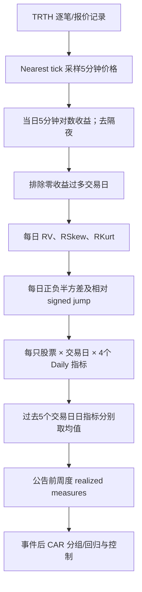

# C004｜从五分钟交易价格构造每日已实现矩

> **状态：阶段一客观骨架已初核（2026-10-27）**。作者稿 §1–4 的数据、计算公式及部分结果已核对；完整图表、稳健性与附录仍待逐页校验，未复现实证、未审批创新/不足。研究重点是“分钟→Daily”，不把财报事件结果误读成普通日频选股收益。

**正式论文**：Qingxia Wang, Robert Faff, Min Zhu (2022), *Realized moments and the cross-sectional stock returns around earnings announcements*, *International Review of Economics & Finance* 79, 408–427。[DOI](https://doi.org/10.1016/j.iref.2022.02.036) · [大学公开作者稿](https://pure.bond.edu.au/ws/files/190520552/AM_Realized_moments_and_the_cross_sectional.pdf) · [来源核验页](PAPER.md)

## 一句话与方向 C 的关系

用逐笔/报价信息采样出**5分钟价格和对数收益**，每天聚合出**方差、偏度、峰度、正负半方差相对差值**四种日频指标，然后对**公告前五个交易日**的 Daily 指标取均值，在**财报公告事件**上检验未来异常收益。原文真正做了“min→daily”，但主实证使用的是**5日平均后的周度指标**。

## 客观算法流程（原文 §2–4）

### 数据和时点

- 原文使用1998–2015年曾为S&P500成分的股票，TRTH高频价格按 nearest tick 取5分钟采样；9:30–16:00，共 **78个5分钟收益区间**，排除隔夜收益；连续零收益**超过12个**或非连续零收益**超过30个**的交易日剔除。
- 财报事件信息来自 I/B/E/S，日收益来自 CRSP，公司特征来自 Compustat。每天的全日指标**收盘且价格数据齐全后**才能产生。中国市场有午休/集合竞价，不可直接把美股的78根当模板。

### 公式：分钟如何变成 Daily（原文 Eq.1–8）

令 `r_j=ln(P_{j+1})−ln(P_j)`，`N` 为当天日内收益数量：

| 每日输出 | 计算式 | 直观意义 |
|---|---|---|
| RV | `Σr_j²` | 全日已实现方差 |
| RSkew | `sqrt(N) × Σr_j³ / RV^(3/2)` | 正负分钟收益不对称 |
| RKurt | `N × Σr_j⁴ / RV²` | 日内大幅变化/尾部集中 |
| SV+、SV− | `Σr_j²·1(r_j>0)`、`Σr_j²·1(r_j<0)` | 上涨和下跌分钟各自的平方波动 |
| 相对 RJ | `(SV+−SV−)/RV` | 上下行方差相对失衡 |

**名称提醒**：这里的 signed jump 是**正负半方差差值**，并非先运行显著性跳跃检测来识别每一笔跳点。RV=0 时上述分母需单独处理，不能自动记0。

**第二层聚合**：原文 Eq.9–12 对**过去5个交易日的上述各个 Daily 值分别求平均**，得到实际用于财报事件收益回归的周度特征。

### 一个教学例子（非论文数据）

若某日只有4个收益率 `+1%, +1%, -2%, 0%`，那么 `RV=0.0006`、`SV+=0.0002`、`SV−=0.0004`、`RJ≈-0.333`。这只说明该示例日**下跌分钟贡献较多平方波动**；并非预测明天必跌。论文实际数据为78个5分钟收益。

## 实证口径与作者发现

- 论文按财报公告前5日平均指标做横截面排序与回归；标签是公告日开始至 `t+1`、`t+5`、`t+10`、`t+20` 的 **CAR（累计异常收益）**，不是全市场每天调仓的 RankIC 或策略净值。
- 作者报告：较高的公告前 RV 与较高后续异常收益相关；相对 RJ 倾向负向相关；峰度的关系不稳定。偏度在**单变量**回归中呈负向，但**控制 RJ 等变量后变正向**，不能把符号解释为无条件稳定。
- 原文数据来自美国市场、财报事件研究；在中国股票市场上用1分钟或5分钟数据形成 Daily Alpha **尚未实证**。

**当前可以继承的是计算思路和时间对齐规则，不是把作者结果当成我们已经找到的日频可交易收益。** 贡献判断和特化不足留待研究者讨论认可，不建 CD 卡。

[论文来源、章节与核验边界](PAPER.md) · [返回 C 索引](../INDEX.md)
