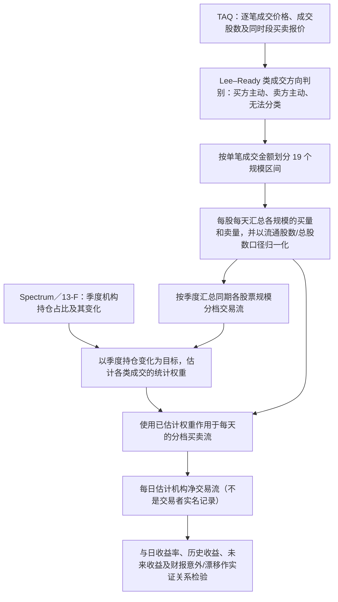

# C005｜Caught on tape: Institutional trading, stock returns, and earnings announcements

> **方向 C／阶段一（2026-10-27）**：正式论文为 Campbell、Ramadorai、Schwartz（2009，*Journal of Financial Economics*）。已核对出版社的题录、摘要和公开正文内容，以及哈佛大学作者稿可检索的具体方法段落/表格文字；**本轮未能直接打开原始 PDF 逐页核查，不能声明全文精读完成**。只整理有证据的客观金融知识，不含给 AI Agent 的生成任务或自拟 Idea Seeds。

[原文与核验范围](PAPER.md) · [哈佛大学作者稿 PDF](https://dash.harvard.edu/bitstreams/7312037c-4c32-6bd4-e053-0100007fdf3b/download) · [正式 DOI](https://doi.org/10.1016/j.jfineco.2008.03.006) · [方向 C 索引](../INDEX.md)

## 一句话：它研究了什么？

美国大型机构的**真实逐日买卖**没有公开的完整逐笔标签，机构申报的 13-F 持仓却只有**季度**信息。作者研究能否利用 TAQ 的逐笔成交及报价信息，按成交方向与金额分组，再从历史季度持仓变化**统计估计每只股票每天的机构净交易流**，并分析该估计与未来收益、财报事件的关系。

**与 C 方向的频率关系**：原始是**逐笔成交／报价**，比 1 分钟更细；当日聚合后的输出是**股票 × 日期的一组规模分档买卖量**，模型进一步映射为**逐股日频的估计机构净流量**。它不是把 1/5 分钟 OHLCV 直接映射为资金流，也没有实际观察到每一笔交易者的真实身份。

## 客观流程（正式论文 §2–5；此处是方法结构的概括，不复刻作者程序）

## 原文金融机制与构造口径（按证据身份区分）

| 知识维度 | 来源支持的内容 |
|---|---|
| **金融研究问题** | 能否根据每笔成交的**交易方向和成交规模**，估计季度披露之间更细的**日度机构交易流**？这种流量怎样与股票收益和财报信息相联系？ |
| **为什么不用简单大单界限** | 作者发现将某一固定金额以上的交易全判定为机构并不可靠；**非常小和非常大**的成交都可能携带机构交易信息，中等规模的成交并不等价于机构流入。这个判断是统计拟合结果，**不是逐笔身份真值**。 |
| **原始字段** | TAQ 的逐笔**成交价格、成交股数、买卖报价及时间戳**；CRSP 的股票标识、每日收益与股本；Spectrum 的**季度 13-F 持仓**。价格数据本身无法直接揭示成交方向和机构身份。 |
| **第一层日频聚合** | 将逐笔成交按报价相对位置/价格变动推断买卖方向（也保留不可判别类）；按**美元成交金额划入 19 个分档**，每只股票每天分别计算买量、卖量、净买卖量，按股票股数归一化，以免拆股造成量纲混乱。 |
| **第二层估计** | 将这些日频分档流量汇总到季度，与机构季度持仓变化拟合出不同成交规模的**回归权重**；再用已估计的权重将每天的分档成交流映射成**每日估计机构净流量**。论文比较样本内与滚动样本外估计。 |
| **观察结果** | 作者报告机构估计流量表现出**日频持续性**；与最近的过去收益正相关，与更长时期过去收益的关系转为负向；机构交易（尤其卖出）与短期价格反向调整及较长期间的正收益关联。 |
| **财报关系** | 作者报告所构造的估计机构交易流与**财报意外及公告后的收益漂移**有关，使用简单大单截断规则时若干结论不再保持。 |
| **边界** | 美国历史样本、机构季度持仓标签及 TAQ 报价/逐笔数据条件下的**统计推断**；不证明能准确识别每笔机构交易，也不自动证明可用 A 股一分钟 OHLCV 复现或交易获利。 |

### 直观计算示例（教学虚构，**不是论文原始系数或实证结果**）

假设某股票某日按成交金额划成三个简化档（实际论文为 19 档）：小额净买 **+300 股**、中额净卖 **−100 股**、大额净买 **+50 股**。股数假设为 **10,000 股**，那么三个当日分档的归一化净流量分别为 **+3%、−1%、+0.5%**。

若*仅为讲解*假设模型学到权重 **0.4、−0.2、0.7**，则加权的日流量统计值为 `0.4×3% − 0.2×(−1%) + 0.7×0.5% = 1.75%`。这只用于理解**“先归一化分档，再按季度校准的权重聚合”**；真实论文有更多变量、股票规模分组及样本外估计，**不能把此算式冒充论文完整原始回归方程**。

## 时间、数据与实证边界

- **信息使用时点**：当日逐笔信息在当天交易结束后可形成日度分档统计；**映射成估计机构流量还需要此前可用的回归系数**。作者评估了用扩展窗口、事先估计的系数构造样本外流量；不能把未来季度的 13-F 标签带回当日交易决策。
- **原文样本**：作者正文说明将 **1993–2000** 年 TAQ 与机构持仓记录匹配，主要可用于日频分析的样本为 **1995–2000** 年；具体筛选、异常处理及滚动估计细节仍须作者原始 PDF 完整核对。
- **评价对象**：研究日度资金流与日收益的时间关系、未来收益以及财报意外和公告后收益漂移。并非 IC/RankIC 标准日报表，也不是已经复现的 A 股选股因子。
- **证据限制**：已核出版社公开的方法、结果和作者稿检索片段；**尚未直接获得可逐页阅读的最终论文 PDF**、逐项核算所有表格与统计显著性；不对学术创新/特化不足作审批前判断。

## 知识中立性

本页只提供**原论文可追溯的金融现象、条件、方法、结果与未知范围**。不设置 Agent 的角色、Prompt、搜索方向、候选种子、优先级、交易策略；后续系统怎样利用这些知识由其自行决定。
