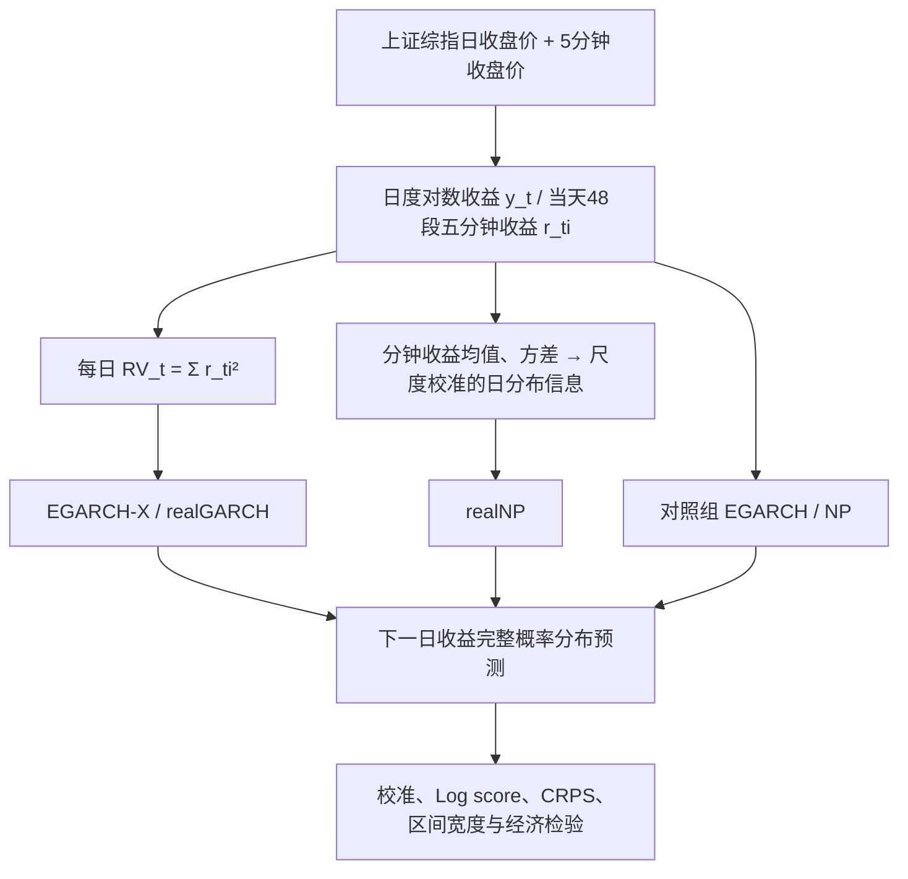

# C006｜用 5 分钟收益描述和预测每日收益分布

> **原文 PDF 已归位（2026-10-28）**：研究者自行上传的 [PDF 原文](25-Daily%20return%20distribution%20forecast%20incorporating%20intraday%20high%20frequency%20information%20in%20China_.pdf) 已放在本目录。文件归档**不等于本轮重新逐页核对**，下述既有核验范围及版本差异仍须保留。

> **方向 C／阶段一客观金融知识（2026-10-27）**。原始期刊题录、官方摘要，以及可检索的出版方 §2–6 正文方法与结果已核；**PDF 图像及全部公式排版未能在当前访问环境逐页复核，未独立复现**。本页不包含因子搜索建议、AI Agent 行动方案或自行衍生的市场规律。

**论文**：Yanyun Yao, Qiang Huang, Shangzhen Cai (2023), *Daily return distribution forecast incorporating intraday high frequency information in China’s stock market*, *Economic Research–Ekonomska Istraživanja*, 36(2), 2107554。[DOI](https://doi.org/10.1080/1331677X.2022.2107554) · [期刊存档](https://hrcak.srce.hr/en/306641) · [出版方正文](https://www.tandfonline.com/doi/full/10.1080/1331677X.2022.2107554) · [来源及未核范围](PAPER.md)

## 1. 原文金融现象、研究问题和作者假设

- **对象**：上证综合指数（Shanghai Composite Index，SHCI）的**每日收益率完整概率分布**；不是单只股票横截面预测，更不是分钟内买卖执行。
- **观察与背景**：作者在样本中描述 5 分钟平均收益的日内时间季节性，尤其开盘、上午收盘、下午收盘附近与其他时段表现不同。这是原文**样本观察**，不是已被证明可套利的交易规律。
- **作者方法假设**：单根 5 分钟收益与每日收益的尺度差别很大。作者以**近似 iid 和中心极限定理**为根据，用分钟收益均值/方差构造日收益分布的信息，或由平方分钟收益构造已实现方差 RV。
- **研究问题**：这样的高频信息加入日度模型后，能否改善**当天分布拟合**与**下一交易日分布预测**？两者是不同的检验目标。

## 2. 数据与原文计算链路

| 变量或样本 | 作者原文口径 |
|---|---|
| 主样本 | **2010-01-04 至 2017-12-29** 的上证综指；初始拟合至 **2014-12-31**，随后 **2015-01-05 至 2017-12-29** 为滚动样本外预测期 |
| 分钟采样 | 沪市 09:30–11:30、13:00–15:00，每日 **48 个 5 分钟收益段**；百分比对数收益 `r_(t,i)=100×[ln p_(t,i)−ln p_(t,i−1)]` |
| **首段跨日** | 原文明确 `p_(t,0)=p_(t−1,N_(t−1))`，即**当日首个5分钟价与前日最后5分钟价相连**；这个段含隔夜及当天首段变动，不能误写成纯日内且“已排除隔夜”的48段 |
| 日收益 | `y_t=100×[ln P_t−ln P_(t−1)]`，是相邻交易日收盘到收盘的百分比对数收益 |
| 每日 RV | `RV_t=Σ_(i=1)^48 r_(t,i)²`，将48段收益平方加总为一个 Daily 变量；部分模型利用 **滞后 log(RV)** |
| 另一类日信息 | 对分钟收益分布进行**尺度校准**，构建与日收益分布相关的概率信息，而非直接输出固定的单个 Alpha 数字 |
| 扩展样本 | 原文还用 **2018 年初至 2021-06-30** 的扩展样本外区间进行稳健性检验 |

**简易算例（教学数字，不是原文实证）**：假设只有两根五分钟百分比对数收益 `[0.3, −0.4]`，其 RV 为 `0.3² + (−0.4)² = 0.25`（百分比收益的平方）。论文实际使用48段，且按其定义首段含跨日间隔。

## 3. 两条高频信息路径与五个模型

| 模型 | 如何处理日度信息和分钟信息 |
|---|---|
| **EGARCH** | 只作为日收益条件波动分布模型基线 |
| **EGARCH-X** | 在条件方差方程中加入**上一期 `ln(RV)`**，把日内波动统计量带入预测 |
| **realGARCH** | 通过测量方程**联合处理潜在条件波动与观察到的已实现 RV**；并考虑冲击的不对称影响 |
| **NP** | 非参数的日收益分布预测基线 |
| **realNP** | 将**尺度校准的分钟收益分布**纳入非参数递推预测；与只加入一个 RV 的 EGARCH-X 不同 |

作者正文模型 Eq.(8)–(18) 涉及具体似然、测量方程、权重和概率密度递推；**PDF 原式的排版尚未逐页复核，故不擅自补写完整精确公式或模型伪代码**。

## 4. 作者报告的正面、有限和负面结果

| 原文证据 | 结果和限定 |
|---|---|
| 拟合 | **EGARCH-X 对 EGARCH、realNP 对 NP** 的样本内拟合有改善；不能据此推论交易盈利 |
| **高频信息模型权重** | 主样本 realNP 的 `α=0.6592`；作者以 `1−α≈34.08%` 描述分钟信息对当期分布的混合权重，而对**下一日分布预测只有约 0.85%** 的相应模型权重。**不是 R²、准确率或收益百分比** |
| 样本外整体预测 | 不同分布评分指标排序不同；作者综合认为 **realGARCH 相对更好**，但不是所有分项都第一 |
| 组合模型 | 原文检验 **EW、SW、CW** 三种组合方式，主样本中某些组合在方向判断和经济评价上优于单模型；结果依模型、分段和允许/禁止卖空条件变化 |
| **扩展样本负结果** | 2018–2021 稳健性期内，原文指出**所有单独模型和组合模型的方向预测均未达到统计显著性**，部分组合的经济评估仍有条件性显著 |
| 作者声明的局限 | 只采用最传统 RV 度量、未严格证明 realNP 的数学性质、尺度校准方法对照有限、缺少禁止卖空收益差异的适当显著性检验 |

## 5. 原文未证明的外推

本篇是**指数级**的日收益分布研究：没有为每只 A 股每日生成可横截面比较的 Alpha，也没有报告每日选股 RankIC、个股调仓组合表现或 240 根一分钟数据下的预测结果。原文模型涉及金融现象和已观察到的限制均仅以本论文样本/设计为边界。

[来源核验](PAPER.md) · [返回论文 Index](../INDEX.md)
