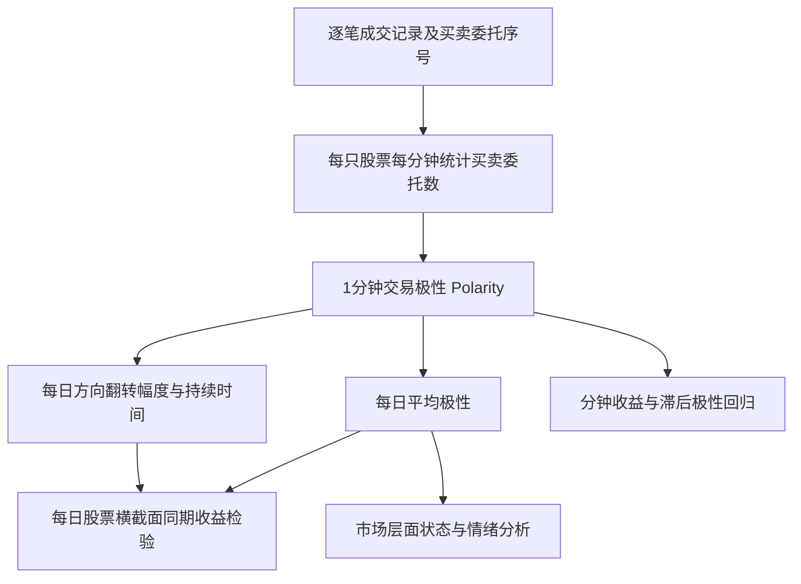

# C007｜Trading Imbalance in Chinese Stock Market—A High-Frequency View

> **方向 C · 原文客观金融知识，阶段一（2026-10-27）**。核查 `Entropy` 2020 年开放全文中的 §2–§4、核心公式和实证表。以下均为**作者的定义、研究问题和报告结果**，并非独立复现或未来收益预测结论。没有自行添加因子构造建议、面向 Agent 的指令或新 Idea。

## 论文研究的问题

一笔股票成交必有买方和卖方，**成交双方的股票数量相等，不表示参与成交的买方委托数量与卖方委托数量相等**。例如，一张买单可能与三张卖单成交。作者研究这种**实际参与成交的买卖委托数不对称**，能否刻画交易方向的拥挤程度及其与股价、市场状态的关系。

作者称其度量为 **trading polarity（交易极性）**。“买卖人数/人次”在原文中指成交记录可识别的买卖**委托决策单元（man-times）**，**不是不同自然人的人数，也不是主动买/主动卖成交量**。

## 数据与核心计算骨架

### 1. 逐笔 → 每分钟 polarity

对股票 `i`、交易日 `d`、分钟 `t`，原文公式 (1)：

[
Polarity_{i,t,d}=rac{NOB_{i,t,d}-NOS_{i,t,d}}{NOB_{i,t,d}+NOS_{i,t,d}}
]

- `NOB`：该分钟**参与成交的买方委托序号对应的不同委托数**。
- `NOS`：该分钟**参与成交的卖方委托序号对应的不同委托数**。
- 数值范围为 `[-1, 1]`；正值是买方委托数更多，负值是卖方委托数更多；绝对值表示两侧委托数的不对称程度。
- **原文 Figure 1 的例子**：两张买单、三张卖单参与成交，则 polarity = `(2−3)/(2+3) = −0.2`。同一委托可能分多笔成交，所以不能直接按逐笔成交记录条数计数。

作者同时对照了买卖委托比例的 Shannon entropy（公式 2）；熵只刻画不平衡程度、不能区分买多还是卖多，polarity 保留正负方向。

### 2. 1分钟 → 每日股票特征

- **Daily polarity**：每只股票**当日所有可用分钟 polarity 的平均值**；明确用于作者公式 (7) 的每日股票横截面回归。
- **Flipping depth**（公式 6）：极性方向发生翻转时，相邻 polarity 数值差的绝对值逐次累积；原文亦将累计幅度除以翻转次数，比较各日平均翻转幅度。
- **Positive / negative flipping length**：某方向连续维持到下一次翻转前的分钟持续长度；原文用正、负方向的持续长度描述日内交易偏向的时间结构。
- **Daily polarity–return correlation**：对**每只股票每一日**，计算当日 1 分钟 polarity 和同一分钟对数收益的 Pearson 相关系数；再比较全市场该相关系数的每日分布，并计算相邻日分布的 KL 散度（公式 8）。

**特别区分**：作者在 §3.4.3 与每日市场情绪做关联时，还取**深圳成指当日分钟收益最低的时刻**，以该时刻全市场平均 polarity 代表当天市场 polarity。这是**另一个市场层面统计口径**，不能与逐股全天分钟均值混为一谈。

## 原文样本与必需数据

- 2015-05-04 至 2015-07-31，**深交所 1646 只股票**，共约 **14.72 亿条成交记录**；包含股灾前、股灾中、股灾后三个时期。
- 逐笔字段包括股票、成交价、股数、时间，**以及买方和卖方委托序号**；作者据此识别不同委托决策单元。
- 每只股票**1 分钟**计算一次，作者分析的连续交易时间为 **9:30–11:30、13:00–14:57，共 237 分钟/日**。
- 价格数据还来自 Thomson Reuters Tick History，使用逐分钟最后价格计算对数收益，配合日收盘价计算日收益。
- **普通 1/5 分钟 OHLCV 不包含买卖委托序号，无法按照原文定义直接计算 polarity**；也不能用普通成交量差额替代这一指标并声称复现。
- 作者公开了**已处理的 1 分钟 polarity 数据**，但原始逐笔成交记录因商业许可不公开。

## 原文如何验证以及实际结果

1. **分钟层面**：用当分钟以及前 1–5 分钟 polarity 回归当前分钟收益（公式 5）。Table 4 的全样本股票平均系数：当分钟 polarity **−0.0009**，滞后 1 分钟 **+0.0008**，滞后 2 分钟 **+0.0006**；不是所有股票或日期均显著，且这是相关回归，不能将作者的因果性解释当作独立识别事实。
2. **日频层面**：作者对**同一个交易日**的股票超额收益（股票日收益减市场日收益），回归每日平均 polarity、flipping depth、正向/负向持续长度（公式 7；GLS）。Table 5 中每日 polarity 的平均回归系数为 **−0.202**；不同股灾阶段的其他系数及显著性存在差异。
3. **市场状态**：股票级分钟 polarity–收益相关系数的**每日横截面分布**在股灾附近明显变化，作者报告相邻两天分布的 KL 散度在股灾与其后若干日上升（§3.4.1）。
4. **市场情绪**：以**市场每日最低分钟收益时刻**的 polarity 和文本情绪指标比较，作者报告三个分段时期的相关系数分别约为 **−0.197、−0.382、−0.493**（§3.4.3）。作者也承认分段点数不足以支撑稳定的线性拟合。

## 证据边界

- **已经由日内分钟数据构造出逐股日频统计量**，但原文的主要股票日收益回归是**同期关联**，而非经独立验证的“今天因子预测明天股票收益”。
- 实证主要集中在**2015 年深圳市场剧烈涨跌的短样本**；不能直接推广到其他时期、市场或数据接口。
- polarity 的定义依赖**买卖委托序号**；已处理数据公开不等于计算原指标所需原始交易数据公开。
- 论文中关于库存效应、市场情绪与市场状态的机制陈述均按**作者解释**归属，不额外给出因果保证。
- 当前未进行独立代码或数据复现，也没有经研究者批准的原创创新/特化不足/CD 知识卡。

[原文与证据核验范围](PAPER.md) · [方向 C 论文索引](../INDEX.md)
