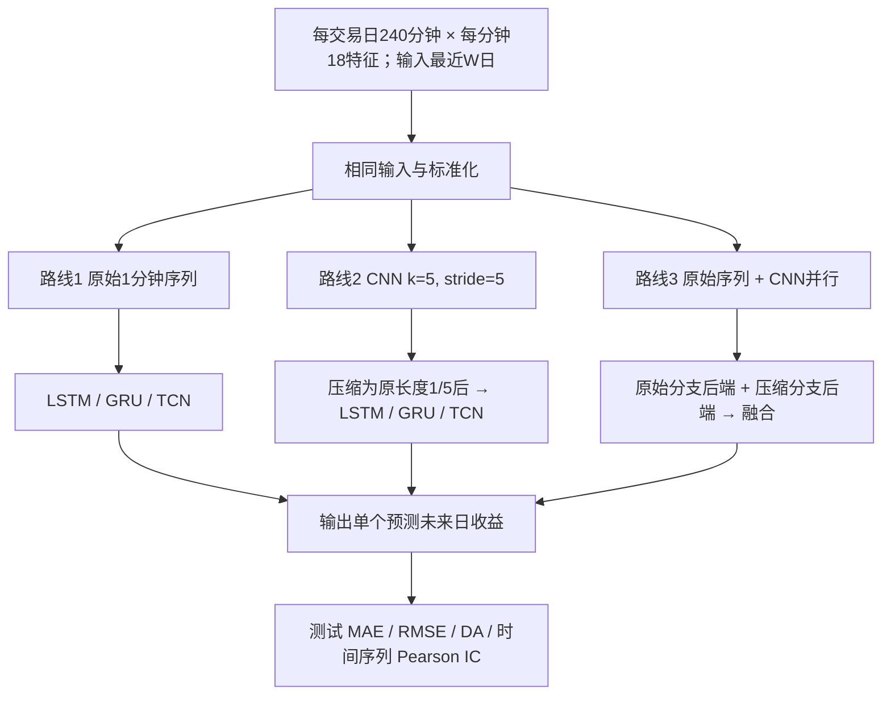

# C008A｜【ARCH·模型架构/时间压缩】沪深300一分钟序列：CNN 压缩与双路融合的实证比较

> **方向 C／阶段一·客观金融知识档案（2026-10-27）**。已核对期刊在线全文的 §1、§3.1–3.5、§4–6 和主要表格公开内容；**未获取收费行情、未运行作者代码、未独立复现**。这里记录论文自己的计算流程、实验对象、正负结果，不提供 AI Agent 搜索路线或新因子设计建议。

**论文**：Fan Zhang; Haobing Wang（2026），*Does CNN-Based Feature Extraction Improve High-Frequency Return Prediction? Evidence from the CSI 300 Index*，*Journal of Risk and Financial Management* 19(5):371。[正式全文](https://www.mdpi.com/1911-8074/19/5/371) · [DOI](https://doi.org/10.3390/jrfm19050371) · [原文及核验边界](PAPER.md)

## 知识类型：ARCH（方法架构证据，不是显式金融 Alpha）

- **为何标 ARCH**：本篇核心问题是 1 分钟序列经过 CNN **时间轴压缩**（每 5 根变 1 个压缩时间点）、LSTM/GRU/TCN 与原始分支/双路网络的预测比较；原文没有交付可独立计算、赋予明确金融机制含义的 Daily Alpha 公式。
- **论文实际输出**：每个指数日期对应一个 **D+1 开盘至 D+2 开盘**预测收益标量；CNN 中间隐藏通道依赖模型权重，不是可直接命名的金融因子。即便把预测分数称为“模型因子”，这也只是在命名一个**依赖训练参数的预测输出**。
- **不能从输出反推既成规律**：相同预测分数可由不同输入组合与不同模型参数产生；只凭网络输出，**无法唯一确定**具体金融现象及显式 Alpha 表达式。归因、敏感性分析或蒸馏模型在技术上可以产生**候选解释**，但这些解释不等于该论文已验证的金融事实，也不应以本文名义存入 FIN 知识。
- **和 C009A 的边界**：[C009A](../C009A/README.md) 的 CNN 用 **1×11 卷积组合每个 15 分钟区间的 11 项字段**，而非 C008A 的 **5 根 1 分钟时间压缩**；C009A 另外测试 LSTM 并输出逐只股票四档概率/预测分数。两篇都属深度学习 ARCH，**只是具体操作轴、预测对象和实验问题不同**。
- **知识保留价值**：论文在作者样本下关于“纯 CNN 下采样可能损失预测信息、双路与单路表现不同”的**方法实验观察**可客观存档，但不冒充可解释金融规律或日频横截面 Alpha。

## 1. 研究对象与原文假设

这是一篇 **CNN 特征压缩对比研究**：每天的 1 分钟行情包含细节，也包含噪声。作者要检验：
- **RQ1**：先让 CNN 对原始分钟序列进行局部压缩，再送入 LSTM / GRU / TCN，是否比让后端直接读取原始分钟序列更好？
- **RQ2**：如果同时保留**未经压缩的原始分支**与**CNN 压缩分支**，效果是否比只有 CNN 分支更好？

**重点边界**：本文预测的是**沪深300指数的一个未来日度执行回报**，不是逐只股票横截面选股；它报告的 **IC 是跨测试日期对预测值和实际值计算的 Pearson 相关**，不是每天横截面的股票 RankIC。它比较的是模型信息表征，而不主张已经获得可交易的多股票 Alpha。

## 2. 数据：每天240根1分钟K线 → 日级样本

| 项目 | 原文具体口径（§3.1–3.3） |
|---|---|
| 市场与标的 | **沪深300指数**的 1 分钟数据（2015-01 至 2025-12），来自 **BigQuant 付费数据**；不是300只成分股逐股票面板 |
| 每分钟18个字段 | 原始开高低收、成交量、成交额6项；高低均价、开收均价、K线全长、实体、上下影线、实体方向7项；分钟对数收益、成交量变化2项；分钟在日内的位置、开盘前5分钟标记、收盘末5分钟标记3项 |
| 240时间步 | 数据初有含09:30竞价时段的**241根**；分钟收益及成交量变化需要上一根，移除09:30的缺失行，留连续竞价交易时段**09:31–15:00 的240根** |
| 训练/验证/测试 | **训练 2015-01 至 2024-12：2430日**；**验证 2025-01 至 2025-06：117日**；**测试 2025-07 至 2025-12：126日**，时间顺序不打乱 |
| 标准化 | 连续字段 Z-score，均值和标准差**仅按训练集**计算；离散方向和三个有界日内时间特征不标准化 |
| 输入窗口 | 最近 **W=1、2、3、4、5 个交易日**的完整分钟序列，张量形状为 `(240W)×18`；W=1 为 240×18，W=5 为1200×18 |

**特别重要的标签和信息时间**（原文 §3.2）：

\[
r_D=\ln\!\left(\frac{\operatorname{open}_{D+2}}{\operatorname{open}_{D+1}}\right)
\]

解释：利用最多截至 **D 日收盘**可见的分钟数据形成信号，按作者的 **T+1 执行口径**计算 **D+1 开盘 → D+2 开盘**的对数回报。它**不是 D 日当天涨跌幅，也不是 D 收盘→D+1 收盘**。论文建模输出是每个指数日期对应**一个未来回报预测标量**，不是直接输出18个日频因子。

## 3. 论文的三条架构路线（§3.4）

**CNN 压缩的精确定义**：对连续的每 **5 根 1分钟 bar**，用**可训练卷积核**（kernel=5、stride=5）输出一组新的局部表征，使时序长度从240降为48（W天从240W降为48W）。**这不是手工等权平均每5分钟的 OHLCV**；卷积权重由模型训练得到。

- **直接输入组**：LSTM、GRU、TCN 分别直接处理未下采样的一分钟序列。
- **CNN 单路组**：CNN-LSTM、CNN-GRU、CNN-TCN，先卷积压缩再进入同类后端。
- **双路组**：LSTMDualBranchFusion、GRUDualBranchFusion、TCNDualBranchFusion，保留原始序列及 CNN 压缩序列，两边分别编码后融合。
- 每一模型族的后端配置尽量保持一致；**9种模型 ×5种窗口=45种配置**，各独立训练**20次**并进行配对 t 检验。实验对比的核心是“压缩是否保留了预测所需的信息”。

**理解性示例（非论文数据）**：一日240个分钟点若按 CNN 核5、步幅5变成48个压缩时间点；它仍可输出针对该日形成信号的一个未来收益预测值。**中间48个时间点不是48个日频特征**，最终低频输出在预测头中。

## 4. 原文正、负和有条件的结果（§4–6）

| 原文现象或结果 | 统计解释与条件 |
|---|---|
| **纯CNN前处理常常不能改善** | 加CNN并没有稳定改善 MAE / RMSE；LSTM 与 GRU 家族的 **IC 多次下降**。例如 W=1：LSTM IC **0.1031**，CNN-LSTM 仅 **0.0187**（作者 Table 4） |
| **双路一般优于“CNN压缩单路”** | 保留 raw 分支与 compressed 分支后，LSTM / GRU 双路相对 CNN 单路的 MAE、RMSE、IC 在多个 W 上有改善；但对 raw baseline 的 **IC 提升有限，不是所有指标上都更好** |
| **TCN 的IC较弱** | TCN 相关模型在该测试集上IC接近0或为负；改变为CNN压缩或双路并未普遍修复，不能外推为“TCN在所有金融序列上无效” |
| **涨跌方向成绩有限** | 作者报告 DA 多在**约0.44–0.50**，没有架构持续稳定显著提高方向准确度 |
| **样本与指标限制** | 只测试 2025 年下半年的这一次测试期；研究没有给出 Sharpe、交易成本、组合净值；样本外跨市场/多轮滚动稳健性未建立 |
| **作者声明的方法限制** | CNN 前处理后的后端仍保留与 raw 模型相同配置；这保证可比性，但作者承认可能非最佳 CNN 配套结构 |

**论文“正负证据”要同时保留**：作者认为原始序列可能包含 CNN 降采样后丢失的信息，同时双路表示在不少比较上优于纯压缩输入。但这来自其**固定数据、窗口、标签、架构和评测设置**；不是“加神经网络必然产生新 Alpha”的普适结论。

## 5. 适用范围与身份边界

- 原文确实提供了 **1分钟×240根×18维 → 时序编码/压缩 → 日级预测输出** 的一条可追溯算法链路。
- **不同于方向C部分传统统计论文**：中间产物是**网络学习到的局部时序表征**，不等同于每天直接生成 RV、偏度等可解释标量。
- 不能将本文单一指数**跨日期相关系数 IC**直接改写为逐股票每天截面 RankIC，或将固定2025H2测试结果宣传成全A股长期有效选股。
- 不含研究者批准的创新、特化不足、原创Idea Seed、Agent搜索建议、策略推荐或CD知识卡。

[原文证据及核验页](PAPER.md) · [方向C学术论文Index](../INDEX.md)
