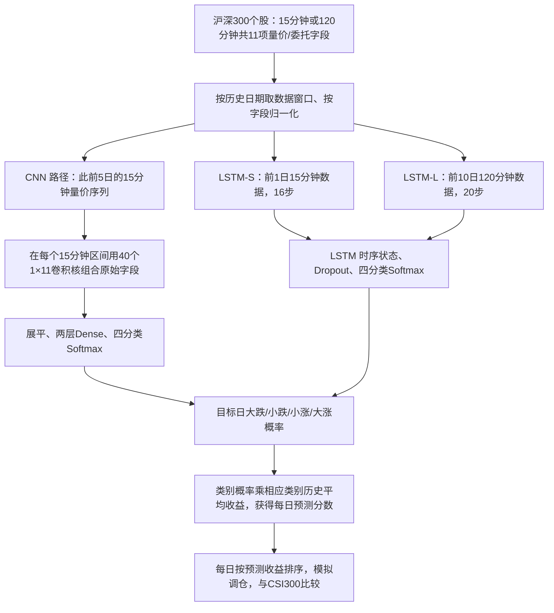

# C009｜Deep Learning for Stock Selection Based on High Frequency Price-Volume Data

> **方向 C／阶段一（2026-10-27）**。直接查阅 [arXiv:1911.02502v1 原始 PDF（25 页）](https://arxiv.org/pdf/1911.02502) 的方法 §2、数据与实验 §3、结果和局限 §4，并以 PDF 截图核查标签表、数据表、模型测试图及 Table 4 回测数据。**2019 年预印本，未独立复现；作者结果不等于已验证实盘效果。** 只归档金融来源事实，不给下游 Agent 研究指令、推荐因子或 Idea Seeds。

[原文与核验范围](PAPER.md) · [arXiv 入口](https://arxiv.org/abs/1911.02502) · [论文索引](../INDEX.md)

## 研究对象、频率和边界

作者用**沪深 300 成分股**的 15 分钟或 120 分钟量价序列，比较 **CNN 自动组合区间字段**与 **LSTM 时序记忆**预测每股目标日的**开盘到收盘回报**。输出是股票当天的四档涨跌概率和估计收益分数，进而按股票排序做作者自己的模拟组合。

**和方向 C 的准确关系**：这是“历史分钟级输入 → 学习型隐含表征 → 每只股票每日一个预测分数”，不是先输出一组可独立调用、带金融名称的日频公式。作者明确没有使用 1/5 分钟数据（§4.2），也没有证明所学隐藏通道是可解释的金融因子。

## 自绘方法流程（§2.1.4、§2.2.3、§3.1–3.4）

**注意**：CNN、LSTM-S 和 LSTM-L 是原文研究的不同结构/时间窗口。§3.2.4 明确组合两个 LSTM 尺度的输出；§3.4 写两个模型的分数平均，但其所指的两模型不够明确，**不能擅自说作者已经完成 CNN→LSTM 的统一融合系统**，因为作者在 §4.2 把该融合列为以后工作。

## 可检索的客观金融知识

| 维度 | 论文实际内容 |
|---|---|
| **作者研究假设** | 历史日内价格、交易量与委托特征的时间演变可能带有对目标日回报有用的预测信息；是模型要检验的假设，不是已证明的因果机制。 |
| **原始数据字段** | 每时段 11 项：开盘、最高、最低、收盘、成交量、成交额、成交笔数、委比（commission ratio）、量比（volume ratio）、委买量（commission purchase）、委卖量（commission sale）。**并非只有 OHLCV**。 |
| **时段结构** | A 股每日交易 240 分钟；15 分钟粒度为 **16 段/日**，120 分钟粒度为 **2 段/日**。LSTM-S 使用前一日 16 步，LSTM-L 用前 10 日 20 步。 |
| **CNN 特征学习** | 第一层 40 个 **1×11** 卷积核分别组合每时段的 11 字段。若只看**单日**，矩阵 **16×11 → 16×40**；最终 CNN 输入扩大为过去 5 日，不能把单日中间层维度误认为最终输出是 40 个日频因子。 |
| **标签与目标** | 作者按样本中**当日开盘到收盘回报**的分位点划分大跌、小跌、小涨、大涨；Table 1 阈值依次为 **−1.06%、+0.04%、+1.32%**（外侧近似 ±10%），Softmax 给出四类概率。 |
| **每日预测分数** | §3.4 用某股票属于各档的预测概率，与每档历史样本平均回报加权，得单股的预期当日回报；再排序。两个预测模型可先各算概率再做平均，具体网络指代见前述边界。 |
| **实验样本** | 作者给 2014-07-01 至 2018-12-31 的主样本；按日期先 80% 训练，后 20% 测试。另记 2019-01 至 2019-05 的数据用于调节模型，并在 2019-01-16 至 2019-05-31 进行模拟回测。时间划分的具体独立性**未另行审计**。 |
| **预测结果** | §3.3.5 Figure 19 报 CNN 四分类测试准确率约 **42%**；不能理解为次日上涨方向准确率 42%，其 25% 比较基准为四类均匀随机。 |
| **作者模拟回测** | §4.1 Table 4：2019-01-16 至 2019-05-31 **扣作者计列费用后累计净回报** LSTM **16.27%**、CNN **19.61%**，CSI300 基准 **16.02%**；最大回撤分别 **21.27% / 25.43%**，费用项 **15.09% / 15.69%**。这是短期样本作者报告而非独立交易证明。 |

### 直观说明（虚构数字，不是作者的因子或权重）

假设某已结束交易日共有 **16 段 15 分钟 × 每段 11 字段**，原始观察含 176 个数字。CNN 用 40 个可训练卷积核把每段 11 个字段变成 40 个“隐藏通道”，单日会形成 **16×40** 的中间表征；实际最终模型读取历史 **5 日**。这些通道的权重由数据训练得到，并非论文预设了 40 条显式 Alpha 公式。

假设**仅用于理解概率加权**的四档预测概率为 `[0.1,0.2,0.4,0.3]`，虚构的四档历史平均回报 `[-2%,-0.5%,0.5%,2%]`，则单模型的每日估计分数为 `0.1×(-2%)+0.2×(-0.5%)+0.4×0.5%+0.3×2%=0.5%`。论文 §3.4 还包含两个模型结果平均，此例**不代表**完整交易公式。

## 实验与解释的明确边界

- **信息可见时点**：要预测目标日开收盘收益，历史 1/5/10 日的分钟数据须在**目标日开盘前**已完整产生。文中的测试和建模描述以过去数据为输入；是否严格执行滚动训练、标准化仅用训练数据、2019 调参与回测隔离，**仍待独立源代码和时间索引审计**。
- **弱证据与局限**：作者 §3.2.4 报小跌和小涨两类较难区分；§4.2 承认预测准确率仍有限、交易费用高、计算资源不足因而未尝试 1/5 分钟数据，并将 CNN 先抽取隐含特征再送 LSTM 的结构留给未来工作。
- **不同结果口径**：摘要的 62.27%（CNN）与 50.31%（LSTM）是**作者声称的年化净回报**；Table 4 的 **19.61% / 16.27%** 是 2019-01~05 的区间净收益。**本轮未核年化换算，严禁混写**。
- **未做的事**：未独立复现、未审核动态指数成分、费用计算、标准化泄漏与调参边界；不将“可能存在”写成“已经发生”的错误。不建立未经批准的论文特色评价、特化不足或 CD 卡。

**知识中立**：上面是原文金融假设、数据、模型、输出、报告数字及适用范围。下游 Agent 如何研究或使用，由其自主决定；没有本档案新增的方向、候选因子或系统设计。
