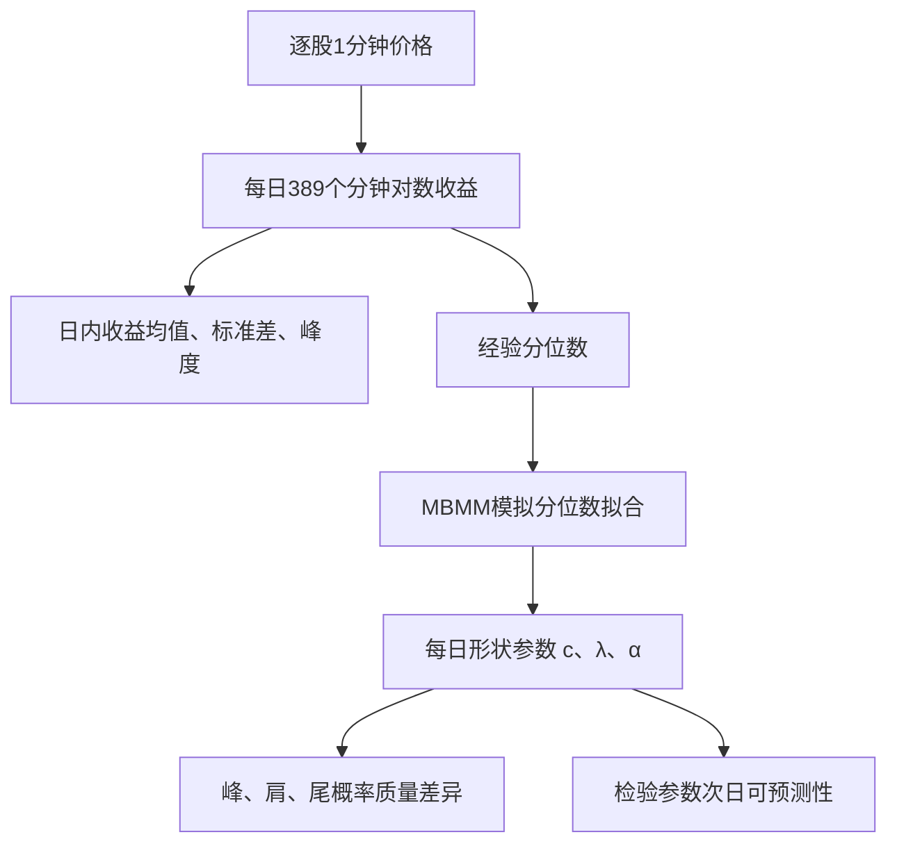

# C010｜Measuring intraday return-shape geometry with modified Brownian motion

> **方向 C｜客观金融知识，原文初核（2026-10-27）**。来源为 2026-10-12 提交的 [arXiv:2610.16311](https://arxiv.org/abs/2610.16311) 预印本；已核对原文 §1–6 的方法和核心实验表，未独立复现，未按期刊同行评议研究表述。只归档原文金融知识和证据，不含任何 Agent 生成指令或衍生 Idea。

## 一、研究问题（作者原意）

**股票某一天分钟收益的峰度即使相近，收益分布的具体形状也可能不同。**

- 峰度（realised kurtosis）把每天所有分钟收益的四阶特征压缩成一个数。
- 同样的峰度，不一定意味着**中心附近的小幅收益**、**中间幅度收益（肩部）**和**极端收益（尾部）**出现的相对频率相同。
- 作者研究：在每个股票—交易日上，能否量化这些形状差异，以及对应形状参数在不同日期之间如何变化。

本文关注**分钟收益的概率分布形状**，不是“一天内价格曲线先涨后跌”的时间顺序形态；把一分钟观测值重新排序，不改变其经验分布。

## 二、从一分钟到逐股日频指标的流程

### 1. 原始数据与日度峰度

- 美国 10 只高流动性股票；2021-05-03—2026-04-30；Alpaca Market 数据。
- 纽约时间正常时段 **09:30–16:00**；保留作者定义的**完整交易日**；每个股票—日期有 **389 个一分钟对数收益**，不含隔夜收益。
- 对一分钟收益 $r_{i,d,j}=\log P_{i,d,j}-\log P_{i,d,j-1}$，当日实现峰度 $RK$ 为：
  
  $
  RK_{i,d}=\frac{\frac1{389}\sum_j(r_{i,d,j}-\bar r_{i,d})^4}{\left[\frac1{389}\sum_j(r_{i,d,j}-\bar r_{i,d})^2\right]^2}
  $
  
  它度量当天一分钟收益的第四标准化矩，**不是仅从日 K 线可直接算出的量**。

### 2. MBMM：拟合日内收益分布的形状

作者采用改进布朗运动模型 **MBMM**，用一个非线性项改变高斯创新 $Z$ 的分布：

$
r=\mu+\sigma Z+\lambda f_c(Z),\quad
f_c(z)=\left[2e^{-cz^2/2}-1\right]\arctan(z),\quad
\alpha=\lambda/\sigma.
$

- **$c$**：控制非线性形状变化发生在分布的什么位置。
- **$\lambda$**：控制非线性变形的强度与符号。
- **$\alpha=\lambda/\sigma$**：经波动尺度标准化的变形强度。
- 分别计算每个股票—日期的经验收益分位数；对候选参数模拟 MBMM 收益分位数，**最小化两组分位数之间的平方距离**，得到日度 $\hat c,\hat\lambda,\hat\alpha$。这叫 simulation-based minimum-distance estimation（模拟最小距离估计）。
- 模型拟合出的密度相对高斯密度，区分**中心超额概率质量**（peak）、**中等幅度的概率质量缺口**（shoulder）、**极端收益区的超额概率质量**（tail）。对应的 $A_{\mathrm{peak}}, A_{\mathrm{shoulder}}, A_{\mathrm{tail}}$ 是两种密度的**差异面积**，不是三个区间的绝对发生概率。

特别注意：**当 $\lambda=0$ 时，高斯基准下 $c$ 不可识别**；原文明确指出 $\lambda$ 接近零时估计的 $c$ 可能不稳定。

## 三、作者如何检验以及报告的结果

**实验 1｜分布拟合（样本内）**。逐股逐日比较 MBMM 与传统高斯/几何布朗运动基准的分位数拟合误差。原文 **Table 3**：10 只股票的平均目标函数降幅 **63.05%**；在所有满足估计条件的股票—日期上，降幅均为正。**这是样本内分布拟合误差下降，不能写成收益预测准确率提升 63%。**

**实验 2｜日度形状参数的次日预测（样本外）**。作者对每只股票用扩展训练窗口的 AR(1)，预测次日的 $\log\hat c$、$\hat\lambda$ 和 $\hat\alpha$，对照“明天等于今天”的随机游走基线。原文 **Table 5** 报告 RMSE 降幅分别为 **28.51%、24.78%、23.77%**；预测对象是**估计出的分布参数**，不是下一交易日股票收益。

**描述性发现**：不同股票—日期的已实现峰度接近时，模型拟合的峰、肩、尾分配仍可能不同；论文还通过 Monte Carlo 检查模拟最小距离估计在有限样本中的参数恢复情况。

## 四、证据边界

1. **输入是股票逐分钟价格**，输出是按股票、按日的分布形状参数；不需要买卖委托序号，但公式含模拟、优化与参数拟合，非直接简单求和即可得出。
2. 研究样本仅为**美国 10 只高流动性股票**，不是全市场 A 股检验。
3. **无股票未来收益的 RankIC、多空分组或交易收益验证**；次日可预测性指**形状参数自身的动态**。
4. 作者的 MBMM 拟合结果依赖模型假设，不能把拟合的峰/肩/尾面积当作无模型的实测概率。
5. **2026-10-12 arXiv 预印本**；未独立复现实验、未验证正式发表版本。

[原始来源与核验清单](PAPER.md) · [方向 C 论文索引](../INDEX.md)
