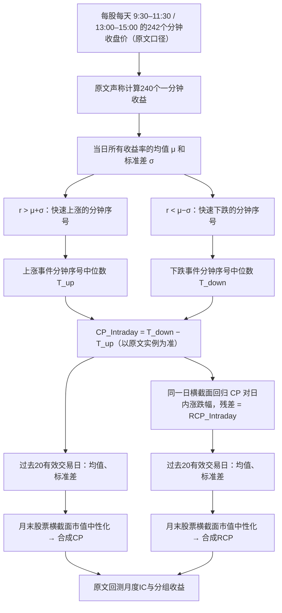

# CR001｜东吴证券：重拾自信选股因子更新——从过度自信到重拾自信

> **FIN｜经研究者同意收录的客观券商金工知识，2026-10-27**。来源：高子剑、庞格致，东吴证券，2024-03-05，22页。本档案直接核查公开报告 PDF 的构造方法 §2.2、§3.2–3.4、相关回测表与局限；保存的是**原文定义和作者报告观察**，不是认可“投资者确实重拾自信”这一未直接观测的经济因果解释。

[原始 PDF（外部公开链接，不在本库再分发）](https://file.iyanbao.com/pdf/57c21-06bf3c6e-87ae-450a-a1a2-3ba8b81f1ed2.pdf) · [核验依据与未明确细节](PAPER.md) · [CR 索引](../INDEX.md)

## 研究对象和一分钟→日度机制

**客观金融知识**：用“当日分钟收益率相对于当日均值的异常幅度”定义两种事件，比较**快速上涨和快速下跌的相对时间位置**。这是价格路径时间结构，不是直接观测到的内幕消息、投资者身份或心理状态。作者援引 DHS 过度自信模型将其解释为信心持久度，**解释身份为作者假说**。

## 操作定义（先定义，后解释）

1. **采样**：报告 §2.2 文字明确“每天 242 个分钟收盘价 → 240 个分钟收益率”，涉及沪深 A 股上午/下午交易时段；**为何由242得240，如何处理午间差分、边界分钟及有效分钟不足，报告没有完整算法**，不私自改成其他数。
2. **“快速”阈值是每股每日本地阈值，不是固定1%**：当日240个分钟收益率 `r_j` 的均值 `μ`、标准差 `σ`；严格 `r_j > μ+σ` 为快速上涨，严格 `r_j < μ−σ` 为快速下跌，其余分钟不参与该日事件时点统计。
3. **日频 CP**：取快速上涨分钟序号中位数 `T_up` 与快速下跌分钟序号中位数 `T_down`。**原文§2.2步骤⑤印刷为“相加”，但紧随的真实图2实例写 `42−120=−78`；本档案按示例解释 `CP_Intraday=T_down−T_up`，明确保留文本冲突待勘。** 不能把 CP 当成真实高位持续分钟数。
4. **日频 RCP**：每日跨股票回归 `CP_Intraday_i=a+b*Ret_Intraday_i+ε_i`，残差 `ε_i` 定义为 `RCP_Intraday_i`；这只是去除了对日内收益率的**横截面线性关联**，不等于已经识别所有反转/经济因果机制。
5. **月末合成**：分别计算过去20个交易日 Daily CP 或 RCP 的**时间均值**与**时间标准差**，先对两个量分别作当期**横截面市值中性化**。原始 CP/RCP 合成规则：均值从小到大排序（大值高排名）＋标准差从大到小排序（小值高排名）；新版 CP_new/RCP_new 用对应两个均值/标准差量的**横截面 zscore(均值)−zscore(标准差)**。
6. **可见时间**：当日完整值依赖全天分钟收盘价及当日股票横截面，最早于当日收盘后完整可得；作者用过去20日、月末形成信号评估。不可误写成盘中实时已知或直接日度回测结果。

### 能手算的教学例子（数字为虚构，非原文）

若一天240个分钟收益率的均值 `μ=+0.01%`、标准差 `σ=0.15%`，则快速上涨门槛为 `>+0.16%`，快速下跌门槛为 `<−0.14%`。如果符合条件的上涨分钟为 `[20,40,60]`，下跌分钟为 `[100,140,180]`，则 `T_up=40`、`T_down=140`，`CP_Intraday=100`。

**原文真实计算实例**（报告第7页图2）：上涨事件中位数 `120`，下跌中位数 `42`，报告记 `CP_Intraday=42−120=−78`，不是教学编造。

## 作者报告的证据（非独立复现）

- 样本：**2014-01-01 至 2023-12-31**，报告全 A 股十组多空、月度 IC。原始 CP 月度IC均值 **0.028**，多空年化 **14.07%**，信息比率 **1.88**。
- RCP：月度IC **0.038**，多空年化 **20.49%**，信息比率 **2.97**。
- RCP_new：月度IC **0.040**，多空年化 **21.26%**，信息比率 **2.66**。**收益率提高，但信息比率和波动/回撤不比旧 RCP 更好。**
- 进一步对 Barra 风格和31个中信一级行业哑变量剔除后，“纯净”旧 RCP / RCP_new 多空年化分别为 **9.12% / 11.68%**。报告也写了收益中性化与年度分解，样本外与实盘成本不能自推成立。
- **不把作者声称“证明过度自信存在”当成已验证的心理事实**；原文统计只支持所定义数值及该样本回测联系，而不是内幕消息、投资者心理或未来必定上涨的机制。

## 明确未核 / 不替原文补的工程边界

- 原文对收益率是否用简单百分比还是对数、样本标准差分母、异常成交/缺分钟/涨跌停/停牌处理、快速上涨或快速下跌集合为空时、时点相同的中位数处理，以及具体市值中性化控制变量/回归样本的全部执行实现，未给出足以独立确定的完整源码。**不自行补全**。
- 作者没有独立证明 CP 与内幕消息真实程度或“投资者信心”有一一映射，也没有保证能直接移植到别的市场。
- **归档权限**：2026-10-27 用户在本轮明确同意“可以作为知识”；仅表示准入中立 FIN 来源，不等于批准原创创新/特色不足、CD卡或交易策略，均未创建。
