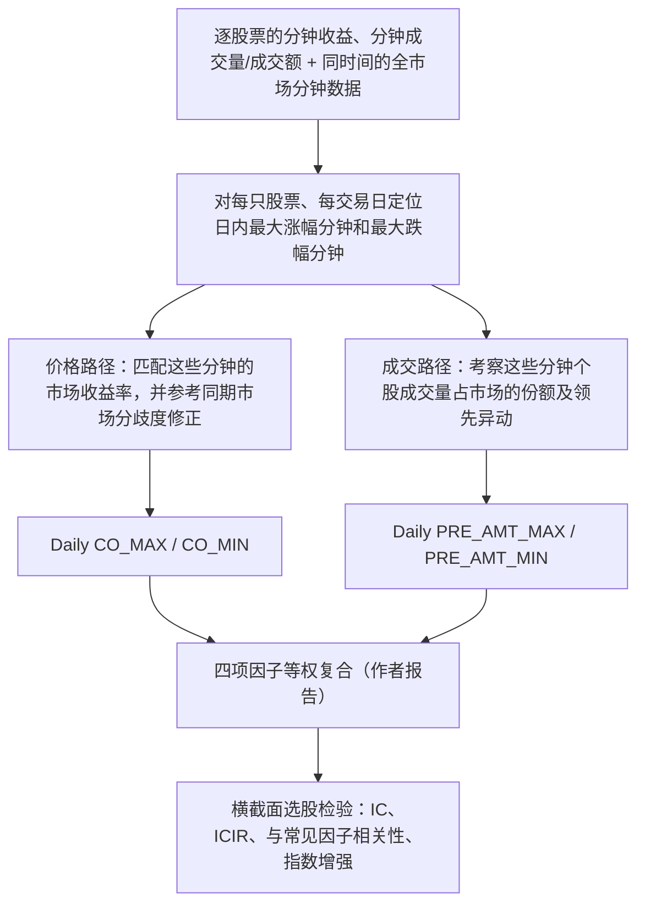

# CR002｜招商证券《基于分钟数据的价变共振因子》

> **方向 C / FIN 类券商金工研报（2026-10-27 经研究者明确同意收录）**。**来源证据仅覆盖可公开访问的研报摘要及独立题录，未取得或阅读全文 23 页正式研报，也未独立回测。** 本页是带证据边界的金融知识档案，不构成作者未发表的公式复现或给下游 Agent 的因子搜索指令。

**原题**：“青出于蓝”系列研究之九：基于分钟数据的价变共振因子  
**券商与作者**：招商证券 · 任瞳、麦元勋、许继宏 · **2024-12-16**（报告公开记录日期）  
[研报摘要（慧博）](https://m.hibor.com.cn/wap_detail.aspx?id=3329d18b0baef99e311939075554811a) · [23 页原报告的公开题录（迈博汇金）](https://www.microbell.com/repinfodetail_3796270.html) · [可核来源与未核事项](PAPER.md)

## 1. 研究的金融现象和作者解释（只归属报告原文）

**原文关注**：一只股票的分钟级价格和成交量变化，是否与**整个股票市场同时段的价格变动、分歧程度和成交量情况**形成某种“共振”；这种共振在作者历史选股测试中与随后收益是否有关。

- **作者报告的观察**：个股和市场分钟收益率的相关系数因子呈一定正向选股有效性；走势与市场背离的个股在其测试中表现相对较弱。
- **作者解释 / 构造动机**：认为金融时间序列噪声较多，关注个股日内价格变化最突出的分钟，而不是对所有分钟赋予一样的解释权重。
- **非因果事实**：作者描述的共振、交易过热、未来收益关系是该报告提出的金融解释或历史回测结果；不是本档案独立验证的市场定律。

## 2. 摘要可以确认的分钟 → Daily 架构

### 摘要所述四种输出（**公式级细节未核**）

| 作者命名 | 已能确认的研究信息 | **无法据摘要确认的关键参数** |
|---|---|---|
| **CO_MAX** | 以个股**日内分钟收益率最高**时刻的市场分钟收益率为基础，并参考同一时刻市场分歧度作修正，描述相对较好表现时的价格共振 | 市场收益聚合定义、分歧度统计式、修正算子、符号与标准化 |
| **CO_MIN** | 与 CO_MAX 同类，但对应个股**日内分钟收益率最低**的时刻 | 同上，亦未核窗口平滑/时段过滤 |
| **PRE_AMT_MAX** | 与日内**最高分钟收益时刻**相关的**领先成交量异动**信息；摘要先讨论个股成交量市场占比，作者称领先异动比同步异动更稳健 | 领先的具体分钟差、成交量或成交额字段、占比和异动的精确公式 |
| **PRE_AMT_MIN** | 与日内**最低分钟收益时刻**相关的领先成交量异动信息 | 同上 |

**不可擅自填公式**：摘要虽然给出了四个名字及机制框架，**没有公开能直接复现四项数值的完整等式**。尤其 `PRE` 的具体领先窗口、市场分歧度如何修正、四项等权前是否中性化或归一化，均不能凭名称补造。

### 示意：什么叫“按极端分钟条件观察”（教学例子，非研报因子）

假设一只股票某天第 17 个分钟收益最高 `+1.2%`，第 73 个分钟收益最低 `−0.8%`；对应市场在这两分钟分别为 `+0.3%`、`−0.2%`。

公开摘要支持的逻辑是：**先根据个股自身选出两个分钟时刻，再读取市场相同时刻的信息**。但由于缺失“市场分歧度修正”和“量领先异动”精确公式，**不能计算出该例子的 CO_MAX / CO_MIN / PRE_AMT 数值**。

## 3. 摘要公开的实证结果（全部为作者报告，非本项目验证）

- **价格**：个股与市场的分钟收益相关关系，在报告历史测试中具有一定正向选股有效性。
- **成交量**：摘要称**同步成交量异动**的选股效应不稳定，而**领先成交量异动** `PRE_AMT_MAX` / `PRE_AMT_MIN` 相对稳健；不能把两类异动都写成有效。
- **四项等权复合**：作者公布复合因子的 **IC 均值 6.32%**、**年化 ICIR 4.64**。
- **进一步检验**：作者声称与常见因子相关性较低，正交化后 ICIR 略有提升，且在不同宽基指数增强回测中表现较稳健。
- **未见详细实验口径**：公开摘要不提供能独立核查的样本起止、股票池、预测标签和持有期、IC计算方法、交易成本及各项分组收益明细，因此不可将这些数值写成复现完成或未来必然有效。

## 4. 时间可见性、适用范围与证据定位

这里的两次“日内极端分钟”选择**依赖整天分钟数据**，意味着在全部当天分钟数据被观测前，通常无法确定其当日最终位置；不能假设盘初即可获得当天完整因子。所涉及的全市场分钟同步数据需要一致时间戳；公开摘要尚未说明股票池、缺失分钟、停牌、涨跌停、复权、是否跨日平滑等技术定义。

**FIN 的原因**：这份研报提供了相对明确的市场金融现象（个股极端分钟价格变动与全市场共振）、条件抽样机制、四个 Daily 命名指标及历史检验；**不是只给出了某个神经网络预测分数的 ARCH 类资料**。但该 FIN 分类不表示研报已被独立验证、精确公式已获得或构成可直接运行的 Alpha。

**归档状态**：研究者已同意**来源收录**；未审研究者创新/论文不足/CD 卡，也未上传版权受限的23页全文。

[报告原始证据与缺失项目](PAPER.md) · [返回券商研报 INDEX](../INDEX.md)
