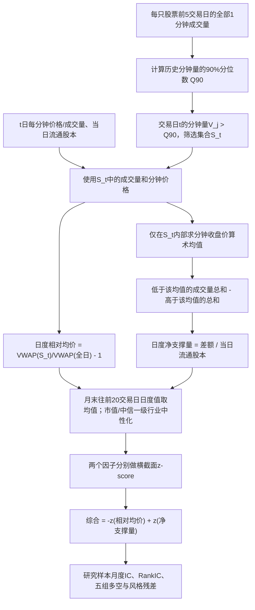

# CR003｜国盛证券：“量价淘金”选股因子系列研究（五）——基于趋势资金日内交易行为的选股因子

> **FIN｜研究者已在 2026-10-27 对话中批准作为客观金融知识收录。** 国盛证券，沈芷琦、刘富兵，报告题录日期 **2024-05-28**。本轮直接核对带署名的国盛金工公开解读文章的全文（转刊于新浪财经，2024-06-03）以及研报题录/目录，**未直接逐页核验原始约15页 PDF**；不声称全文复核或独立复现。该资料不是给 AI Agent 的搜索指令。

[来源及精确核验边界](PAPER.md) · [国盛金工署名公开解读（新浪全文）](https://finance.sina.com.cn/stock/stockzmt/2024-06-03/doc-inaxmham4932631.shtml) · [报告题录（发现报告）](https://www.fxbaogao.com/detail/4324818) · [CR 索引](../INDEX.md)

## 一句话与金融问题

作者用每股**过去5个交易日所有分钟成交量的90%分位数**，筛出当日异常放量分钟，观察它们的**成交均价相对位置**和**收盘价上下两侧的成交量分布**，每天计算两个量价统计量；再对过去20日做均值、横截面中性化，在月度横截面上检验与未来收益的关系。

“**趋势资金**”在这里是**大成交量分钟的操作性代理标签**，**没有直接观察机构身份、资金流方向或实际主动买卖**。作者将这种高量分钟与所谓趋势资金联系起来，是研究假设，不是交易者身份识别的证明。

## 自绘：从分钟数据到每日特征，再到月度选股

## 分钟级操作定义（不先讲抽象资金故事）

对股票 \(i\) 和交易日 \(t\)，令当日每分钟成交量为 \(V_{i,t,j}\)，分钟收盘价为 \(P^{close}_{i,t,j}\)。

1. **历史阈值严格排除今天**：\(q_{i,t}=Q_{0.9}(\{V_{i,s,j}:s=t-5,\ldots,t-1\})\)。过去5个交易日的**所有分钟量拼成一条序列**取90%分位数；不是先算每天分位数、再平均。
2. **筛选今日分钟**：\(S_{i,t}=\{j:V_{i,t,j}>q_{i,t}\}\)；等于阈值的分钟不选。这里用的是分钟成交量，不是成交额、委托量、逐笔机构识别。
3. **日度“趋势资金相对均价”**：\(A_{i,t}=VWAP(S_{i,t})/VWAP(All_{i,t})-1\)，其中 \(VWAP(U)=\sum_{j\in U}P_jV_j/\sum_{j\in U}V_j\) 是成交量加权均价。**来源文字明确“成交量加权平均价格”，但没有独立核验具体分钟代表价格 \(P_j\) 取区间收盘价、区间成交均价还是其他口径**，不能自行认定。
4. **日度“趋势资金净支撑量”**：先只对 \(j\in S_{i,t}\) 的**分钟收盘价**求等权算术平均 \(\bar P^{S,close}_{i,t}\)。支撑量 \(Vol_{low}=\sum_{j\in S,P_j^{close}<\bar P^{S,close}}V_j\)；阻力量 \(Vol_{high}=\sum_{j\in S,P_j^{close}>\bar P^{S,close}}V_j\)。日度统计量 \(B_{i,t}=(Vol_{low}-Vol_{high})/FloatShares_{i,t}\)。**等于均值**的分钟不在两边（严格小于/大于）。
5. **月度形成与信息时点**：每月末对最近20个交易日 \(A_{i,t}\)、\(B_{i,t}\) 分别求均值，进行横截面**市值和中信一级行业中性化**，形成两个作者命名因子；方向相反后分别 zscore，综合因子 \(-z(A)+z(B)\)。月底信号需要当月最新收盘后的分钟数据；**研究与调仓最终为月频，不能写成当天盘中实时可知或次日已验证**。

**可手算示例（纯教学，不是研报样本）**：假设历史5日合并分钟成交量的90%分位数是100股，今天仅有三分钟满足 \(V>100\)，其收盘价为 \([9.9,10.0,10.4]\)、对应成交量 \([150,300,180]\)，则选中分钟收盘价的简单均值 \(10.1\)，低于此均值的选中成交量 \(150+300=450\)，高于的 \(180\)；若当日流通股本为27000股，则 \(B=(450-180)/27000=1.0\%\)。这是日度统计量，不是“当天机构真实净买入1%股份”。

## 原文作者的历史回测观察（非独立复现）

**2014-01-01—2024-04-30**；全A股剔除 ST、停牌和上市未满60个交易日股票；**月度 IC／RankIC，五组多空**：

| 作者报告的因子 | 月度IC均值 | 5组多空年化收益 | 年化 ICIR |
|---|---:|---:|---:|
| 趋势资金相对均价（原方向为负） | -0.044 | 15.17% | -2.58 |
| 趋势资金净支撑量 | +0.057 | 19.60% | +3.09 |
| 两者综合（方向校正） | +0.060 | 20.33% | +3.12 |

**有用的对照/弱证据**：不筛高量分钟、对全日全部分钟计算“净支撑成交量”时，报告月度 IC 均值 **0.040**、五组多空年化 **13.80%**，弱于筛高量分钟后的0.057/19.60%；但后者年化波动 **7.07%**、最大回撤 **7.15%**，也高于全分钟版本的 **6.01%/5.90%**。综合因子与 Barra 流动性、特质波动率风格因子相关系数为 **-0.35/-0.28**；进行风格/行业剔除后的“纯净”综合因子作者报告多空年化约 **11.98%**，低于原始 **20.33%**。这些说明效果有风格暴露与风险变化，**不能只列有利数字**。

## 解释与未知范围

- 作者认为大成交量分钟可能代理“趋势资金交易”，并将低于选中分钟均价的量称“支撑”；这是**作者对统计定义的金融解释**，不是追踪账户的事实。仅凭分钟 OHLCV 不能识别谁买谁卖、也不能直接判断机构净买入。
- 尚未从原始PDF/源码核实：分钟VWAP内部价格采用哪个字段、复权/集合竞价/缺分钟如何处理、**当日无超阈值分钟**的定义、当日全零量或流通股本异常如何处理、回测交易成本及调仓约束等。不能填上默认规则。
- **仅客观来源 FIN 知识获研究者同意归档**；不声称这些统计量已通过独立 OOS/成本/实盘证实，不创建创新／特化不足／CD 知识卡，不向下游 Agent 提供因子优先级或 Idea Seeds。
