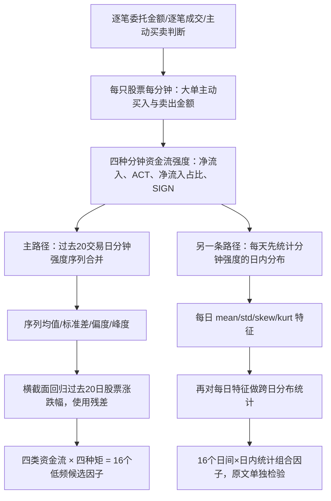

# CR004N｜【FIN·当前数据不可原样复现】高频资金流分布因子的构建方法

> **状态（2026-10-27）**：研究者明确批准来源收录。已核开源证券研报题录及作者署名公开长文的正文文字（含大单主动资金流机制、20日聚合、结果和分钟→日度→月度路径）；**14页正式PDF图表未逐页核查，未独立复现**。后缀 **N** = *Not directly reproducible with currently expected data*，只反映当前预计的数据权限，不是低质量或永久无效。

**完整题名**：开源证券《市场微观结构研究系列（35）：高频资金流分布因子的构建方法》  
**报告日期**：2026-09-04 · **作者**：魏建榕、高鹏 · **机构**：开源证券 · **正式身份**：券商金融工程研报，主要知识类型 **FIN**。  
[研报题录与摘要](https://www.microbell.com/wap_detail.aspx?id=5211813) · [作者署名公开正文转载](https://finance.sina.com.cn/roll/2026-09-06/doc-iniqwnkx0140930.shtml) · [原文范围与缺失字段](PAPER.md)

## 1. 研究的问题与金融机制

该报告研究的不是每天净买入一个金额，而是：**逐笔成交归纳出的每分钟大单主动资金流，其强弱、方向、波动、不对称与尾部结构，在20个交易日中如何分布，这些分布统计与股票未来表现是否相关**。

**最重要的前提**：先用**买卖委托金额分档 + 逐笔成交/主动成交识别**，区分大单主动买入/卖出，得到每分钟大单主动净流入。普通一分钟 O、C、V、VWAP 只能看到成交价格与总量的聚合，**不能恢复原文所需的真实大单交易身份、买卖发起方向、分档资金流**。后文的分布运算虽可对一般序列计算，但换用普通分钟量价数据就**不再是这篇研报定义的资金流因子**。

## 2. 原文两种降频路径：不要误写成已验证 Daily Alpha

**报告主路径的实际输出是过去20个交易日汇总的低频选股因子**，不是已经对每天单独的 Daily 中间特征验证了每日调仓 IC。报告 §3.2 则明确讨论**逐笔→分钟→Daily→月度**这条备选降频路径；论文报告部分双层分布结果，不能把不同路径的统计绩效混为一谈。

### 2.1 从逐笔到一分钟：依赖真实交易方向/大单标识

| 原文分钟级输入/强度 | 原文概念及可核范围 |
|---|---|
| 大单主动买入、主动卖出 | 根据买卖委托金额划分超大/大/中/小类，再汇总逐笔成交，按主动/被动区分；本文举例用**大单主动资金流** |
| 净流入 | 每分钟主动买入金额减主动卖出金额，金额有量纲 |
| ACT | 对净流入强度进行尺度标准化，作者指出范围为 −1 至 1 |
| 净流入占比 | 用成交金额或资金流基数进行相对化的强度指标；公开长文中的**表1是图片**，不自行声称已逐式核对精确定义 |
| SIGN | 仅保留主动净流入方向（正负），弱化强度水平 |

**特别注意**：报告的 `SIGN` 是**大单主动净流入的符号**，不是一分钟股票价格涨跌的符号；把 `sign(C−O)` 代替 SIGN 是另一种自拟价格因子，**不能冒充原文或沿用原文绩效**。

### 2.2 分布统计与中性化

报告以过去 **20 个交易日**的分钟资金流强度串为一个样本，分别计算 **均值、标准差、偏度、峰度**；分别在股票横截面对**过去20日涨跌幅**回归，**取残差**形成 mean/std/skew/kurt 因子。四种强度 × 四种统计 = **16个**因子（原文图表2–3；表格为公开长文图片，具体算式/样本过滤仍需核 PDF）。

作者还检验了**第一/二/三/四交易小时**及以指数1分钟/5分钟涨跌幅、符号成交额等确定的**市场情景分钟**。这些条件选择只改变用于计算大单资金流统计量的分钟集合，**不会替代已缺失的大单主动资金流**。

### 2.3 直觉例子（说明 N；不是原文数据或实证）

同一分钟，股票总量都是 `V=10000`、`VWAP=10`、`O=10`、`C=10`。潜在的逐笔订单既可能由若干主动大买单与小卖单组成，也可能由相反方向的主动卖单组成。分钟汇总价量相同，**主动买卖金额与大单身份仍无法唯一识别**；因此不存在单凭 O/C/V/VWAP 能无损还原上述 SIGN/ACT 的计算。

## 3. 作者报告的实证、条件和负面边界

- 四类资金流强度 × 四个统计指标的对比中，**SIGN 系列总体更优**。作者报告 SIGN-kurt：IC均值约 **−0.036**、ICIR约 **−3.7**、RankIC均值约 **−0.05**、多空对冲年化约 **18.3%**。方向符号须结合作者组合排序与回归约定，不直接说“正向高值必涨”。
- 时段拆分中作者报告**首小时总体优于其他时段**；作者进一步用市场情景筛选分钟，描述不同因子的条件表现。
- 作者报告回看天数从5日增加至30日，绩效**先升后降**，不同指标的最优长度不同；不同股票池（沪深300/中证500）之间强弱也不同。
- §3.2 另一降频路径为**逐日先提取 mean/std/skew/kurt，再对日度特征的跨日分布计算16项**；作者只报告部分双层分布组合较好，**不等于已验证单日 Daily 预测因子**。
- **非本项目复现**：数据样本、回测成本、全表单元格和有效期的核验均以已见公开文字为边界；历史回测不能保证未来有效。

## 4. 当前数据缺口：N 后缀的具体依据

目前据研究者描述**预计**能拿到每股票每分钟 **O、C、V、VWAP**，**H/L 甚至可能没有，逐笔成交、委托、主动买卖标签及盘口未提供**。这是**暂定数据范围**，后续应按真实接口更新，不声称已经核验全部数据授权。

| 报告所需 | 预计数据能否提供 | 影响 |
|---|---|---|
| 分钟价格变化与成交量总体分布 | **可以**：O/C/V/VWAP 可作常见时间统计 | 这属于泛化分钟价量现象，**不等价于原文大单主动资金流** |
| 每分钟大单、主动买卖净流入 / ACT / 净流入占比 / SIGN | **不能原样得到**：缺逐笔买卖/订单身份/主动方向 | **报告核心16因子及改进因子不可原样复现 → N** |
| 首小时、日内时段、指数市场情景筛选 | **时间筛选机制可理解**；是否有同步指数/全市场数据仍需核 | 可以理解条件窗口，但**筛完仍缺原始大单净流入** |
| 高频到 Daily/跨日的分布算子 | **计算操作本身可用**（均值、标准差、偏度、峰度） | 对别的序列使用是**新定义的候选变量**，不能写成报告因子的复现 |
| 分钟最高/最低价、盘口、逐笔订单 | **当前预计缺失或未确认** | 不能无中生有，以分钟O/C/VWAP冒充完整OHLC/订单簿 |

**编号 `CR004N`** 中的 N 意为 **当前数据不可原样复现**，不是 FIN/ARCH 分类，也不表示本来源没金融价值、原作者结果无效或将来一定不能复现。若数据权限变化，须由该档案负责 Agent 对照必需字段重新核定，不因仅含少量可计算通用统计量就自动去 N。

## 5. 证据与版权状态

此次只核**题录、署名公开文字和摘要**；正式14页报告的各表为未逐页检验的原文图像，**不自行补全任何隐藏公式**，未取得券商逐笔数据或独立回测结果。本报告的来源收录已得到研究者批准；创新、独立不足和 CD 知识卡尚未经审批。

[原始来源与证据范围](PAPER.md) · [方向C券商研报索引](../INDEX.md)
