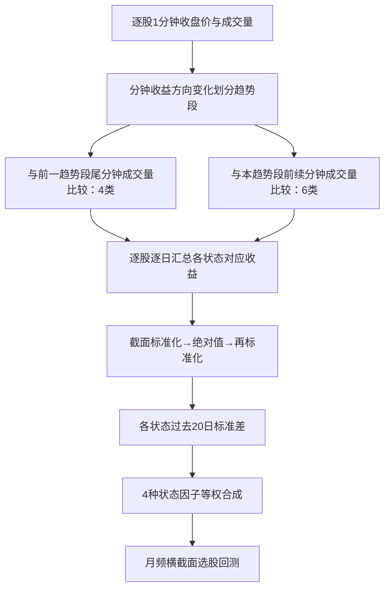

# CR005｜民生证券《基于分钟K线的“主力波动率”构造及应用》

> **FIN｜客观金融知识（2026-10-27）**。研报发布于 2024-08-02，分析师叶尔乐；经研究者确认可收录。资料来自券商题录/摘要及作者署名公开解读，原始 23 页 PDF 的全部图片公式尚未逐项核对；没有自行复现。本文只记录作者的实际量价计算机制和报告数据，不为任何 Agent 指定因子生成任务。

## 核心研究问题

相同日收益率的股票，日内价格方向与成交量变化方式可能不同。作者研究：**在日内涨跌趋势段内按相对成交量分类，再计算特定状态下的收益率和历史波动率**，能否形成不同于直接使用每日总收益的波动率指标。

研报把特定价量状态解释为“主力拉升/出货”；这是**作者对行为机制的解释**，不是用真实机构账户或主动买卖标记识别出的资金流。

## 1分钟 → Daily → 20日因子的客观流程

### 1. 动态划分涨跌趋势段

使用前后一分钟收盘价判断该分钟收益方向；连续同向的分钟组成一个趋势段，方向变化则进入另一段。成交量的比较单位是**分钟成交量**，不是盘口挂单量或逐笔大单数量。

### 2. 两种分类方式（来源 §1.1）

- **方法一：跨趋势段比较**。当前分钟成交量和**上一个趋势段最后一分钟**成交量比较；结合当前涨跌方向得到**放量上涨、缩量上涨、放量下跌、缩量下跌** 4 种状态。第一个趋势段没有前序趋势段，原文跳过其对应分钟。
- **方法二：趋势段内部比较**。当前分钟成交量和**当前趋势段更早分钟的成交量范围**比较；结合涨跌方向，得到放量/缩量/平量 × 上涨/下跌共 **6 种状态**。每段第一分钟缺少段内既往分钟，原文跳过该分钟。
- 公开署名解读中的**比较关系公式为嵌入图片**；已核文字描述与状态类别，精确阈值符号及端点等号仍需对照原始 PDF，不另行补造数学定义。

### 3. 每日状态收益与20日修正波动（来源 §1.2–2.1）

- 作者将每个交易日归属同一状态的**日内区间收益**汇总，得到逐股票、逐日、逐状态的收益值。
- 对这些日度状态收益做**同日股票横截面标准化**，取绝对值后再次做横截面标准化，再在过去 **20 个交易日**计算时间序列标准差。这里的20日标准差**不是直接对240个分钟收益计算日内标准差**。
- 将 **放量上涨、放量持续上涨、放量下跌、放量持续下跌** 对应的4个修正波动率因子**等权合成**，构成作者命名的“主力波动率”因子。

**关键频率区别**：分钟是原始数据频率；状态收益是逐股每日输出；修正波动率还需要过去20日状态收益；研报主要按**月频调仓**进行选股检验。

## 作者报告的历史结果

- **测试条件**：2013年1月至2024年6月的全市场测试，剔除 ST/*ST、退市、停牌、涨跌停等状态股票；报告称对因子做市值/行业中性化，主要月频调仓。
- **主力波动率合成因子**：IC均值 **6.75%**、RankIC均值 **9.06%**、多空年化收益 **33.83%**、多头年化超额收益 **9.96%**；均为**作者历史回测报告**，不是我们独立复现的净利润。
- 作者还报告周频调仓下多空年化 **48.62%**，以及沪深300/中证500/中证1000/国证2000中不同表现，均非当前数据的实证结果。
- 研报讨论了与传统波动率的联系和对红利低波策略的应用；**具体相关系数、全部风险/交易成本细节尚未逐项由原始 PDF 核实**。

## 数据可实施性与 N 判断

- **当前暂定可用字段**：每股票1分钟 O/C/V/VWAP，分钟 H/L、逐笔成交、主动方向、委托/盘口没有确认。
- **本篇核心必需输入**：分钟前后**收盘价**（收益方向）＋每分钟**成交量**（段际/段内比较）。只需 **C 与 V** 即能表达其主体方法，**不需要高低价 H/L 或真实机构账户身份**。
- **编号不加 N**：按现阶段数据约束，本篇主方法不存在已确认不可恢复的关键输入；但不表示我们已有实际行情权限、完整交易所清洗口径或实证复现。
- 研报“主力”与市场过度反应的联系均属于作者金融解释。**量价状态不是对真实机构身份的直接观测**。

**边界**：未获得完整逐项核对的原始 PDF 公式/附录，没有独立回测，也没有经研究者批准的“学术创新”“特化不足”或 CD 知识卡。没有提出任何下游因子生成建议。

[来源和核验范围](PAPER.md) · [CR研报索引](../INDEX.md)
