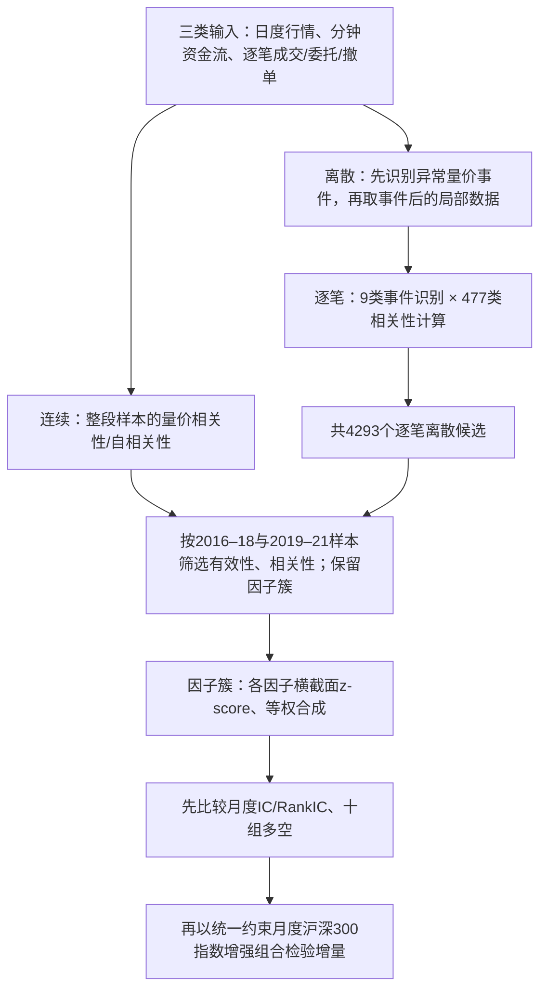

# CR006N｜国盛证券：高频数据+离散化构建方式在因子研究中的重要性

> **FIN + N｜研究者在 2026-10-27 明确批准收录客观知识**。正式名称：《“量价淘金”选股因子系列研究（十二）：“高频数据+离散化构建方式”在因子研究中的重要性》；国盛证券，沈芷琦、刘富兵、阮俊烨，**2025-05-14，约24页**。已核研报题录、公开摘要和网上可阅读的较长正文转录（§1–5）；**尚未亲自逐页核对原始研报 PDF / 图表 / 原始代码**，因此仅将可见文字当作部分原文证据，不冒充全面复现。

[报告题录与作者信息](https://www.fxbaogao.com/detail/4838568) · [公开可读正文转录](https://www.vzkoo.com/read/202505161482bab3c39fda0ce4460240.html) · [证据与数据依赖](PAPER.md) · [本方向研报 INDEX](../INDEX.md)

## 核心问题与来源知识性质

作者研究两个独立维度：**数据频率**（日度、分钟、逐笔）和**取样算子**（连续时段全部参与、或仅在离散事件附近计算）。重点不是证明某个新因子必定赚钱，而是比较不同类型因子在**单因子统计与已有选股组合中的增量**。该分类是来源的研究对象，不是面向下游 Agent 的搜索规划，也不意味着离散化构造在所有市场都更有效。

**N 的依据（当前预计字段仅 1 分钟 O/C/V/VWAP）**：论文真正比较的“逐笔离散”方法**必须具备逐笔成交、逐笔委托、逐笔撤单，以及每笔的买/卖方向、价格、数量、时间顺序**。分钟 O/C/V/VWAP 无法唯一恢复其序列、方向和下一笔间隔；主方法**不能原样复现**。某些只用分钟价格/成交量的统计或筛选思路可以理解，但不能冒充原始逐笔模型。N 不是质量评级。

## 原文研究结构（自绘，§2–4）

图只是本文两类路线的概括，**日度输入没有离散型量价相关性因子**（作者认为日频样本量太少）；不同数据粒度的实际输入字段也不相同，不能误以为三个分支同用一分钟 OHLCV。

## 关键操作定义：不把“事件”说成模糊异常

| 源文问题 | 已核定义与边界 |
|---|---|
| **“连续”怎么计算** | 在连续区间内取量价序列，计算两指标的相关性、单一指标的自相关；可有变化率、前后错位等变体。日频起始56类指标得到18,760个候选，逐笔连续9种量价原始指标得到477种计算方法。 |
| **“离散”是什么** | 先定事件时点，只使用事件对应及之后的局部样本计算量价相关性；它不意味着因子值只能在事件分钟产生，后续仍可按原文规则汇总到股票日频。 |
| **逐笔事件具体是什么** | 对**逐笔成交、逐笔委托、逐笔撤单**三种类型，分别取**整体量、买入量、卖出量**，当某笔对应量**超过该股当天同类型数据的95%分位数**时标为事件：3×3=9 种。**分位阈值要用当天的序列计算**，因此不能在每笔到来时直接假设全天阈值已知。 |
| **事件后算什么** | 从事件发生后取**未来20笔**数据，在所选量价字段之间算相关性/自相关性；作者沿用 2.3节的477种定义，得到 9×477=**4293个候选**。这不是4293个全部入选的最终因子。 |
| **分钟离散的口径** | 使用原始逐笔降频而来的**1分钟数据集**识别量价异常并计算相关性。某些方法依赖逐笔降频得到的资金流字段，**不能直接断言普通 O/C/V/VWAP 就能复刻整个分钟离散因子簇**。 |
| **选因子／输出** | 原文先比较 IC、ICIR、十组多头超额、相关性，筛成各类因子簇，横截面标准化后等权合成；输出包括逐股月末选股因子和模拟的**月频**指数增强组合。 |

### 用数字理解事件的定义（教学虚构，并非论文实证）

若某股票当天逐笔成交量的95%分位数为800股，某一笔成交1200股，则该笔属于“**逐笔成交—整体量**”这类超阈值事件。随后提取该笔**之后20笔**的相关量价数据，计算作者给出的某一种相关性算子；对其他成交/委托/撤单及买卖分组重复同类流程。**不能把1200股改写成“这一分钟成交1200股”，两者时间粒度不同。**

## 作者报告的主要结果（不是我们复现）

- **连续型因子**：原文认为引入分钟/逐笔连续因子后，**单因子层面的统计可以更强**；但沪深300月度指数增强组合相对仅日频连续因子的**超额年化提升约0.5–0.6个百分点**。
- **离散型因子**：当分钟或逐笔离散因子加入连续基准，**单因子IC等统计增量不明显**；“连续+逐笔离散”在作者测试里沪深300超额年化约 **8.15%**、信息比率约 **2.14**，相比仅连续组合的超额年化**增加超过1个百分点**。
- **逐笔离散单簇**：作者报告月度IC **0.073**、年化ICIR **2.87**；去 Barra 风格与中信一级行业后，残差因子的IC **0.037**、ICIR **2.84**。风格暴露并非零。
- **实验时间与选择**：报告给出 **2016-01-01—2025-04-30** 的统计；候选选择先用2016–2018，再用2019–2021 筛选，作者视**2022年起**为后续观察区间。未独立复算筛选过程及其样本外独立程度；所有收益均为来源的历史组合测试。
- **组合约束**：月频；沪深300示例使用**指数成分权重不低于85%、中信一级行业偏离不超过1%、个股权重偏离不超过0.5%**。收益和信息比率不能直接移植到无约束组合或实盘交易。

## 中立性与局限

**来源支持的结论**是：在这组特定候选因子、筛选规则、历史样本与组合约束下，逐笔离散因子在组合层面的增量强于部分连续因子增量。它**不证明**“所有事件筛选优于连续统计”“只用1分钟收盘价就能得到逐笔关联”，更不证明成交/撤单背后一定有某类交易者身份。

未验证：完整24页原始PDF的全部图表、逐笔交易数据与订单簿匹配处理、筛选参数鲁棒性、事件重叠、零/稀缺事件处理、相关性算子的确切各项公式、费用和换手；不能自行填入默认实现。**仅批准客观FIN知识；没有创新、特化不足、CD知识卡或 Agent 行动建议入库。**
