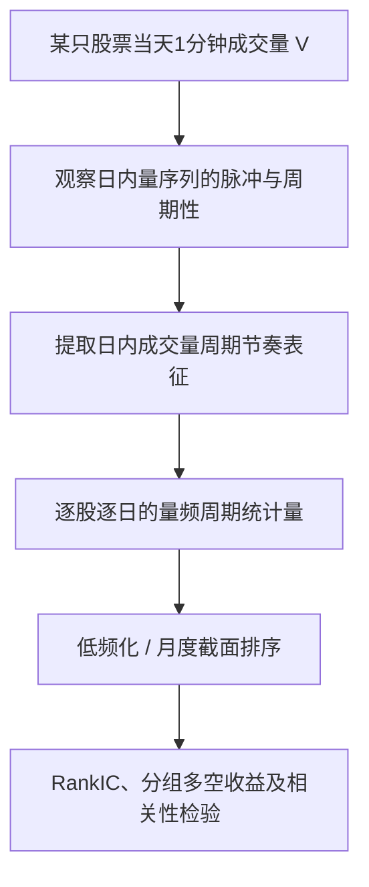

# CR007｜方正证券：个股日内成交量周期性节奏刻画与“滴水穿石”因子构建

> **方向 C｜FIN（客观金融统计知识）；当前不加 N；2026-10-27 获研究者批准收录。** 研报署名日期为 2025-12-16，分析师曹春晓；方正证券官网于 2025-12-17 发布摘要。**原始20页PDF的公式和预处理细节尚未逐页直接核验**。此处严格区分券商官方摘要、第三方技术复现，以及尚未确认的信息。

## 一、研报研究的问题

一天中成交量可能有不同的**时间分布方式**：

- **瞬时脉冲**：成交量集中在很少的分钟突然放大；
- **周期性脉冲**：成交量按较稳定的时间间隔重复波动。

两只股票即使**全天总成交量相同**，分钟成交量的先后顺序和周期性结构也可能不同。

**作者的解释（非已证明事实）**：较稳定的交易节奏可能与投资者分批、定频执行交易有关，和一次性大额冲击不同；**只有分钟成交量无法识别交易账户、主动买卖方向或真实机构资金行为**。

## 二、输入 → 日度统计量 → 评价的骨架

**已由官方摘要明确的事实**：报告区分瞬时脉冲和周期性脉冲，以日内成交量节奏设计“滴水穿石”因子，在**月度频率**上进行选股回测。

**具体频谱实现需标明证据层级**：第三方 BigQuant 数据表 `hf_bar1m_fz_drip_stone` 将这个统计量实现为：
1. 逐股逐日获取1分钟成交量序列；
2. 对异常单分钟脉冲限幅，再进行去均值和窗函数处理；
3. 用快速傅里叶变换（FFT）计算功率谱；
4. 用**2–5分钟周期频带的功率占非零频总功率的比例**表示当日周期性强度；
5. 在其实现里，还给出行业/风格正交化结果和过去20个交易日移动平均结果。

以上技术参数尤其是**限幅阈值、Hann窗、2–5分钟频带、20日移动平均窗口**，目前来源为**第三方复现说明**，不能把它们全部冒充已经直接核验的券商原文逐项公式。BigQuant也明确把部分实现口径（例如平滑窗口）标作**该项目自行选定**。本档案没有把这些细节写作方正证券独立确定且已核实的参数。

### 频率与金融含义

| 层级 | 记录对象 | 来源与状态 |
|---|---|---|
| 原始输入 | 股票×日期×1分钟成交量序列 | 券商官方摘要研究对象已核 |
| 主要统计 | 一天内成交量周期性节奏 | 券商官方摘要已核；精确公式待核 |
| 日度计算实现 | 每只股票每天的频带功率占比 | **第三方实现**，非已证实的券商原式 |
| 后续评估 | 月频截面RankIC、分组组合、多空收益 | 券商官方摘要已核 |

**信息时间**：使用当日完整的分钟成交量序列计算的统计量，须在该日所采用的全部分钟成交量可见后才能得到，不能视为当日开盘前已知。

## 三、作者报告的实证结果

方正证券官网与署名公开摘要报告：

- “滴水穿石”因子月频 **RankIC 均值 8.69%**；
- **RankICIR 4.63**；
- **多空组合年化收益率 32.69%**，信息比率 **3.59**；
- 与此前其他量价因子的**平均相关系数 27.20%**（取决于作者实际纳入比较的因子集合，并非全市场所有因子）。

官方还报告，将其与过去其他量价因子做处理并合成后，“综合量价”因子 RankIC 均值 **−12.39%**、RankICIR **−5.09**，多空年化 **47.51%**；这些是**另一个组合因子的表现，不能与“滴水穿石”单因子混写**。正负方向按作者原摘要记录，不任意改号。

上述全部为**券商历史回测**，本项目未独立复现；不自动推出稳定、可交易净收益或在另一股票池中存在同等效果。

## 四、数据可实施性与 N 审核

- **当前预计行情**：每只股票1分钟 O、C、V、VWAP；H/L、逐笔成交、委托、盘口及主动买卖方向未确认。
- **本篇主输入**：1分钟**成交量 V**。分钟周期性统计以 V 时间序列为核心，无须逐笔成交序号或买卖盘明细。
- **N 判定**：在当前已核的主研究问题下，**不符合“关键输入缺失、不可由当前字段唯一恢复”这一 N 条件**，因此编号 **CR007（FIN，无 N）**。具体公式、异常值处理、集合竞价和缺失分钟的确切原文口径仍待原 PDF 核查。
- 资金“分批执行”是**作者机制解释**，不能从分钟成交量识别为已确认的机构账户行为。

**审批范围**：仅批准这份券商材料的客观知识归档；未批准独立创新判断、特化不足、CD 机制卡或对生成 Agent 的推荐。

[原始来源与核验记录](PAPER.md) · [CR 研报 Index](../INDEX.md)
