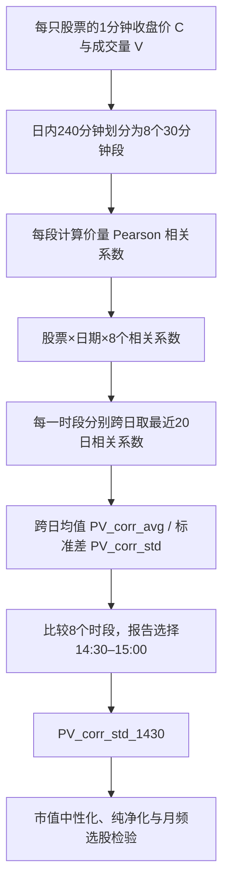

# CR008｜东吴证券《“技术分析拥抱选股因子”系列研究（十六）：CPV分时版》

> **方向 C｜FIN 客观金融知识｜当前不加 N｜2026-10-27 经研究者批准收录**。原报告日期 2024-12-29；分析师高子剑、庞格致。已核对研报题录及多处报告摘要/正文提要；22页原始PDF尚未完整逐页核验，未独立复现。以下区分原作者解释、可核统计定义与作者回测结果，**不包含面向 Agent 的生成建议、搜索指令或自拟因子变种**。

## 一、作者的研究问题

东吴证券此前 CPV1.0 使用**一整天240分钟的收盘价和成交量的相关性**，将其视为量价配合的统计代理。作者观察到这种全日统计的因子在样本外表现下降，研究**全天混合计算是否掩盖不同交易时段的量价关系**。

作者举出**辛普森悖论**作为分组统计与整体统计可能不同的解释：一天内成交量分布不均，逐30分钟统计得到的价量关系，可能与全日240分钟合并后的关系不同。这是作者提出的**研究动机**，不等于每只股票每天均实证出现辛普森悖论。

## 二、原始分钟数据 → 逐股 Daily → 20日滚动指标

### 1. 每日的8个相关系数（分钟 → 日）

对股票 i、交易日 d、日内半小时段 s，取该时段内每分钟的收盘价与成交量成对观测：

$$
\rho_{i,d,s}
=\operatorname{Corr}_{m\in s}\bigl(C_{i,d,m},V_{i,d,m}\bigr).
$$

- 输入字段是分钟**收盘价 C**与分钟**成交量 V**；相关系数度量该时段内两组分钟数值的线性共同变化，不直接观察主动买卖或交易者身份。
- 一个正常 A 股交易日240个连续交易分钟，分为**8个30分钟**：四个上午段、四个下午段（午休不计入）；原文选中的最后一段是 **14:30—15:00**。
- 每天每只股票可形成 \(\rho_{i,d,1},\ldots,\rho_{i,d,8}\) 八个**日度可见统计值**；每个值来自相应时段的分钟观测，不是股票全日价格收益率。

### 2. 同一时段的跨日20日均值与标准差（日频 → 20日滚动）

作者比较 `PV_corr_avg`（最近20日相关系数均值）与 `PV_corr_std`（最近20日相关系数标准差）。用概念公式表示：

$$
\overline{\rho}_{i,d,s}^{(20)}
=\operatorname{Mean}\bigl(\rho_{i,d-19,s},\ldots,\rho_{i,d,s}\bigr),
$$

$$
PV\_corr\_std_{i,d,s}
=\operatorname{Std}\bigl(\rho_{i,d-19,s},\ldots,\rho_{i,d,s}\bigr).
$$

**注意：**“标准差”是沿着**过去20个交易日、固定同一半小时段**计算，不是对当天8个时段的相关系数再求一次标准差，也不是对分钟收益率求波动率。

- 每个时段都可对应一组均值及标准差滚动统计量；研报比较8个时段的选股结果后，采用**尾盘14:30–15:00段的20日标准差** `PV_corr_std_1430`。
- 报告还包含横截面**市值中性化**，并另外报告剔除 Barra 风格及行业暴露后的**纯净因子**；这些属于后续处理和检验，不能与未经处理的日度相关系数混为一谈。
- 原始报告各公式中**标准差分母的精确样本/总体约定、缺失分钟规则、原始数据复权与交易日边界**尚未逐页核验，故这里仅写经公开资料支持的概念公式，不擅自指定实现常数。

### 一个不涉及行情的概念例子

某股票若在连续多个交易日的14:30—15:00内分别得到价量相关系数：
`0.7, 0.6, -0.1, 0.8, ...`，其20日标准差刻画**尾盘量价线性关系随日期变化的幅度**。某一天全日240分钟的整体相关系数，不能替代这个跨日统计量。此例仅用于解释“标准差的输入是什么”，不是原文样本数据。

## 三、报告做了什么实验，得到什么结果

- **样本区间**：研报摘要给出的主回测区间 **2014-01-01—2023-12-31**；以月度排序、分组、多空对冲与 IC/RankIC 等统计检验。详细起止交易日、样本内/外切分和成本细则尚未按原 PDF 完整核验。
- **基线全时段PV_corr_std**：摘要报告**10分组多空年化收益19.98%**，年化波动 **11.12%**，信息比率 **1.80**，月度胜率 **69.42%**，最大回撤 **10.15%**。
- **原文报告的负面结果**：全时段 `PV_corr_avg` 样本外 ICIR **+0.13**；分时 `PV_corr_avg` 样本外 ICIR 绝对值未超过 1，作者据此认为平均数因子样本外表现不足。不能只记录正面结果。
- **尾盘选择**：报告比较八时段后选 `PV_corr_std_1430`。可访问的**第三方研报结构化转录**给出**未纯净化尾盘因子**10分组多空年化收益 **27.71%**，但此数尚未从原 PDF 完整对应表格核验。
- **纯净尾盘因子**：报告摘要直接给出剔除 Barra 风格和行业后的10分组多空年化收益 **13.66%**，年化波动 **5.62%**，信息比率 **2.43**，月度胜率 **72.27%**，最大回撤 **4.91%**；月度 IC 均值 **−0.03**，年化 ICIR **−2.95**，月度 RankIC 均值 **−0.03**，年化 RankICIR **−3.41**。这些符号与指标口径均按原摘要保留。
- 作者还报告在沪深300、中证500、中证1000、国证2000的历史测试及宽基指数增强结果；不是本项目的独立回测。

**所有收益和显著性表述仅对应券商历史研究**，不能转述为当前数据、其他时间区间或交易执行的已验证效果。作者关于尾盘“知情交易者”的解释属于引用的理论/经验动机，而非本研报从 C/V 识别到了真实交易主体。

## 四、FIN／N 判定（当前预计数据口径）

- **FIN**：研究核心是有明确金融含义与数学定义的**价量相关性跨日不稳定程度**，并非通过模型架构生成无显式解释的预测分数。
- **核心必需字段**：逐股票逐分钟**收盘价 C、成交量 V**。目前预计的数据为1分钟 O/C/V/VWAP；该主要计算链不要求 H/L、逐笔成交、委托序号、主动买卖方向或盘口。
- **N 暂不适用**：按当前已核的核心数据条件，未发现原定义必需且不可由 C/V 恢复的缺失字段；**CR008 不加 N**。这不表示已核定交易所行情权限、全部原文预处理参数或已完成复现。
- **可见时点**：当天最后一段价量相关性和包含当天的20日滚动指标，至少要等**当日14:30—15:00交易信息全部形成**才可完整算出；不能当作当日开盘前已知。

## 五、文献证据边界

来源为**券商研报公开摘要/题录**和标明第三方身份的结构化转录；完整22页PDF的全部公式、图表和附录未逐页核。未经研究者审批的特色创新判断、特化不足、CD机制卡均未建立。本档案只陈述来源的统计定义、实验口径、作者解释及客观未核范围。

[来源与核验记录](PAPER.md) · [研报索引](../INDEX.md)
