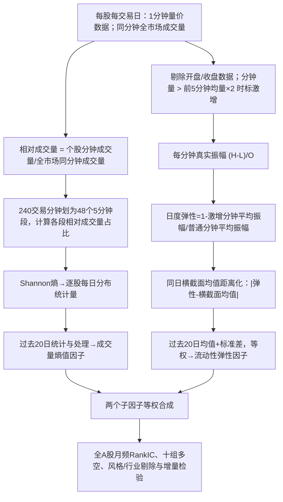

# CR009N｜方正证券：个股日内成交量分布特征与日内流动性弹性刻画

> **FIN + N｜2026-10-27 获研究者同意作为客观金融知识收录。** 方正证券“多因子选股系列研究之二十三”，**2025-08-27，曹春晓**，因子名称“暗流涌动”。研究者明确要求 **保留 N**；按当前预计每股 1 分钟 O/C/V/VWAP、H/L 未确认可用的条件，原报告的日内价格振幅定义需要真实分钟 H/L，无法严格按原文复现。这既不降低其金融知识价值，也不妨碍未来独立研究其他统计定义。**该资料只有来源客观知识获批准；没有批准任何改造因子、原创 Idea、特色不足或 CD 卡。**

[来源核验与未核内容](PAPER.md) · [券商研报公开摘要](https://m.hibor.com.cn/wap_detail.aspx?id=b923ec70904d3ed2afc2b1ed61f94abd) · [公开正文转录](https://m.vzkoo.com/read/20250828a4b2ec9e2f21ddba1dc19d60.html) · [CR Index](../INDEX.md)

## 原文研究问题与知识边界

作者研究：（1）**每只股票的分钟成交量分布，相对全市场同分钟交易节奏有多不均匀**；（2）**当成交量突然放大时，该分钟的完整价格振幅相对于普通分钟有何变化**。分别计算“成交量分布熵值”和“日内流动性弹性”，再等权合成为“暗流涌动”。作者解释其可能与个股信息驱动交易、流动性缓冲有关，这些是**基于统计代理变量的解释假设**，没有直接识别消息类型、真实交易者或因果链条。

## 自绘原文流程

**信息时点**：逐日熵值/弹性均需完整日内数据；弹性还需**同一天全部股票的横截面值**进行处理；20日聚合后的月度信号在该窗口末期数据全部可见后才能形成。不能用当天收盘后才能知道的阈值/统计量倒推为早盘已知。

## 操作性定义（原文§2.1、§2.2；原文优先、未知不补）

### 一、日度成交量分布熵值

- 对股票 \(i\) 第 \(j\) 分钟的成交量 \(V_{i,t,j}\)，定义相对成交量 \(R_{i,t,j}=V_{i,t,j}/\sum_{k\in\mathrm{全市场}}V_{k,t,j}\)。分母是**全市场同一分钟**成交量，而非单股当天累计量。全市场零成交时处理原文未核。
- A股全天240交易分钟，分成**48段、每段5分钟**。每段相对成交量累加为 \(S_{i,t,b}\)，再标准化成 \(p_{i,t,b}=S_{i,t,b}/\sum_{h=1}^{48}S_{i,t,h}\)。
- **Shannon 熵** \(H_{i,t}=-\sum_{b:p_b>0}p_b\log p_b\)。报告称“大熵值＝该股相对成交量更均匀、更接近全市场交易节奏；低熵值＝盘中相对成交量更集中”。**对数底数、极端缺值、熵值最终的全部中性化/20日合成细节尚未从原始PDF逐一核实**；公开第三方复现提出“均值距离化、20日均值和波动”，但不可把其未逐页核实的代码细节视为报告的逐字原定义。

### 二、日度流动性弹性（关键需要真实 H/L）

1. 报告写“**剔除开盘和收盘数据**”，但在已核公开正文中未明确定义剔除几根分钟K线，不自行指定。
2. 以**此前5分钟**的成交量均值 \(\bar V_{t,j-5:j-1}\) 为基准，若 \(V_{t,j}>2\bar V_{t,j-5:j-1}\)，定义 \(j\) 为“成交量激增分钟”；否则为“普通分钟”。“比均量超过1倍”意即高于均量 **100%以上**。首5分钟不足长度、零成交等操作边界未确认。
3. 对每分钟用真实成交区间 **\(A_{t,j}=(H_{t,j}-L_{t,j})/O_{t,j}\)** 衡量**完整振幅**，并非开收到收盘的实体幅度。
4. 分别求激增/普通分钟的振幅算术均值 \(\bar A_{surge}\)、\(\bar A_{normal}\)，作者定义日度“价格敏感系数” \(Q=\bar A_{surge}/\bar A_{normal}\)，然后 \(E=1-Q\)。在同一天全部股票上作“均值距离化” \(E^{dist}_{i,t}=|E_{i,t}-\mathrm{CrossSectionMean}_t(E)|\)。
5. 过去**20交易日**分别对 \(E^{dist}\) 求**均值**与**标准差**，形成“月均流动性弹性”“月稳流动性弹性”，**等权合成**为作者的月度流动性弹性因子。当前已核资料未完整给出零激增分钟、零普通分钟、\(\bar A_{normal}=0\) 的作者处理。

### 三、原始研究的月度组合

**“成交量分布熵值”与“流动性弹性”两子因子等权合成**“暗流涌动”。日频中间统计量不能直接混称为作者用来评价的月频选股组合；月度因子平滑、截面方向调整与其他14个旧因子正交化构成不同实验阶段，不能混写收益。

## 作者报告的历史观察（报告结果，非本项目复现）

测试沪深A股非ST、上市满半年股票，**2014-12—2025-07**，**月频调仓**、十组等权多空：

| 作者因子 | 月频 RankIC 均值 | 十组多空年化 | 信息比率 |
|---|---:|---:|---:|
| 成交量分布熵值 | **−5.72%** | **23.14%** | 2.74 |
| 日内流动性弹性 | **−7.14%** | **29.49%** | 4.36 |
| 暗流涌动（两者等权） | **−7.65%** | **29.17%** | 3.49 |
| 剔除风格/行业后的“纯净暗流涌动” | **−4.38%** | **20.45%** | 2.99 |

- **负 RankIC 不是预测效果不存在**：反映作者当时的因子方向与未来收益排名负相关。未独立复算。
- 作者另报告“暗流涌动”与另外14个因子正交化、等权合成后的**综合量价** RankIC −12.10%、多空年化47.37%；这不是本篇单独两因子组合的绩效。
- 这些回测涉及因子加工、历史选样与横截面构造；**不直接代表扣除真实全成本的可实施收益或未来必有 Alpha**。

## N与“新统计定义”的边界

报告使用的 **\((H-L)/O\)** 是**分钟完整振幅**。当前预计只有分钟 **O/C/V/VWAP**，没有确认可得真实 H/L：不能从 \(O,C\) 唯一反演分钟内的最高、最低价；用 \(|C-O|/O\) 计算的是**分钟实体的绝对净变化**，**不等于报告的流动性弹性或严格复现**。有数学关系 \(|C-O|/O \le (H-L)/O\)，但经“激增/普通”两组平均及比值后，替代版本**没有保证与原报告日度弹性值/个股排序保持一致**。

此处仅说明原始数据定义与可能混淆的统计差别，**不归档“让 Agent 构造 O/C 弹性”的任务、配方、候选因子 Seed、原创创新/特化不足或结果主张**。未来是否研究任何不同定义，由下游系统自己独立提出并检验；不以本篇回测替其背书。

## 证据级别与限制

研报标题日期/作者与历史结果经券商研报题录及公开文本核对；逐段构造方法经**公开正文转录**核对，但未拿到原版逐页可核 PDF，原图、具体实现细节、全部统计公式和参数稳健性不能称为完全核实。没有独立行情复算，且**N是当前预计字段下的可实施性标记，未来获得真实H/L后可复审**。
