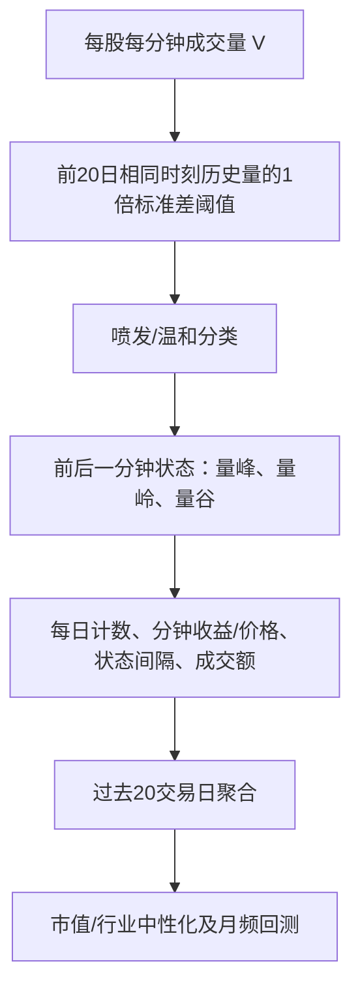

# CR010｜开源证券：高频成交量的峰、岭、谷信息

> **FIN｜研究者2026-10-27批准来源收录；主类不加N。** 已核研报题录及开源金工署名公开解读正文、摘要；**正式研报PDF图片/公式未逐页核对，本项目未独立复现**。只保存客观金融知识及证据边界，不给研究Agent设定新因子、搜索方向或优先级。

**身份**：开源证券《市场微观结构研究系列（27）：高频成交量的峰、岭、谷信息》，2025-07-20，魏建榕、王志豪。  
[署名公开解读](https://finance.sina.com.cn/roll/2025-07-20/doc-infhcnsm4121126.shtml) · [慧博原研报题录及摘要](https://m.hibor.com.cn/wap_detail.aspx?id=4080509a8c31bbf1ed080ebf4fe261d6) · [证据和数据条件](PAPER.md)。

## 金融观察与作者解释（不等于身份识别）

论文关注**异常分钟放量是否持续**，而不是单纯记录放量总次数。作者认为：日内成交量具有头尾较高的U型时段特征，因此与**过去20交易日相同时刻分钟量**比较；再根据当前分钟及其相邻分钟的状态分类。

- **量谷**：温和量分钟。
- **量峰**：该分钟喷发，而**前、后一分钟都温和**，即孤立放量。
- **量岭**：该分钟喷发，且**前后至少一分钟也喷发**，即连续放量。

作者把量峰解释为可能对应知情交易者、量岭可能对应跟随交易或个人投资者、量谷可能对应交易情绪平静。但**普通分钟成交量没有交易账户身份或主动买卖方向**，这些都是作者的解释假设，而非已确认的行为主体或经济因果。

## 分钟→Daily→20日低频因子的事实链

**精确阈值未核**：公开文字只写“过去20日同时点成交量按照1倍标准差的标准”，没有在可读文字中给出完整阈值公式。不能擅自写成“均值+1σ”、指定等号分类、午休跨段邻接、边界分钟或零成交处理；具体应待PDF逐式核实。

| 原文代表性统计量 | 原文计算含义 | 目前字段限制 |
|---|---|---|
| 量峰分钟数 | 过去20日的量峰分钟总数 | 1分钟V可形成主要输入 |
| 量岭分钟收益 | 过去20日量岭时刻分钟收益累积 | 分钟收盘C和V可形成对应序列 |
| 量谷相对加权价格 | 每日量谷VWAP/全日VWAP，再对20日均值 | V和VWAP等可形成相应价格；具体价格字段/量纲仍待核 |
| 量峰间隔峰度 | 同日相邻量峰之间间隔的20日分布峰度 | 1分钟V、时间戳；样本空缺与间隔定义待核 |
| 峰岭成交比 | 20日量峰总成交额/量岭总成交额 | 成交额可望由V×VWAP得到，需单位和复权口径一致 |
| 喷发成交额跟随比例 | 喷发分钟的下一分钟成交额之和/喷发分钟成交额之和 | 需要分钟金额，非主动买卖资金流 |
| **量谷加权价格分位点** | 量谷加权价相对于由真实当日最高、最低价及昨收确定的价格区间 | **没有真实H/L则不能原样计算这个子因子** |

原文称**11大类、20个“有效”因子**，是其历史筛选结果；作者§8指出部分因子相互高度相关（量峰分钟数与若干其他因子相关绝对值超80%，间隔峰度与偏度约98%），**不能当成20条独立规律**。

## 作者历史测试与边界

报告公开说明测试区间为**2013-01-01—2025-05-31**，市值与行业中性化、**月频调仓，双边千三费率**。作者报告：
- 量峰分钟数：**RankIC +10.62%、RankICIR 4.36、十组多空年化31.58%**；其中沪深300为9.99%、中证1000为24.73%。
- 量岭分钟收益：**RankIC −6.29%、多空年化14.98%**。
- 量谷相对加权价格：**RankIC +8.69%、多空年化25.35%**；作者还提到近年阶段性减弱。

以上只是**作者回测**，并非已独立验证的未来收益或每日调仓表现。日内分钟标记及逐日统计可以形成Daily中间信息，但原报告主要报告**过去20日聚合、月频选股**。

## 数据适配决定：FIN，不加N，但并非全因子可复现

研究者预计每股有1分钟**O、C、V、VWAP**；H/L不确定，逐笔、委托、盘口没有。**量峰/量岭/量谷核心状态划分主要依赖V**，故暂不因部分扩展缺H/L而将整篇标N。需要**真实日内最高/最低价**的分位点等子因子目前不可原样复现；行业市值、成分股票池等完整回测数据也未确认。

**N与作者测试好坏无关**。不能把用C构造的价格端点当成真实盘中最高最低价，也不能把分钟成交量直接解释为实际知情交易者或个人交易资金。

[来源核验与缺口](PAPER.md) · [方向C研报索引](../INDEX.md)
