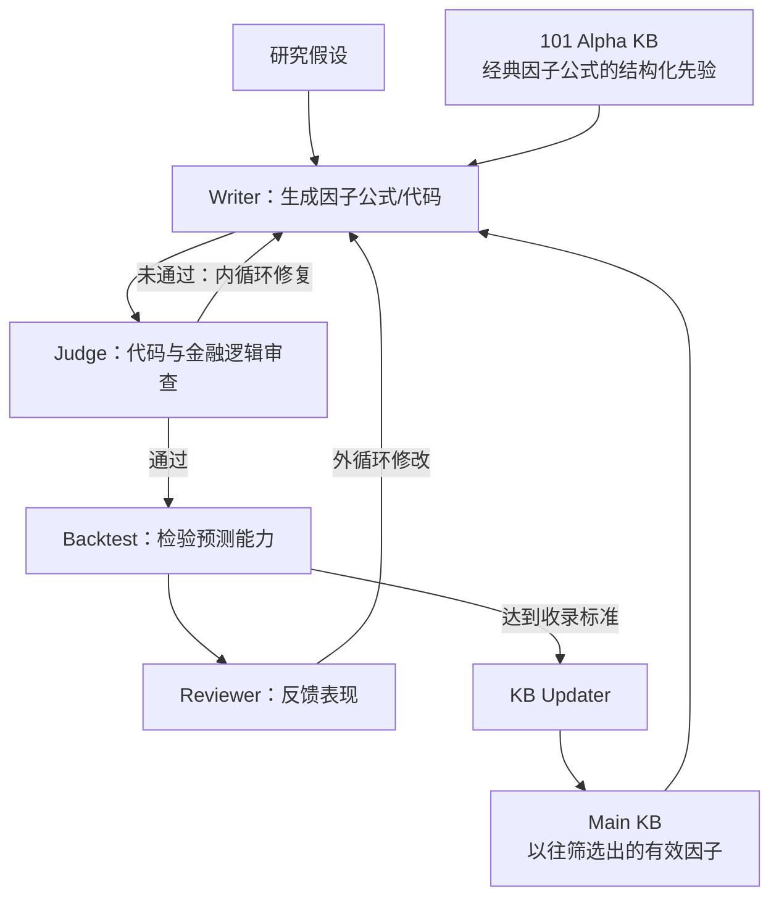

# P001｜Self-improving Alpha Mining（Vu et al., 2026）

**一句话理解**：让 AI 参考经典因子的构造方式，生成并修正因子；用历史回测反馈筛选，再把有效因子作为经验留给后续任务。

[原文与 PDF 入口](PAPER.md) · [作者贡献及客观评价](ARCHITECTURE.md) · [研究者确认的特化疑问](IDEAS.md)

## 先看骨架

**三句记住**：101 KB 像参考教材；内循环解决“写得对不对”，外循环解决“预测效果好不好”；Main KB 存储成功经验，帮助下一个任务。主要改进的是**候选因子与外部知识**，不是已经证实的 LLM 参数训练。

## 已讨论确认的论文特色与具体不足

- **核心特色**：使用 **WorldQuant 101 的公式结构**作生成先验，引导 LLM 不从零盲猜。作者把它列为关键贡献；相对所有早期研究是否首次提出，尚待完整查新。双循环和知识积累有 [QuantAgent（2024）](https://arxiv.org/abs/2402.03755) 等前作，不算本文独创。
- **特化不足／待验证风险（研究者确认应保留）**：**强先验可能锁定搜索方向**，使生成因子反复围绕经典公式变形，牺牲真正新颖的探索；再反复按历史指标挑选，**可能增加搜索层面的过拟合风险**。这是针对本文“结构化公式先验”的机制推论，**不是已证明 P001 确实发生过拟合**。见 [IDEAS.md](IDEAS.md)。

**作者报告的效果**：越南市场样本中，10 个研究想法有 9 个达到作者的因子标准，平均样本外 IC 约 **0.048**；Sharpe 报告约 **2.39**，但**未扣交易成本**。这里只说明结果口径，**不把通用扣费/OOS问题另列为本篇特化不足**。

**证据边界**：目前核对了期刊摘要/Highlights、作者公开仓库说明及部分先前研究；完整 PDF 方法、表格和消融尚未逐页核对。作者报告不等于独立复现。原文见 [PAPER.md](PAPER.md)。

> 本文件是**研究者已讨论确认的精炼骨架版**；不表示整篇论文全文研读已完成，且不批准其他未经讨论的创新和缺点。

**工程复现速查**：[GitHub 直接查看问题表（CSV）](P001_工程复现问题清单_v1.csv) · [Excel 版本](P001_工程复现问题清单_v1.xlsx)。仅作机制理解与导师沟通；未宣称端到端运行完成。
