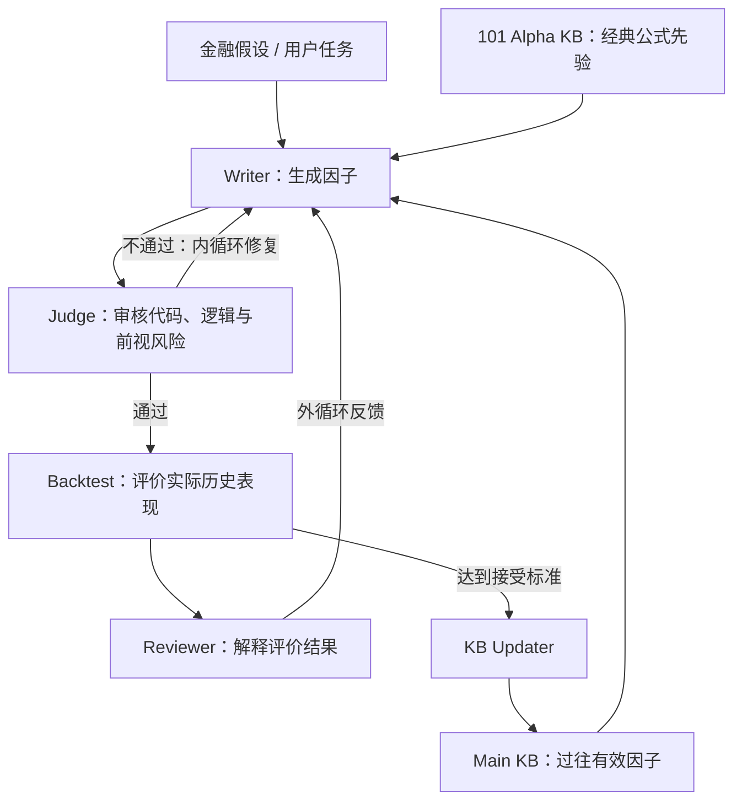

# P001｜Self-improving Alpha Mining (Vu et al., 2026)

**一句话骨架**：用经典因子知识引导 LLM 生成，用内循环检查质量、外循环回测反馈；把达标因子存入可检索知识库，辅助下一轮搜索。

**进度**：已经核对出版方摘要/Highlights 与作者公开代码 README，并核对部分相关先行研究。尚未逐页核对论文完整 PDF 正文与全部消融；不是“已全文完成”或“创新性得到独立认证”。

## 本篇档案
- [PAPER.md｜论文本体入口、出处、阅读与版权状态](PAPER.md)
- [ARCHITECTURE.md｜架构图、作者贡献、客观评价、局限](ARCHITECTURE.md)
- [IDEAS.md｜我们的独立思考、改进假设、未来验证计划](IDEAS.md)

## 系统骨架（自绘简化示意）

**三句理解**：101 KB 是“参考教材”；内外循环分别回答“写得对不对”和“历史上有没有预测效果”；Main KB 是“成功经验库”。这里的“self-improving”主要是候选代码与外部知识积累，并非已证明训练了 LLM 参数。

## 与跨论文 Delta 知识库的关系

这是知识库第一篇论文，相关机制第一次**进入本项目数据库**，详见 [knowledge/DELTA_INDEX.md](../../knowledge/DELTA_INDEX.md)。**首次入库 ≠ 学术首次发明**。尤其“内外循环 + 经验知识库”可追溯更早的 [QuantAgent (2024)](https://arxiv.org/abs/2402.03755)。

后续的论文必须先对比已有 Delta，再判断「已有 / 变体 / 新增 / 待证实」，不能重复声称所有技术都是新创新。
