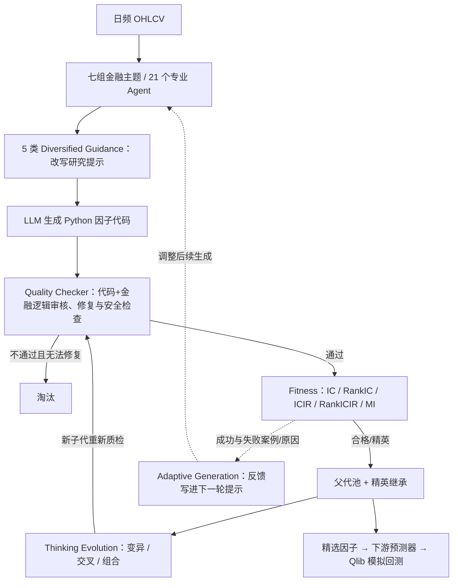

# P002｜CogAlpha（Liu et al., ACL 2026）

**一句话骨架**：由 21 个金融主题 Agent 各自提出因子代码，经过代码/金融逻辑审查与指标筛选，再让 LLM 以**变异、交叉**的方式进化候选；把成功与失败案例反馈到后续 Prompt，构成自动因子探索闭环。

**关键提醒**：进化的是**因子代码、种群和提示上下文**；没有证据表明 LLM 自己更新神经网络权重，因此不等于严格 RSI。作者报告跨市场回测结果，**不是我们独立复现或实盘证明**。

## 本篇档案

- [PAPER.md｜原文入口、论文身份、核验与版权状态](PAPER.md)
- [ARCHITECTURE.md｜Agent 具体实现、作者贡献、结果及客观局限](ARCHITECTURE.md)
- [IDEAS.md｜我们的独立问题、候选改进方向、怎样验证](IDEAS.md)

## 整体架构图（基于原文 Figure 1 / §3 自绘简化）

**三句理解**：专业 Agent 的作用是**扩大因子假设的搜索覆盖面**；进化算子改变的是**Python 因子代码，不是 LLM 权重**；质量评估淘汰无效候选、成败反馈引导下一轮生成。这是**有外部评价器的搜索系统**，不是“AI 自我训练”。

## 相对 P001 的机制位置（项目知识库视角）

- **已有/变体**：生成—审核—评价—反馈闭环（[D001](../../knowledge/deltas/D001_nested_feedback.md)）；角色分工与质量检查（[D004](../../knowledge/deltas/D004_role_separation.md)）；样本外评价（[D005](../../knowledge/deltas/D005_oos_evaluation.md)）。
- **结构不同**：P001 有可检索的 101 Alpha 结构先验及长期成功因子 Main KB（D002/D003）；CogAlpha 主要是**金融主题角色引导 + 代码进化种群 + 当轮成败样本写回 Prompt**。不能说二者记忆机制完全相同。
- **新进入项目知识库的机制**：领域主题分工与提示多样化（[D006](../../knowledge/deltas/D006_domain_guidance.md)）、LLM 代码级进化/种群控制（[D007](../../knowledge/deltas/D007_code_evolution.md)）。**项目新入库不代表学术首次发明。**

**阅读阶段**：单篇核心机制、实验与讨论已归档；仍在整体项目**阶段一**。正式跨论文创新/局限整合与原创方案未完成。
