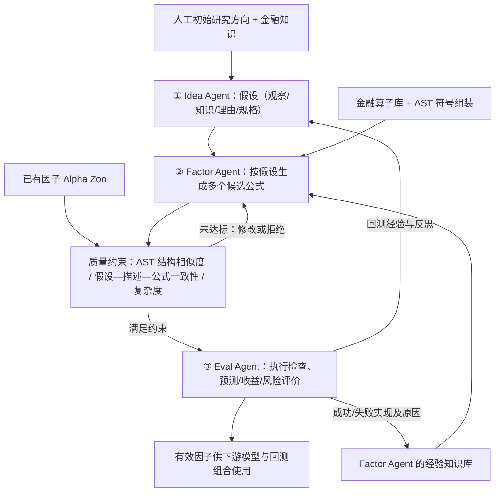

# P003｜AlphaAgent（Tang et al., KDD 2025）

**一句话**：先让 Idea Agent 提出金融假设，再由 Factor Agent 用符号算子生成因子，Eval Agent 回测并反馈；**特色是对生成过程加上结构原创性、假设一致性、复杂度三项约束**，目标是减缓 Alpha Decay。

[原文与核验边界](PAPER.md) · [经讨论的特色机制](ARCHITECTURE.md) · [经讨论的特化问题](IDEAS.md)

## 核心骨架（据原文 Figure 1、§3.2–3.3 自绘）

**记住三点**：① 三 Agent 分工是已有自动研发反馈范式的一种实现，不单独计创新；② 真正值得关注的是 Factor Agent 的三种**生成质量约束**；③ 迭代主要改变**假设、候选公式、外部经验**，原文未证明模型参数自我更新，不等于严格 RSI。

**作者报告的效果**：2021–2024 两市场回测，CSI 500 年化超额收益 **11.00%**、S&P 500 **8.74%**；组合消融中有约束的有效因子比例 **0.29**，无因子建模约束 **0.16**。这些是作者报告，不是独立复现，更不能直接推断某一条约束单独有效。参见 [原文 §4](https://arxiv.org/html/2502.16789)。

**知识库去重**：通用反馈/角色分工对应 [D001](../../knowledge/deltas/D001_nested_feedback.md)、[D003](../../knowledge/deltas/D003_success_memory.md)、[D004](../../knowledge/deltas/D004_role_separation.md)；P003 仅对结构相似度惩罚 [D008](../../knowledge/deltas/D008_ast_originality_penalty.md) 和双层语义对齐 [D009](../../knowledge/deltas/D009_hypothesis_factor_alignment.md) 留独立特色记录。单篇的特化问题见 [IDEAS](IDEAS.md)，不在这里重复展开。

**状态**：论文方法及主要结果已据公开 HTML 核对；代码实现与实证缺口尚未独立验证。此为研究者已同意归档的单篇特色讨论，不意味着已开始整个项目阶段二/三。

**工程复现速查**：[GitHub 直接查看极简问题表（CSV）](P003_工程复现问题清单_v1.csv) · [Excel 单工作表](P003_工程复现问题清单_v1.xlsx)。仅记录论文关键工程链路，未声称按当前公开仓库独立复现。
