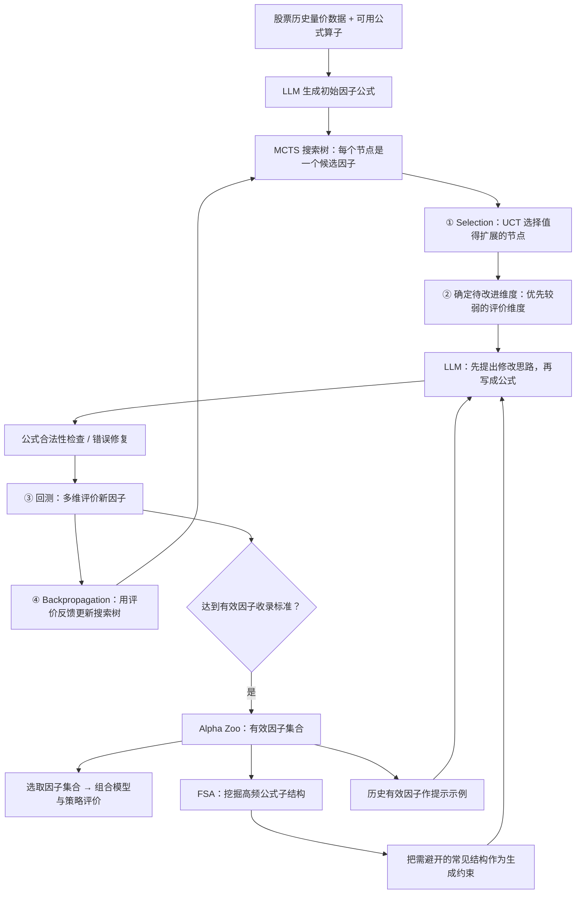

# P004｜Navigating the Alpha Jungle：LLM + MCTS 因子搜索

> **归档状态（2026-10-21）**：系统骨架已按原文归档；另有研究者已讨论认可的 **2 个机制亮点 + 2 个特化风险假设 + 1 个作者自述局限**，见 [独立评价](ARCHITECTURE.md)。风险并非论文已证实的缺陷。

**一句话**：让 LLM 负责想因子公式和改进方案，让蒙特卡洛树搜索（MCTS）决定哪些候选值得继续研究，用回测结果指导树搜索，再通过 FSA 抑制反复出现的公式结构。

**贡献与不足（已审）**：[P004 特化贡献与局限](ARCHITECTURE.md) · **原文**：[AAAI 2026 正式论文](https://ojs.aaai.org/index.php/AAAI/article/view/37069) · [arXiv 可读全文](https://arxiv.org/html/2505.11122) · [来源与证据](PAPER.md)

## 系统骨架（据原文 §3 与 Appendix F 自绘）

## 用三句话看懂

1. **MCTS = 有方向地试错**：不是每次让 LLM 随机重写，而是把候选公式组织成搜索树，平衡「继续改进已见希望的分支」与「探索还没充分尝试的分支」。
2. **回测 = 下一步搜索的反馈**：从**有效性、稳定性、换手、多样性、过拟合风险**等维度评价候选；分数用于选择待优化维度，并沿搜索路径回传。
3. **FSA = 减少公式结构重复**：从 Alpha Zoo 中抽取反复出现的公式子结构（忽略具体参数差异），让 LLM 后续尽量绕开这些结构；收录达标因子后更新 FSA 参考。

## 谁控制什么

| 部件 | 职责 |
|---|---|
| LLM | 提出因子修改思路、生成具体公式、修复不合法表达式 |
| MCTS / UCT | 选择进一步扩展的候选公式节点；评价反馈更新搜索树统计量 |
| Backtest + 多维评价 | 用历史数据及风险维度评价新公式，而非仅靠 LLM 自评 |
| Alpha Zoo | 保存达到筛选条件的有效因子，供后续组合和生成参考 |
| FSA (Frequent Subtree Avoidance) | 从有效因子的公式树找高频结构，并在后续生成中限制重复使用 |

**注意**：图是帮助理解的机制概括，不是直接复制论文 Figure 1/2；该框架改的是**候选公式与搜索树状态**，这里没有把它写成 LLM 参数级训练。

**研究状态**：原文 [§3 方法](https://arxiv.org/html/2505.11122) 与 [Appendix F 伪代码](https://arxiv.org/html/2505.11122) 已用于核对架构。贡献与特化疑问已按研究者本轮批准另行归档，但**不把骨架或审批等同于全文所有实验已核验**。

**工程复现速查**：[GitHub 直接查看问题表（CSV）](P004_工程复现问题清单_v1.csv) · [Excel 版本](P004_工程复现问题清单_v1.xlsx)。重点回答 MCTS 搜索树、弱维度选择、树回传更新、FSA 的结构识别/Prompt 约束与源码公开边界；未宣称完整框架已跑通。
