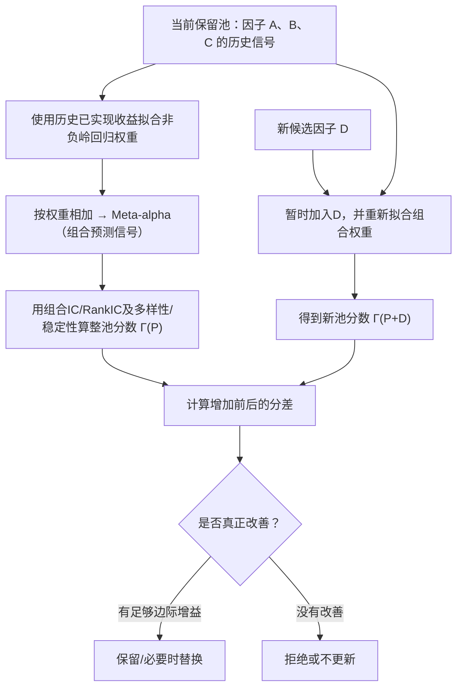

# P005｜“非负岭回归”到底在干什么？从加权平均到因子池筛选

> 本文是 [P005 工程问题主表](P005_工程复现问题清单_v1.csv) 中“整个池怎么得到分数？”的**通俗展开说明**，不是第二张研究表。这里讲的是**非负岭回归（nonnegative ridge regression）**，不是“负岭回归”。

## 1. 为什么要给因子分配权重？

假设因子 A 看近期价格走势，因子 B 看近期成交量，每个因子对每只股票都会给一个数值信号。要把它们合起来预测股票未来收益，就需要给每个因子一个权重：

**组合预测信号 = A 的信号 × 权重A + B 的信号 × 权重B。**

例如某只股票的 A 信号是 `0.8`、B 信号是 `0.3`，如果权重分别是 `0.7` 和 `0.3`，组合信号就是 `0.8×0.7 + 0.3×0.3 = 0.65`。

问题是：**权重0.7和0.3从哪里来？不是 LLM 随口指定，也不是平均分配，而是利用历史因子数值和历史已实现收益来拟合。**

## 2. “回归”“岭”“非负”，三个词分别说什么？

| 词 | 不用术语怎样理解 |
|---|---|
| **回归** | 调整每个因子的权重，使“因子加权预测结果”尽量接近历史真实收益。 |
| **岭（Ridge）** | 如果某些权重特别大，即便历史拟合得很好也要额外扣分。因为大权重容易把噪声当成规律，且相近因子容易使权重不稳定。 |
| **非负** | 限定每个**组合权重不小于0**，不让程序通过给某个因子负权重来反向使用该因子。注意：权重非负**不代表因子信号或组合预测值一定为正**。 |

对应最核心的目标，只需要读懂一行：

```text
挑选一组权重 w（每个 w ≥ 0）
让以下两项之和尽可能小：

  ① 预测误差的平方总和
  ② λ × 所有权重平方的总和
```

第一项要求**尽量预测准**；第二项要求**不要把权重调得太夸张**。其中 `λ`（也常写成 `ρ`）控制“压制大权重”的力度。越大通常越倾向较小的权重。**非负约束和岭惩罚是两条独立规则。**

### 一个只有一个因子的简单算例

假设历史某个样本的因子信号=1、真实收益标签=1，要学一个权重 `w`：

- 如果不加岭惩罚：只最小化 `(1-w)²`，最优是 `w=1`。
- 如果令 `λ=1`：最小化 `(1-w)² + w²`，最优是 `w=0.5`。
- 这就是“岭”的直观效果：**允许少量拟合误差，以换取不那么极端的权重**。真实论文用很多股票、多天和多个因子一起拟合，而不是只用这个样本。

## 3. 为什么非负岭回归会关系到“因子池边际贡献”？

P005 实际上有两个不同问题：**新因子自身有没有预测能力？** 和 **它加进当前因子组合之后有没有带来额外价值？**



**教学数字例子：**

| 情况 | 整池分数（虚构） | 与原池相比 |
|---|---:|---:|
| 只有 A+B+C | 0.040 | — |
| 加入 D 后 | 0.043 | +0.003：有正增益 |
| 加入另一个 E 后 | 0.039 | −0.001：没有增益 |

即便 E 单独算 IC 很高，它与 A、B、C 可能表达重复信息；放进组合后不一定让整池分数变好。**因此 P005 的入池判断是“逐个候选做决定，但看整个池的表现有没有提高”**，不是单纯挑单因子 IC 最大者。

## 4. 这是不是让 LLM 自己做岭回归？

**不是。** LLM 在 P005 负责提出 DSL 因子公式；`factor_evaluator` 和 `Pool Updater` 是外部计算与管理逻辑。权重拟合、组合评分、增删因子都应由真实数据上的程序计算，而不是让 LLM 在 Prompt 里猜权重。

历史训练使用的是对应历史时点**已实现**的收益作为监督标签，不意味着在真实预测日把尚未发生的未来收益泄漏给 LLM；论文另使用未来窗口结果作为**离线 GRPO 训练奖励**，二者用途不同。

## 来源边界

此页依照 [P005 原有论文方法档案](PAPER.md)、[P005 架构记录](README.md) 和论文描述的非负权重组合机制作独立通俗解释。原始论文入口：[AlphaPilot arXiv:2610.15488](https://arxiv.org/abs/2610.15488)。**本次对话中 P005 HTML 重新访问未成功**，所以这里不新增对原文未重新核实的程序源码断言；数字例子明确为教学示意，未独立复现。

[返回 P005 主表](P005_工程复现问题清单_v1.csv)
