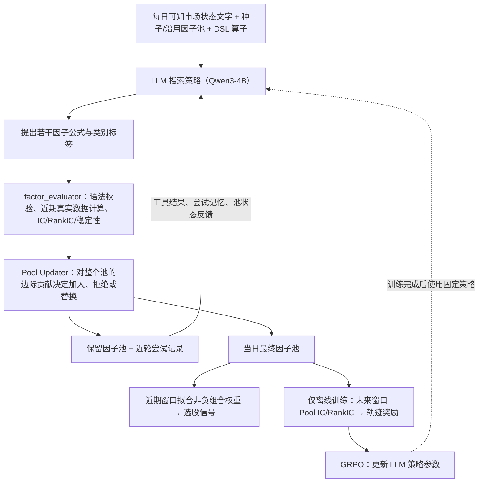

# P005｜AlphaPilot：多轮工具使用与强化学习因子挖掘（Jiang et al., arXiv 2026）

> **归档范围**：仅原文来源、系统骨架、客观职责、训练与推理界限；对学术新意/特化不足/Delta 的独立评价尚未审批，不进入正式机制知识库。

**一句话**：给小型 LLM 每日市场状态和已有因子池，让它多轮生成公式、调用真实数据评估工具、按**对整个因子池的边际贡献**决定保留/替换；在**离线训练阶段**用最终因子池的未来窗口评价作 GRPO 奖励，训练 LLM 的搜索行为。

[权威来源和核验范围](PAPER.md) · [arXiv 原文](https://arxiv.org/abs/2610.15488)

## 一眼看懂的原文系统骨架（自绘，依据 Figure 2、§3–4）

## 组件具体做什么

- **输入**：3 年滚动历史、市场状态的自然语言描述、种子或之前沿用的因子池、DSL 算子集合（§4.1，附录 A.3/A.4）。
- **LLM 动作**：每轮生成多个公式及类别标签；最多 40 轮，执行器按现实数据验证、反馈；LLM 后续轮次能看到最近尝试和当前因子池（§4.2–4.3）。
- **Pool Updater**：先剔除无效、低覆盖和分数非正候选，再按**组合因子的近期训练窗口池分数变化**决定是否接受；池满时可替换最弱/最冗余成员。组合权重通过非负岭回归式目标拟合（§4.3）。
- **离线训练**：每个历史决策点生成多条完整工具使用轨迹，在未来窗口按最终因子池的 IC/RankIC 形成轨迹级奖励，用 **GRPO** 更新 Qwen3-4B 模型参数（§4.4–4.5）。
- **每日推理**：训练后的模型在每个测试日仅使用当日及历史可知信息，更新因子池、计算组合信号，纳入统一的 long-only top-K 策略回测；**未来窗口收益只作为离线训练奖励，不是推理输入**（§4、§5）。

**反馈/更新对象需严格区分**：当日轮内改变**候选公式/因子池/Prompt 记忆**；离线 GRPO 训练改变**LLM 参数**；测试日的因子池自适应不代表每日重新训练权重，也不等于严格自修改学习算法（RSI）。

## 作者报告的主要实验（只列必要事实）

2024-01-01 起为验证范围、2025-07-01 起为测试范围；CSI300/CSI500 日频滚动推理，主试验采用 3 次独立运行平均，另有与相同 Qwen3-4B、GRPO、数据和奖励匹配的**单轮 GRPO**对照。

- **CSI300**：总回报 42.93%，Sharpe 2.46，IC 0.0403。
- **CSI500**：总回报 54.19%，Sharpe 2.86，IC 0.0259。
- **控制对照**：在 CSI300，与单轮 GRPO 相比，多轮方案平均总回报多 7.31 个百分点、Sharpe 多 0.43；此对比隔离了多轮工具反馈在该试验中的增益（Table 4）。
- 所有数字均是**作者历史模拟回测/训练报告**，非独立复现或实盘验证；本文当前为预印本，未视作正式同行评议出版。

**区别于已有索引的客观机制位置（非创新审批）**：P001–P004 主要展示固定基础 LLM 外围的因子/上下文/种群/树搜索；本篇明确执行**GRPO 参数更新**。同时，组合层边际贡献应和更早 AlphaGen 等研究的协同性目标核对，不能把“池级评价”冒充首创。

**状态**：原文 §3–5 及附录 A/B 核对核心职责和重要数值。学术增量、独有不足及相关知识卡留待研究者后续审批；不建立未获批 D010。
