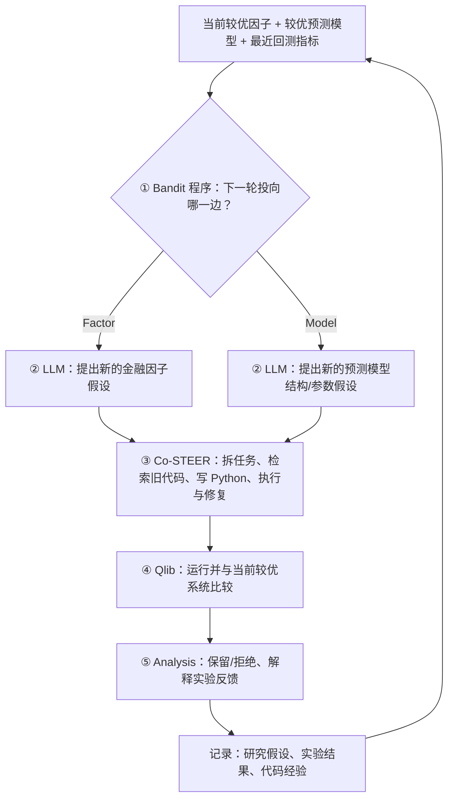
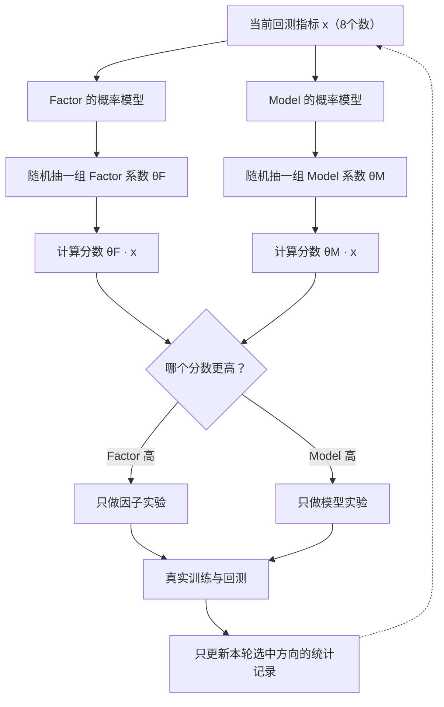
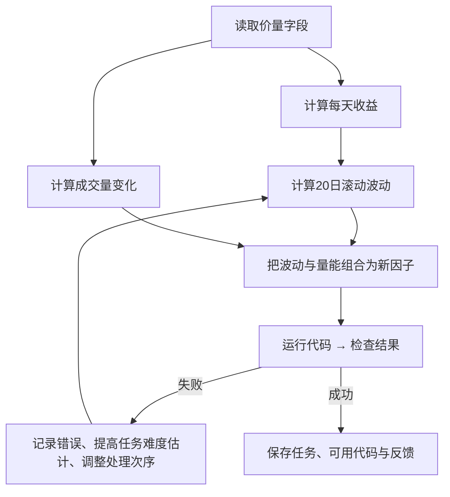
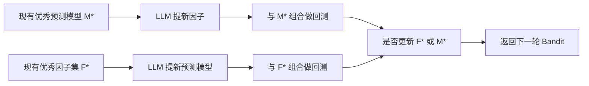

# P006｜Bandit 与 Co-STEER：从直觉、数字到 Python（展开阅读）

> **本页是 [P006 工程问题主表](P006_工程复现问题清单_v1.csv) 的算法图解，不是第二张工程研究表。** 前半部分尽量不需要数学基础；最后才对照论文算法及公开代码。文中注明“教学例子”的数字**不是论文实验结果**。

## 一张图：到底哪部分由谁完成？



**先分清三个人的工作：Bandit 只选研发方向；LLM 提出“研究什么”；Co-STEER 帮忙把想法实现成代码。** 只有实验后才能知道所选方向的表现。

## 1. 为什么叫 Bandit？“双臂老虎机”具体指什么？

想象你只可以按两个按钮：**A=研究新因子**，**B=研究新预测模型**。每按一次按钮都要花钱做一轮实验，而实验之前不知道结果。你不能“同时知道两个按钮本来会怎样”——因为实际只试了一个。

这就是 Bandit（多臂老虎机）问题：**每次只能选一个动作，只能看到选中动作的结果，再用历史经验决定下一次选哪个**。本文恰好只有两个动作，所以叫 *Two-Armed Bandit*；它管理的是研发预算，**不是股票买卖策略**。

为什么不直接永远选过去成绩最好的按钮？因为 B 可能只试过一次，证据太少；如果永远选 A，就不会知道 B 的潜力。算法必须同时考虑“过去表现”和“对判断有多大把握”。

## 2. P006 到底每次抽取什么？

不是对 Factor / Model 各扔一枚硬币。它使用 **Contextual Thompson Sampling（有上下文的汤普森采样）**，步骤如下：

1. **先看状态**：读取当前系统8个指标，例如 IC、ICIR、RankIC、RankICIR、年化收益 ARR、信息比率 IR、最大回撤 MDD 及第8个风险收益统计量。它们合在一起叫状态向量 `x`。含义是：**现在的策略处于什么水平**。
2. **分别翻各自的“经验账本”**：Factor 和 Model 各保存一套统计参数：估计的**均值**（大致认为这种动作在某种状态下效果如何）与**不确定性**（证据还够不够）。
3. **各随机取一种合理情况**：分别从 Factor 和 Model 的参数概率分布中抽一组系数 `θ_factor`、`θ_model`。计算 `score = θ · x`，也就是把8项指标分别乘以这次抽到的系数后求和。
4. **比较两个抽样分数**：哪个更高，这一轮就研究哪个。**抽样不是不看证据的随机选择**：经历较多实验的方向，其概率估计会更有依据；证据较少的方向通常保留较大不确定性，因此仍有机会被试到。
5. **实验后才更新经验**：只给刚才真的执行的方向更新记录；没有执行的另一方向，这一轮没有新的观察值。



### 一个三分钟能算懂的极简数字例子

**注意：这里为了讲清概率更新，把真实8维问题暂时缩成只有1个指标。以下数字是教学示意，不是作者代码的运行记录。**

假设“做 Factor 带来的效果”在实验之前被估计为均值 **0**，但很不确定。为了简单，取服从正态分布、方差为 **1**；Model 也如此。

- 第一次系统先研究 Factor，结果观察到教学分数 **2**。
- 假设观测噪声方差也为1，按照**标准的一维贝叶斯正态更新**，Factor 对这个效果的估计由“均值0、方差1”变为“**均值1、方差0.5**”；Model 没试过，仍是“均值0、方差1”。
- 第二次抽样，假设 Factor 抽到了 **0.7**，Model 抽到了 **1.2**，就会选 Model。虽然 Factor 的历史平均更乐观，但 Model 因为没试过、分布更宽，仍可能抽到更高的结果。
- Model 实验后再根据实际成绩更新 **Model 自己的**估计；第三轮又重新抽样。

**均值代表当前估计，不确定性代表“我对估计有多大把握”。两者同时更新才是 Bandit 的核心。** 教学中使用的是标准一维后验更新；P006 论文和 Python 代码使用8维线性形式，不能拿示例数字冒充源码逐行输出。

## 3. 对照真实 Python：里面究竟存什么、运行什么？

作者当前公开的 [`bandit.py`](https://github.com/microsoft/RD-Agent/blob/main/rdagent/scenarios/qlib/proposal/bandit.py) 中：

| 代码里的名字 | 用人话解释 |
|---|---|
| `mean["factor"]`、`mean["model"]` | 两个方向各自保存的**8个系数的平均估计** |
| `precision["factor"]`、`precision["model"]` | 两个方向各自保存的**8×8确定度矩阵**；越确定，抽样分布通常越窄 |
| `sample_reward(arm, x)` | 为这条方向随机抽一组系数，和当前8指标相乘加总，得本轮抽样分数 |
| `next_arm(x)` | 比较 Factor/Model 两个抽样分数，返回更高的那条方向 |
| `record(m, arm)` / `update(...)` | 将实际执行方向的本轮指标和奖励用于更新其统计参数 |

这里还有**两种不同的“权重”**，不能混淆：

- **固定评分权重 `w`**：作者当前代码用它把8项已观察指标合并成一个实际反馈分数，写作 `r = w · x`。`EnvController` 预置这些权重；它不是每轮抽样得到的。
- **抽样系数 `θ`**：Factor/Model 各自的统计模型学出的不确定系数。抽取它的一个可能值，再计算 `θ · x`，用于**决定下一轮选哪条路**。

```text
实验后的8项指标 x
        ├─ 固定权重 w · x → 实际记录的奖励 r
        └─ Factor/Model 各从自己的后验分布抽 θ
                     └─ θ · x → 两个比较分数 → 选择下一轮
```

**实现口径必须说清**：[论文§2.5及附录A.2](https://arxiv.org/html/2505.15155#Sx1) 讲的是根据研究动作结果更新统计模型；但当前 `bandit.py` 的实际 `reward()` 是8指标加权和，**不是直接计算“新分数−旧分数”**。而且 [`quant_proposal.py`](https://github.com/microsoft/RD-Agent/blob/main/rdagent/scenarios/qlib/proposal/quant_proposal.py) 在下一轮先读取**上一轮实验后的指标**，据此 `record(previous_action)`、再 `decide(next_action)`；初始无历史时固定选择 Factor。当前配置还允许把调度器切换为 `llm` 或 `random`，但默认是 `bandit`。

**不要把“标准算法的数学直觉”和“这个仓库默认分支的具体代码行为”直接画等号。** 源码持续变化，当前未锁定论文提交版本或做端到端运行测试。

## 4. Bandit 选完，谁真正提出研究想法？

例如它选了 Factor：

- Synthesis 给 LLM 提供已有金融任务描述、旧因子研究假设、成功/失败实验和当前较优方案。
- **LLM 提出新的自然语言金融假设**，随后生成说明因子公式、变量、目标的结构化研发任务。
- Co-STEER 进一步将任务变成 Python 代码，并交给 Validation/Qlib 评价。

如果选了 Model，过程相似，只是 **LLM 的研究目标换成网络结构、参数或训练方法**，不是“再写一个因子”。作者在 `quant_proposal.py` 使用对应不同分支的 Prompt 模板，还从历史实验中选取适用记录。

所以“LLM参与哪里”不是一句“多 Agent 都用 LLM”，而是明确分开：**研究假设生成、代码编写与错误诊断会调用 LLM；Bandit 的两个分数比较由 Python 完成，实验回测由程序计算**。

## 5. Co-STEER 又是什么？为什么还需要 DAG？

Co-STEER 是 **Collaborative Scheduling and Task Execution Engine（协作式任务调度与执行引擎）**。它负责“想法已经定了，怎样按顺序写出能运行的程序”。

假设一个新因子需要“先算每日收益，再算20天收益波动，最后与成交量变化结合”（**教学例子，非论文原始因子**）：



**DAG 是“谁依赖谁”的任务图**：要先有“每日收益”，才能算“收益的20日波动”，不能反过来。*拓扑排序*就是找一条不违反依赖关系的执行顺序。

论文附录A.1描述：初始化每个子任务的难度估计，按依赖和难度安排任务；失败就提高对应任务的难度估计、重新排序。代码生成时检索过去相似任务，LLM 写/改程序，真实执行产生报错或成功反馈，最后保存 `(任务, 代码, 反馈)` 供下一次复用。**这里的“难度估计更新”与 Bandit 学习选 Factor/Model 是两个不同层次的优化。**

## 6. 两条研发线如何衔接？



这里的优秀因子集是用于模型输入和联合回测的研究资产；**不等于 P005 使用非负岭回归求因子权重、逐一计算池级边际增量的程序**。另外，Model 分支可能实际训练下游股票收益预测模型；论文没有显示研发用的通用 LLM 自身通过 SFT 或 RL 更新参数。

## 来源与核查边界

- **论文已直接可读的原始材料**：[P006 arXiv HTML 正文 §2](https://arxiv.org/html/2505.15155)；附录 **A.1 Algorithm 1**、**A.2 Algorithm 2**。
- **当前开源代码已静态检查**：[bandit.py](https://github.com/microsoft/RD-Agent/blob/main/rdagent/scenarios/qlib/proposal/bandit.py)、[quant_proposal.py](https://github.com/microsoft/RD-Agent/blob/main/rdagent/scenarios/qlib/proposal/quant_proposal.py)、相关 Co-STEER 文件。
- **本文尚未完成**：锁定论文对应的 Git 版本、独立运行全套研发、对论文奖励公式与当前源码行为做逐项实证等价检验。
- 本页仅解释已描述的工程机制，不新增“论文创新”“特化缺点”或 Delta 结论。

[返回 P006 主表](P006_工程复现问题清单_v1.csv) · [返回论文首页](README.md)
