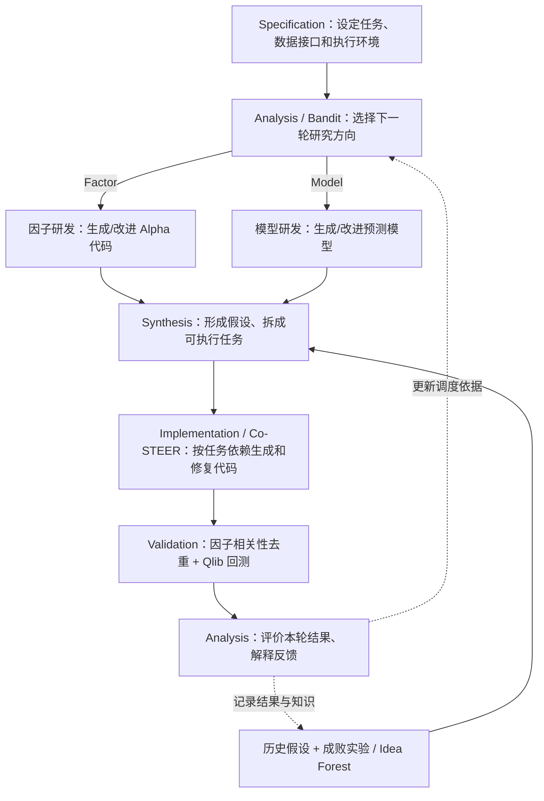

# P006｜R&D-Agent-Quant（NeurIPS 2025）

**一句话骨架**：让 AI 研究员同时参与**因子挖掘**和**预测模型改进**；研究 Agent 提出假设，开发 Agent 将它们写成代码，回测结果与历史经验反馈给研究 Agent，**Bandit 调度器决定下一轮先改因子还是先改模型**。

> **阶段一：原文核心方法正在研读。** 本文件仅保留可核查的架构和职责事实；**尚未审批创新 Delta、特化不足或研究者想法**，不把作者声称的“first”转为我们的学术首创结论。

## 原文入口

- [PAPER.md｜NeurIPS 正式来源、arXiv 全文与代码链接](PAPER.md)
- [论文在线全文](https://arxiv.org/html/2505.15155)
- [微软 R&D-Agent 项目](https://github.com/microsoft/RD-Agent)

## 系统架构图（根据原文 Fig. 2–4 / §2 自绘）

**怎么理解两条工作线**：

- **因子线**：优化输入的预测信号（Alpha 因子），先检查与当前优秀因子的相关性，再拿当前预测模型回测。
- **模型线**：优化利用因子预测收益的模型，用当前优秀因子集合测试新模型。
- **协调方式**：Analysis 根据回测反馈，通过 **contextual bandit / Thompson sampling**（根据历史尝试的效果，在两条方向间权衡）决定下一轮该投入哪条线；同时把成功、失败和代码经验保留下来。

**重要边界**：这是**研发系统的搜索与任务调度**，并不说明 LLM 底层权重被自主训练。与其他论文的创新性比较、可能的专属缺点目前未讨论审批，不写进正式 Delta 库。

**原文依据**：[§2.1–2.5](https://arxiv.org/html/2505.15155#S2) · [NeurIPS 正式摘要](https://papers.neurips.cc/paper_files/paper/2025/hash/ac5c2b6e423883cbcacbcccf88491b78-Abstract-Datasets_and_Benchmarks_Track.html)。

**工程机制速查（2026-10-26）**：[GitHub 上直接查看三列表（CSV）](P006_工程复现问题清单_v1.csv) · [Excel 单页版](P006_工程复现问题清单_v1.xlsx)。合并为13个易读问题：重点讲清Bandit为什么叫Bandit、怎样选方向并根据回测学习，以及LLM提出假设、Co-STEER写代码、因子/模型交替优化的真实分工；其他适用问题按贪婪双向复用协议保留。仅作为原文与部分公开源码的客观工程解释，**非正式新贡献/不足或独立复现**。
