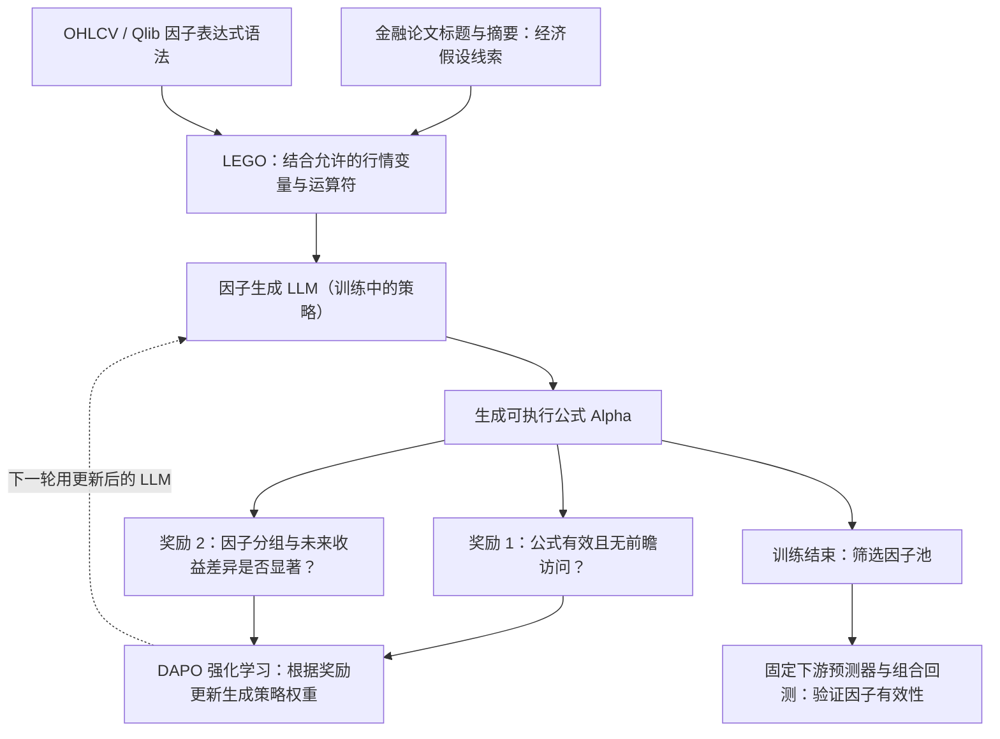

# P007｜AlphaRLM：金融文献引导的强化学习因子挖掘

**一句话骨架**：让 LLM 从金融文献中提炼经济假设，拼装可执行 Alpha 公式，用市场历史数据给公式打分，然后通过强化学习**更新因子生成 LLM 的参数**，让它学会生成更有预测信息的公式。

> **资料性质**：2026-10-10 arXiv 预印本（当前 v2）；**阶段一核心方法已核，实验细节仍在继续研究**。本文只归档客观系统骨架；**特色贡献、局限和 Delta 判断未获研究者审批，暂不落地**。

[原始论文与阅读边界](PAPER.md) · [arXiv 原文](https://arxiv.org/abs/2610.14959)

## 核心架构图（据原文 Figure 1 与 §3 自绘简化）

## 与此前研究目标的边界

- **直接优化**：Alpha **因子生成能力**，而且训练的是**生成因子的 LLM 自身策略**。
- **不以此为主要创新对象**：下游股票收益预测器的模型结构，XGBoost 等只是用于检验候选因子在预测/回测中的实际价值。
- **与 P002 CogAlpha 的事实性区别**：P002 用固定 LLM 生成并进化**因子代码**；这里通过 RL 更新**因子生成模型的权重**。是否构成学术原创的新贡献，还须核查已认领的 P005、AlphaAgentEvo 和其他前作，不在此直接下结论。

**原文依据**：[AlphaRLM §3.1–3.4](https://arxiv.org/abs/2610.14959)、[§4.1 实验设置](https://arxiv.org/abs/2610.14959)。
