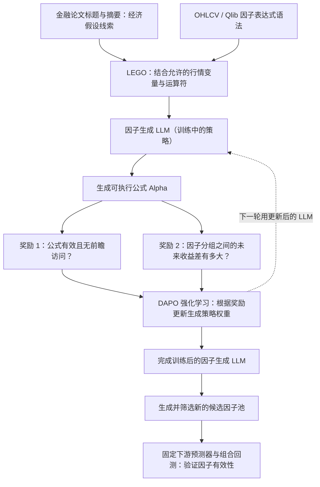

# P007｜AlphaRLM：金融文献引导的强化学习因子挖掘

**一句话骨架**：让 LLM 从金融文献中提炼经济假设，拼装可执行 Alpha 公式，用市场历史数据给公式打分，然后通过强化学习**更新因子生成 LLM 的参数**，让它学会生成更有预测信息的公式。

> **资料性质**：2026-10-10 arXiv 预印本（当前 v2）；**阶段一核心方法已核，实验细节仍在继续研究**。**系统骨架和作者实验报告已归档，研究者明确认可 2 项特色机制 + 1 项审慎的待验证特化风险**；学术首创性/实验复现未确认。

[原始论文与阅读边界](PAPER.md) · [已审贡献与边界](ARCHITECTURE.md) · [谨慎保留的疑问](IDEAS.md) · [arXiv 原文](https://arxiv.org/abs/2610.14959)

## 核心架构图（据原文 Figure 1 与 §3 自绘简化）

## 作者报告的样本外回测结果（实验事实，非创新/缺点审批）

**测试区间**：2021–2024 年。论文 Table 1 以 **5 个随机种子**报告结果；这里的 **AR 是年化超额收益率**（相对基准），**不是绝对年化总收益或实盘收益**。实验从模型生成的候选中筛选因子，将因子输入下游 **XGBoost 股票收益预测器**，用每日 top-50/drop-5 选股策略回测；作者设置开仓约 **0.05%**、平仓约 **0.15%** 的交易费用。

| 评估股票池 | AlphaRLM-8B 年化超额收益 | AlphaRLM-14B 年化超额收益 | 8B 最大回撤（论文口径） |
|---|---:|---:|---:|
| 沪深 300（CSI 300） | **12.14%** | **13.38%** | -6.15% |
| 中证 1000（CSI 1000） | **17.45%** | **17.46%** | -11.98% |
| 标普 500（S&P 500） | **6.94%** | **8.08%** | -14.84% |

**最值得记住的口径**：

- 中证 1000 的结果使用**在沪深 300 设置下训练的因子生成策略/生成的候选**进行跨股票池验证，不等于重新训练一个中证 1000 专用因子生成 LLM。
- **组合收益不等于单因子预测相关性**：8B 在 S&P 500 的 IC 仅 **0.0021**（RankIC **0.0031**），但使用 XGBoost 的组合年化超额收益为 **6.94%**。更换为 Ridge 线性预测器后，该美股配置的年化超额收益为 **-3.90%**；这个预测器敏感性是实验事实，**不自动上升为已批准的特化缺点**。
- 以上均为**作者回测报告值、非独立复现或实盘**；没有把不同论文的 AR/Sharpe 直接作排名，也不能从这些数字推断整个 LLM 训练系统已经在实盘盈利。

**核验说明（2026-10-21）**：arXiv 官方[论文入口](https://arxiv.org/abs/2610.14959)的摘要已支持“三市场年化超额收益领先”的作者主张；本次官方 HTML/PDF 的实验表页暂无法直接打开，因此上表逐项数据来自[公开的原论文 Table 1 转录](https://thelatestinai.com/papers/2610.14959)并与[另一份逐项列数的技术解读](https://aiquantforge.com/articles/alpharlm-aligning-language-models-for-literature-grounded-symbolic-factor-discov)交叉核对。**具体表格仍需后续打开原始 PDF/HTML 直接复核**，并非本研究独立回测。

## 研究者已认可的机制与疑问（简要）

- **D012 · LEGO 文献到公式构造**：利用论文题名/摘要中的经济研究线索结合限定算子，区别于 P001 WQ101 现成公式检索和 P002 领域角色 Prompt。[详情](../../knowledge/deltas/D012_literature_operator_assembly.md)
- **D013 · TMB 市场奖励训练**：单条因子公式的合法性和高低分组收益差反馈用于 DAPO 更新生成模型权重；区别于 P005 的多轮轨迹级因子池 GRPO 奖励。[详情](../../knowledge/deltas/D013_tmb_rl_factor_policy.md)
- **唯一谨慎保留的特化风险**：TMB 取历史最高/最低收益组可能在有限样本上放大偶然分组差距。**未实证证明，用户认为也有些牵强，只作为待核问题记录**；不单列泛泛过拟合。[详见](IDEAS.md)

## 与此前研究目标的边界

- **直接优化**：Alpha **因子生成能力**，而且训练的是**生成因子的 LLM 自身策略**。
- **不以此为主要创新对象**：下游股票收益预测器的模型结构，XGBoost 等只是用于检验候选因子在预测/回测中的实际价值。
- **与 P002 CogAlpha 的事实性区别**：P002 用固定 LLM 生成并进化**因子代码**；这里通过 RL 更新**因子生成模型的权重**。是否构成学术原创的新贡献，还须核查已认领的 P005、AlphaAgentEvo 和其他前作，不在此直接下结论。

**原文依据**：[AlphaRLM §3.1–3.4](https://arxiv.org/abs/2610.14959)、[§4.1 实验设置](https://arxiv.org/abs/2610.14959)。

**工程复现速查**：[GitHub 在线表（CSV）](P007_工程复现问题清单_v1.csv) · [Excel 版本](P007_工程复现问题清单_v1.xlsx)。重点是论文题名/摘要到Prompt与LEGO的真实边界、TMB奖励、DAPO参数训练及研报迁移尚未验证的部分。
