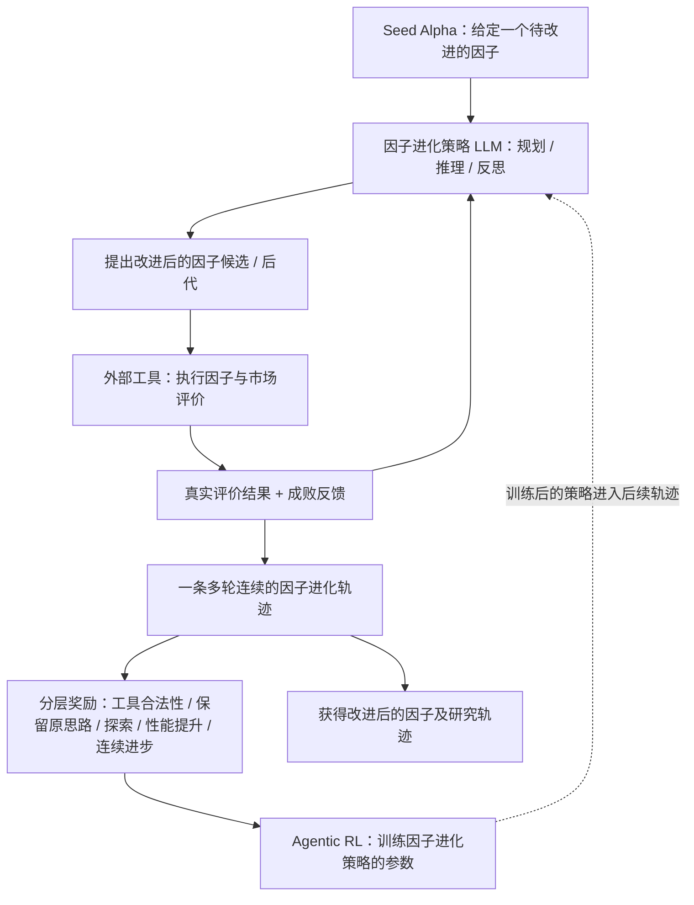

# P008｜AlphaAgentEvo：让因子搜索策略在多轮反馈中学习

**一句话骨架**：不是让 LLM 每次独立「生成因子→回测→重来」，而是给它一个种子因子，让它在**多轮提出变体、调用因子评估工具、分析反馈、继续改进**的轨迹里学习；训练时依据**有效性、探索多样性、与种子的一致性、表现改进、持续改进**等奖励更新因子搜索 Agent 的策略。

> **ICLR 2026 正式论文，阶段一原文研读中。** 此处只有可核查的高层系统骨架；**任何创新、独特缺点和 Delta 仍待研究者逐项审阅**，不宣称“首次自进化”已得到学术首创性证明。

[论文来源与核验范围](PAPER.md) · [ICLR 2026 正式题录](https://mlanthology.org/iclr/2026/tang2026iclr-alphaagentevo/) · [OpenReview 原文](https://openreview.net/forum?id=lNmZrawUMu)

## 自绘高层架构图（依据 ICLR 正式摘要；细节待 PDF 逐节核）

## 先搞懂哪里不一样（事实比较，不是创新审批）

- **相对 P002 CogAlpha**：P002 固定底层 LLM 的权重，外部通过变异、交叉和种群筛选改变**因子代码**；本论文还在训练因子 Agent 的**搜索策略权重**。
- **相对 P007 AlphaRLM**：P007 更强调**文献直接组装单个因子 + 公式合法性/TMB 奖励**；本论文强调**从一个种子因子出发，多轮工具反馈并持续改进**。两者都与 RL 有关，不能重复宣称“首次训练因子 LLM”。
- **相对 P005 AlphaPilot**：两者都使用**多轮工具反馈与 RL**，所以「多轮 RL」本身不是新的差别；实际是否新增了**种子因子持续进化、奖励层级或轨迹评价**，必须通过原文方法/公式与 P005 原文精确对比后才讨论，**此时不建立新 Delta**。

**研究目的**：它聚焦量化 **Alpha 因子挖掘**，而非联合优化收益预测器；正式论文摘要报告 4B 模型在多组 Alpha 进化基线上取得较好的因子进化效果，但不能把成功进化率误当成「实盘净收益」。详见[ICLR 2026 摘要](https://mlanthology.org/iclr/2026/tang2026iclr-alphaagentevo/)。
