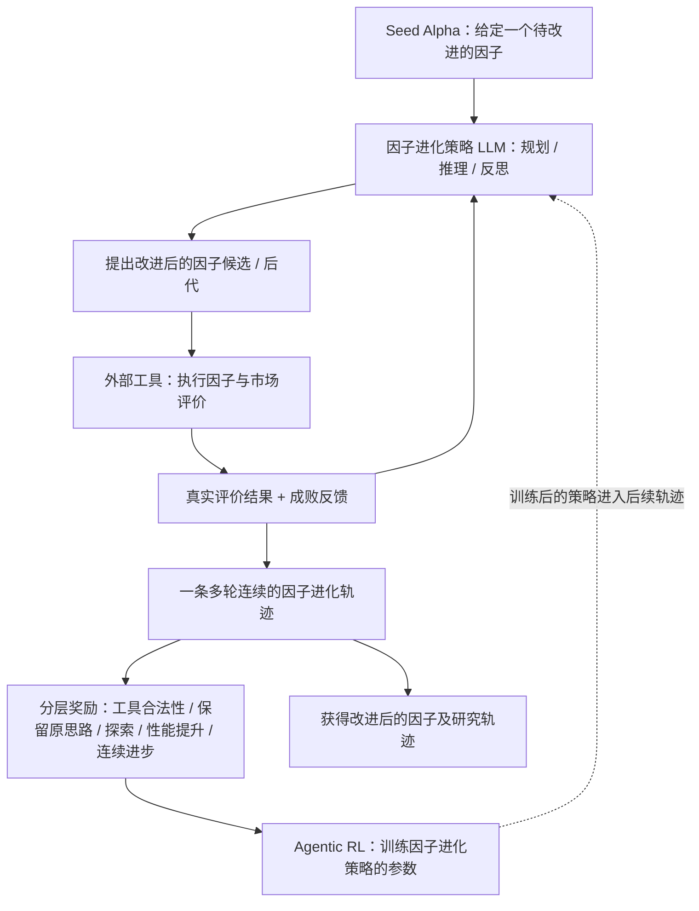

# P008｜AlphaAgentEvo：让因子搜索策略在多轮反馈中学习

**一句话骨架**：不是让 LLM 每次独立「生成因子→回测→重来」，而是给它一个种子因子，让它在**多轮提出变体、调用因子评估工具、分析反馈、继续改进**的轨迹里学习；训练时依据**有效性、探索多样性、与种子的一致性、表现改进、持续改进**等奖励更新因子搜索 Agent 的策略。

> **ICLR 2026 正式论文，阶段一原文研读中。** 此处只有可核查的高层系统骨架；**研究者已认可两项特色设计及一一对应的两项特化验证不足**（种子连续进化↔Pass@T 表达力；五维奖励↔独立消融覆盖不足），不宣称“首次自进化”已得到学术首创性证明。

[论文来源与核验范围](PAPER.md) · [已审创新与对应不足](ARCHITECTURE.md) · [两个特化研究问题](IDEAS.md) · [ICLR 2026 正式题录](https://mlanthology.org/iclr/2026/tang2026iclr-alphaagentevo/) · [OpenReview 原文](https://openreview.net/forum?id=lNmZrawUMu)

## 自绘高层架构图（依据 ICLR 正式摘要；细节待 PDF 逐节核）

## 已获研究者认可的工程与训练机制（2026-10-21）

- **[D014](../../knowledge/deltas/D014_seed_conditioned_evolution.md)：种子 Alpha 的连续进化**。在同一任务中记住前序候选与工具反馈，学习如何持续改造这个种子的后代；区别于 P005 对整套因子池的增删优化，而不是声称独创多轮 RL。
- **[D015](../../knowledge/deltas/D015_hierarchical_evolution_reward.md)：五类奖励的分层组合**。Tool、Consistency、Exploration、Performance、Streak 相互制衡，兼顾可用性、保留研究方向、探索不同候选和连续改善；**目的不是让所有目标都同向**。具体消融及证据边界见[评价页](ARCHITECTURE.md)。
- **与创新①对应的不足**：论文 Pass@T 成功定义只要求前 T 轮至少一个候选 `IR > max(0, 种子IR)`，**无法单凭成功率看出改善幅度**；不是说没有其他 IR 或组合指标。
- **与创新②对应的不足**：§3.4 Figure 4 主要验证 Exploration 与 Consistency 奖励的互补性；Tool、Performance、Streak 以及分层组合形式缺乏同等充分的独立拆分。**奖励目标相互制衡是设计价值，并非缺陷**。两项均已获研究者审批、仍待进一步验证。

## 与此前论文的事实性对照

- **相对 P002 CogAlpha**：P002 固定底层 LLM 的权重，外部通过变异、交叉和种群筛选改变**因子代码**；本论文还在训练因子 Agent 的**搜索策略权重**。
- **相对 P007 AlphaRLM**：P007 更强调**文献直接组装单个因子 + 公式合法性/TMB 奖励**；本论文强调**从一个种子因子出发，多轮工具反馈并持续改进**。两者都与 RL 有关，不能重复宣称“首次训练因子 LLM”。
- **相对 P005 AlphaPilot**：两者都使用**多轮工具反馈与 RL**，所以「多轮 RL」本身不是新的差别；**研究者已认可其种子后代进化任务与五目标奖励的具体差异，并经语义去重记录为 D014/D015**；但正式 PDF 全部公式及消融仍待直接复核，不宣称学术首创。

**研究目的**：它聚焦量化 **Alpha 因子挖掘**，而非联合优化收益预测器；正式论文摘要报告 4B 模型在多组 Alpha 进化基线上取得较好的因子进化效果，但不能把成功进化率误当成「实盘净收益」。详见[ICLR 2026 摘要](https://mlanthology.org/iclr/2026/tang2026iclr-alphaagentevo/)。

**工程复现问题速查**：[GitHub 在线表（CSV）](P008_工程复现问题清单_v1.csv) · [Excel 版本](P008_工程复现问题清单_v1.xlsx)。沿用 P001–P007 的三列问答口径，回答种子来源及是否持续注入、多轮记忆/反思、评价工具、五目标奖励和参数级 Agentic RL；未核实部分明确说明。
