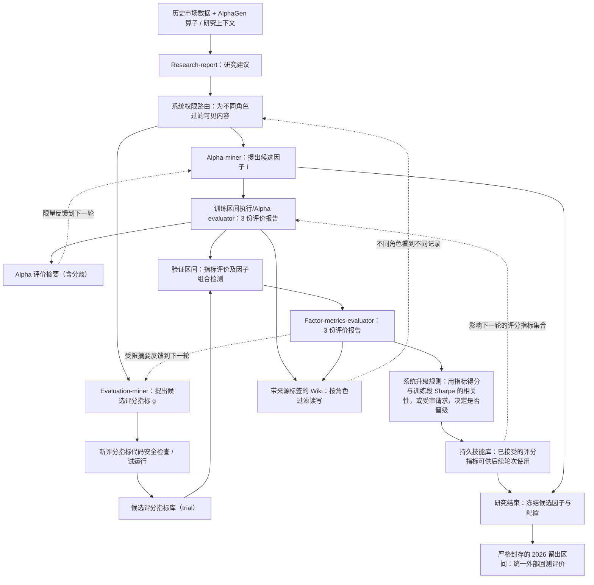

# P009｜AI Trading's Alpha Singularity：SJS / Agora

> **2026-10-22：研究者明确批准 2 项特色机制 + 2 项特化不足，已严格语义去重归档（仍属阶段一）**。原文事实、项目级机制判断、作者自述局限与我们尚待验证的分析严格区分；不宣称学术首次或独立复现。

**一句话**：把「**产生 Alpha 因子的搜索**」与「**产生评分指标的搜索**」分给不同的 Agent；各自依据允许的反馈迭代，评分指标经程序检验才纳入可用库，而**最终留出测试集对整个研究循环严格封存**。

[论文原文与核验范围](PAPER.md) · [已审 2 项特色机制](ARCHITECTURE.md) · [2 项已审特化不足](IDEAS.md) · [arXiv HTML 全文](https://arxiv.org/html/2606.29194) · [arXiv 记录](https://arxiv.org/abs/2606.29194)

## 系统骨架（依据原文 §3–4 与 Appendix A 自绘）

**读图提醒**：这是概括性的双轨信息流，不是论文图的逐箭头复制。评分与候选库在每一轮结束时统一提交，才影响下一轮；最终留出区间**不向搜索中的 LLM 提供反馈**。原文的验证区间会给**评价指标研究角色**有限的四档分类结果，所以**「最终留出集完全封存」不等于「整个验证区间没人用过」**。

## 三个必须理解的控制点

1. **两类被搜索对象**：Alpha-miner 生成因子表达式 `f`；Evaluation-miner 生成评分函数 `g`。后者通过受限代码执行进入 *trial* 状态，而不是生成器自己任意改动最终回测。新指标采用的机制包括验证它与**训练区间**实际 Sharpe 的关系。
2. **指标晋级不是 LLM 自说自话**：论文配置的自动升级条件是累计至少 **3 个观测**，指标得分与训练 Sharpe 的运行相关绝对值 **> 0.3**；另外可以提出由指标评价小组审核的晋级请求。指标持久记录在有状态的技能库，下一轮可用。
3. **反馈经过权限隔离**：Research-report、Alpha-miner、Evaluation-miner，以及两个各有三名独立实例的评价组，分别使用独立 LLM 上下文；跨角色通过带类型、权限和数据来源标签的通道传递摘要。Alpha 生成侧只用训练段信息，指标研究侧可得到验证段的**粗粒度分类**；**最终留出段在整个搜索结束后才评价**。

## 哪些东西真正发生了变化？

- **轮内**：生成新因子、尝试新指标、获得评估报告，评估人员的异议会保留在摘要中。
- **跨轮**：更新带权限的 Wiki、评价摘要和技能库状态；实验主要观察到**指标库**出现晋级变化，不能把「所有技能库都能改」写成「实验中所有技能库都改进了」。
- **不是同一件事**：外部固定回测程序（最终审计）≠ Agent 可进化的内部**选因子评分指标**；两者不能混为一谈。本文的主要记忆与能力积累在**可执行的外部技能库和受限上下文**，不是证实基础 LLM 自主修改参数；系统另含 AlphaGen PPO 中继，不等同于训练这些 LLM。

## 来源与现阶段的证据边界

- **性质**：2026-06-28 的 arXiv 预印本，目前不当作已同行评议的正式期刊/会议论文。
- **作者报告**：CSI1000、100 轮搜索、94 个独立因子、指标库产生 **2 个获晋级的新指标**；2026-01 至 2026-05 的封存时段报告 top-30 因子组合的**多空 Sharpe 为 +1.87**。这是作者的历史模拟结果，**不是我们独立复现，更不是纯做多实盘收益**。
- **关键实验边界**：完整 100 轮系统只跑了**一个随机种子**；该组合收益高度依赖空头一侧。论文报告的部分消融轮数/开关不同，不能把结果差异简单归因于「评价指标自行进化」。作者披露最终留出前的验证段曾对指标研究侧有分类反馈。
- **实现核验**：已阅读原始 HTML §3–5、Limitations 与 Appendix A 中关键设计/审计说明；**没有完成独立代码执行和数据复现，也尚未找到可确认的官方代码仓库入口**。原文声称发布实现，不在未核实前把发布情况当作已验证事实。

**审批与知识库（2026-10-22）**：研究者认可两项项目级机制：[D017｜因子与评分指标共同搜索、受控晋级](../../knowledge/deltas/D017_joint_alpha_metric_evolution.md) 与 [D018｜SJS 来源/角色权限隔离的信息拓扑](../../knowledge/deltas/D018_sealed_joint_search_information_topology.md)。已核对与 D001/D003–D005/D010/D013–D016 及 P010 的语义差异。**只批准两项特化不足**：（1）指标晋级与训练 Sharpe 的循环依赖/可能共适应；（2）缺单 Agent 联合进化对照且冻结库实验预算、PPO 设置混杂。[详情](IDEAS.md)。两项不足属待核推断与作者说明的实证归因边界，非算法失败定论。**不额外创建同义风险 Delta**。

**工程复现速查**：[P009 工程问题表（CSV，GitHub 在线查看）](P009_工程复现问题清单_v1.csv)。沿用 P001–P008 的三列问答，具体区分历史行情与受控研究上下文、SJS 与 Agora、评分器 g 的晋级依据、跨轮 Wiki/Prompt 反馈和 PPO 更新边界。
