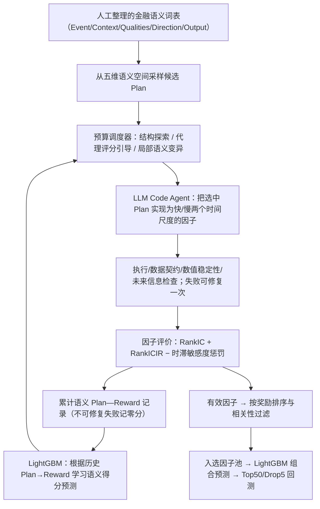

# P010｜AlphaSchema：先搜索金融语义，再实现因子（2026）

> **仅归档原文已核的客观系统骨架**。论文特色是否具有学术新颖性、特化不足、独立研究假设及 Delta 卡均**未获研究者审批**；此处不提前定论。

**一句话**：把因子构思拆为五维金融语义计划，先用可学习的**语义奖励代理评分器（LightGBM）**和预算调度挑选值得实现的方向，再让 LLM 写成可运行因子、回测并把「计划—奖励」反馈给评分器。**训练的是外部代理评分器，而不是微调生成 LLM。**

[原文与核验边界](PAPER.md) · [arXiv 全文](https://arxiv.org/html/2607.26642)

**已确认保留的研究骨架重点（2026-10-22）**：研究者认可继续保留本篇「**五维语义 Plan → 受预算约束的可学习调度器 → LLM 因子实现 → 工具评价 → Plan–Reward 经验回流**」作为研究主线。**这里认可的是准确的架构理解与保留价值，不是对任何学术创新、特化不足或新 Delta 的提前审批**；相关独立评价仍需单独讨论、严格语义去重后才能归档。

## 一眼看懂：系统骨架（依据原文 Figure 1、§2–3 自绘）

## 核心职责与反馈究竟进入哪里

1. **先定义要研究什么**：语义 Plan = **事件、背景/情境、品质限制、预期方向、输出形式**，不直接规定数学算子或参数。每项是一份有结构的金融假设（§2.2；Appendix C）。
2. **外部搜索调度器决定先实现哪些想法**：每轮从大量语义候选中筛选，预算由**新区域探索、LightGBM 预测高奖励、对优质语义 Plan 作局部替换**三部分分配。探索份额随累计评价数逐渐下降（§3.3；Appendix A.3–A.4）。
3. **LLM 主要负责翻译和实现**：将选中的 Plan 变成具体因子程序，各尝试 fast/slow 时间尺度；执行检查未通过允许修复一次，仍失败按零奖励计入缓存（§3.1–3.2）。
4. **学习环路发生在语义层**：RankIC、RankICIR、因子延迟敏感度组成奖励；累计 `(Plan, reward)` 重新训练 LightGBM，指导下轮选 Plan。更新的是**代理评分器的参数与候选探索分配**；未报告对 Code Agent 使用梯度微调，更不是严格 RSI（§3.2–3.3）。
5. **落地与评价**：有效候选按奖励排序、筛掉高度相关的因子；下游 LightGBM 合并因子信号，并按 Qlib Top50/Drop5 测试（Appendix A.5–A.11）。

## 主要实验口径（只记录作者报告）

- **CSI300**：训练 2016–2020，验证 2021–2022，测试 2023–2025；目标为未来五交易日收益。主要语义词表有 **140 个条目**（40 Event、40 Context、50 Qualities、3 Direction、7 Output）；每次 **80 轮×每轮 16 个 Plan**，前十轮纯探索，报告 **5 次独立运行**（§4.1）。
- **主要结果（Table 1）**：仅 OHLCV 计划形成的 **120 因子池**报告 IC **0.0382**、年化超额收益 **8.53%**；加入基本面语义后扩展为 **150 因子池**，报告 IR **1.0877**、年化超额收益 **11.94%**。该 AER 是论文定义的**扣交易成本、相对基准的复合年化超额收益**，不是总收益。表中并非所有预测指标都第一（LSTM 的 RankIC / RankICIR 更高）。
- **因子产生与模型参数层级不可混淆**：这里的 LightGBM 奖励代理**选择语义研究方向**；后面的 LightGBM 组合模型**预测股票收益/排序**，二者职责不同。
- 以上均是作者预印本的历史回测报告，**不是独立复现**；+Fundamental 比纯 OHLCV 多了数据与 30 个因子，不能仅凭组合收益差异把收益归因于“语义搜索算法”。

**去重参照（事实对照，不预审独立创新）**：与 P001 的经典公式检索先验、P004 的 MCTS 因子公式树探索、P005 的池级轨迹 GRPO 微调、P007 的文献—算子生成和 P008 的种子因子进化具有不同的**主要操作对象**。是否足以另立学术/项目 Delta，须先在对话中审批并再次严格语义去重。

**状态**：原文 HTML §2–5、Appendix A、C、D 的方法和主要表格已核对；完整实现代码及重复实验未独立运行，尚不宣称完整学术评估结束。研究处于项目阶段一。
