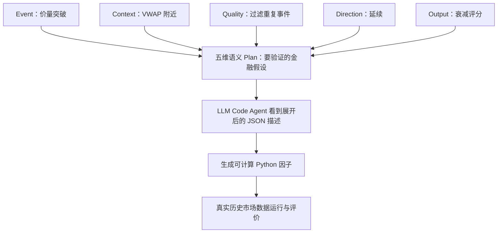
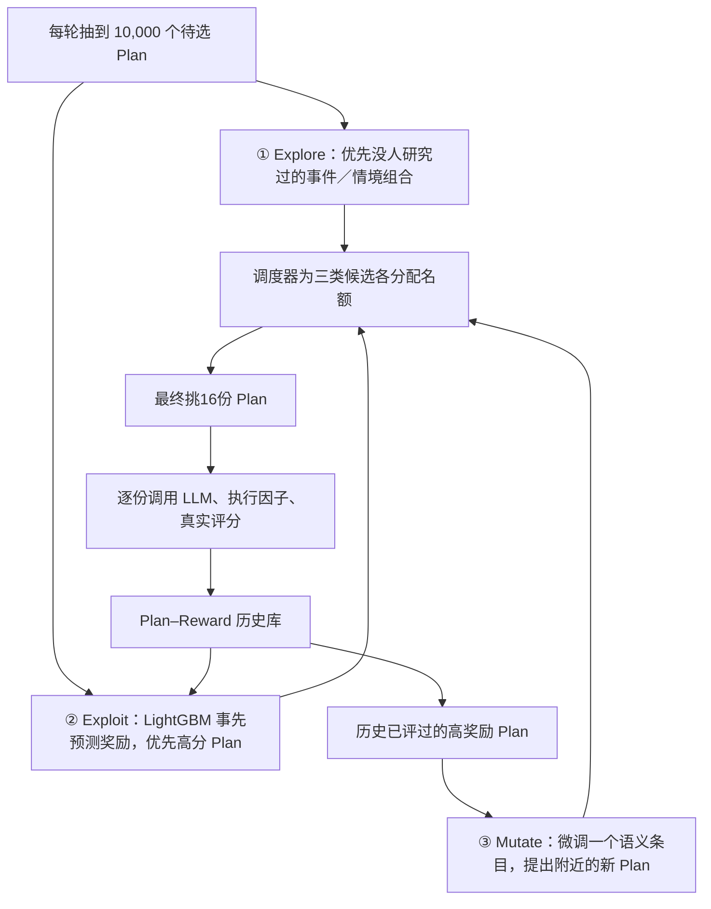
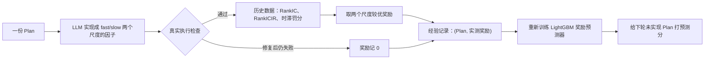
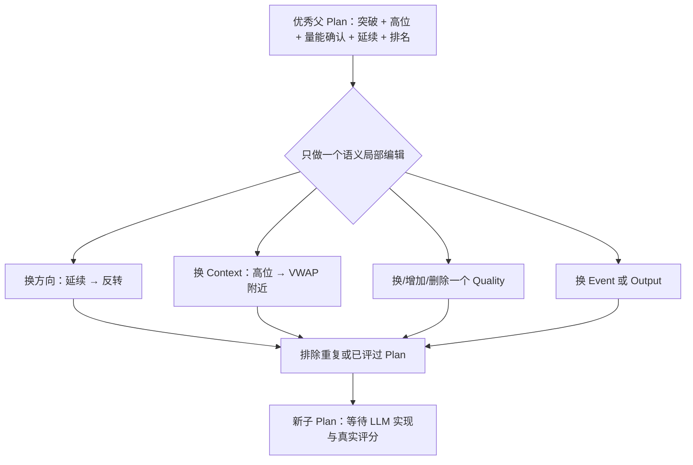

# P010｜语义词表、五维 Plan、搜索调度与“变异”——从零理解

> 这是 [P010 三列工程问题表](../../../shared/A_alpha_mining/papers/P010/P010_工程复现问题清单_v1.csv) 的**可点击展开页**，不是第二张问题表。先讲“每一步程序到底在干什么”，再列关键参数和源码。带数字的演示均标为**教学例子**，不能当作作者真实实验。


*上图为作者 GitHub 仓库提供的原有方法概览；下面的 Mermaid 图是为了讲解另画的简化示意。*

## 1. “金融语义词表”不是一张行情表，也不是 140 个因子

所谓**语义条目**，可以当作研究假设的“积木块”。每一块记录一个**金融含义**，而不是一条可以直接运行的因子公式。

| 类型 | 回答什么问题 | 通俗举例 |
|---|---|---|
| Event（事件） | 价格或量能**发生了什么**？ | 突破价格区间、放量、波动收缩 |
| Context（情境） | **在什么位置或市场背景**下发生？ | 近期高点附近、VWAP 附近 |
| Qualities（确认与过滤） | 需要哪些**额外确认或剔除条件**？ | 成交量确认、冷却重复信号 |
| Direction（预期方向） | 这件事**暗示之后怎么走**？ | 趋势延续、反转、区间震荡 |
| Output（输出方式） | 最后**给股票一个什么信号**？ | 连续分数、截面排名、事件衰减 |

这些积木通常存成 **JSON 文件**。每个条目有 `schema_id`、类别、名称、语义描述、术语定义、`scope`（时序或截面），**没有强制指定 Python 运算符、20 日还是 60 日窗口、买卖阈值**；那些留给后续实现 Agent。

**词表从哪来？** 原文 Appendix C 说可从卖方研报、金融论文、书籍、研究经验和研究目标抽取机制，再去掉具体公式、标注类别、查重后形成记录。研究期间在线搜索只拿当前启用的条目排列组合；**在不同搜索周期之间**可以人工/离线更新词表，加入词表外的新经济机制，并非天生永久固定。它不是每天自动下载行情后生出 140 个新条目。

主论文实验用 **140 个**积木：Event 40、Context 40、Qualities 50、Direction 3、Output 7；当前 GitHub 默认分支的 `schemas/stock_alpha/` 已扩展到**167 个启用条目**（Event54/Context43/Quality59/Direction3/Output8）。两者是不同版本口径，不能把当前文件数硬套为论文实验配置。

来源：[论文 §3.1、Appendix C](https://arxiv.org/html/2607.26642)；[当前公开 JSON 词表](https://github.com/JingyangYi/AlphaSchema/tree/main/schemas/stock_alpha)。

## 2. 五维 Plan 怎么从积木拼出来？它为什么不是代码？

系统从五个栏目取内容，形成一份结构化的**研究计划** `Plan=(Event,Context,Qualities,Direction,Output)`，其中 Qualities 可以选 **0–3 个**，其余栏目一般各选 1 个。

这是根据论文 Appendix D **原始示例**整理的中文简述：

```text
Event       价量共同出现较强突破（在同日股票间比较）
Context     突破位置离该股 VWAP/均线参考点有多远
Quality     短时间内重复出现的同类事件要降权
Direction   延续：预期突破方向随后继续
Output      事件衰减：旧事件的信号随时间逐步减弱
```

这份 Plan 可以被理解成：“寻找出现较强价量突破、参考相对位置且排除近期重复噪声的股票，并把突破后的延续预期做成会随时间衰减的评分信号。”

**注意：这里没有公式。** 同一 Plan 交给不同 LLM，或者同一个 LLM 不同实现，都可能得到不同 Python 运算符、窗口、阈值；它们研究的金融含义却来自同一份 Plan。对应源码 `Plan` 是五个字段的 Python `dataclass`，并用条目 ID 组成 `plan.key` 方便查重。



## 3. “大量五维 Plan”从哪里冒出来？总数为什么会这么大？

不用叫 LLM 随便发明几千个想法。程序从词表里组合取样：例如选 1 个 Event、1 个 Context、选 0–3 个 Quality、1 个 Direction 和 1 个 Output。

**计算一下“组合空间”数量，而不是实际评测次数：** 主论文词表下，若把 Quality 集合看作不计顺序且互不重复，则可组成的理论组合数是：

```text
40 个 Event × 40 个 Context × (C(50,0)+C(50,1)+C(50,2)+C(50,3))
× 3 个 Direction × 7 个 Output

= 约 7.01 亿种理论组合
```

并不是作者真的让 LLM 生成并运行了 7 亿次因子！论文每轮**先抽取 10,000 个候选 Plan**，筛掉已评过或重复的，再从里面决定哪些值得使用昂贵的 LLM 实现预算；实际主实验是 **80 轮、每轮评估 16 份 Plan**，总计 1,280 份 Plan 尝试（不是 1,280 个保证有效的最终因子）。

[源代码：从五类 ID 中抽取 Plan](https://github.com/JingyangYi/AlphaSchema/blob/main/alphaschema/schema_space.py)。

## 4. 搜索调度器究竟怎么选下一批？三条通道不是三种 LLM



- **探索 Explore**：数以前测过多少类似 Event、Context 以及两者的搭配。**越少被评过，新颖度越高**。论文 Appendix A.4 使用三部分加权新颖度（60% 事件-情境组合、25% 事件单项、15% 情境单项）；不是让 LLM 自己说“我觉得这个新鲜”。
- **利用 Exploit**：把 Plan 的字段做成机器可读特征，让 **LightGBM 奖励预测器**根据过去经验估计 `预测奖励`，把高分者送给代码 Agent 验证。**预测只是便宜的排序参考**，不是已实现的真实收益。
- **局部变异 Mutate**：从真正测试过且奖励高的 Plan 出发，只改动一个语义组件，产生“近邻”研究计划。不是修改 Python 算子树。

**名额怎样分配？** 论文主方法写的是冷启动时全探索，之后探索比例随已评样本增加按照平滑函数下降，余下预算分给“高预测分”和“局部变异”。**但当前代码** [`configs/default_stock_search.json`](https://github.com/JingyangYi/AlphaSchema/blob/main/configs/default_stock_search.json) 用明确的**分阶段配额表**，比如下列真实公开配置：

| 当前累计已评 Plan 数 | 新颖探索 Explore | 预测高分 Exploit | 局部变异 Mutate |
|---|---:|---:|---:|
| 0–149 | 16 | 0 | 0 |
| 150–299 | 8 | 6 | 2 |
| 300–699 | 5 | 8 | 3 |
| 700 起 | 3 | 8 | 5 |

这张表是**当前作者仓库配置**，不能声称它就是论文正文那个指数衰减公式的逐步代码实现。当前 `quota_for()` 就是根据累计实验次数寻找阶段，再按三种名额挑 Plan。

## 5. 你说的“取一个预期”：预测奖励是怎样学出来的？

系统不会凭空“预计” Plan 的分数。它先实际试过一些 Plan，留下配对数据：

```text
(Plan A 的五维条目，真正运行后奖励 0.12)
(Plan B 的五维条目，真正运行后奖励 0.04)
(Plan C 的五维条目，真正运行后奖励 0.18)
...
```

**上面 0.12 等是教学数字，不是论文报告。**

程序把 Plan 变成类似 `event=突破`、`context=高位`、`event_context=突破+高位`、`quality_count=1` 的特征，再让 LightGBM **学习什么语义组合过去往往得到较好的真实评价**。之后面对还没写代码的 Plan，它先给一个 `预测奖励`，让系统尽量少浪费 LLM/回测预算。

当前 [`reward_model.py`](https://github.com/JingyangYi/AlphaSchema/blob/main/alphaschema/reward_model.py) 更具体：采用 **8 个带不同抽样子集的 LightGBM 回归器**；`predict()` 把8次预测的**平均值**作为预期奖励，同时输出一个**标准差**作为分歧大小。**它们是外部机器学习模型，不是生成因子的 LLM。**

### “Plan–Reward 经验”究竟存什么？



真实奖励并不是简单“赚了多少钱”。论文用三个部分：

```text
真实奖励 = 10 × RankIC + 1 × RankICIR − 2 × 时滞敏感度
```

- **RankIC**：因子给股票的排序和未来收益排序有多一致。
- **RankICIR**：这种排序预测能力在不同时期有多稳定。
- **时滞惩罚**：如果把信号晚一天使用时 RankIC 降得很明显，就对“过于依赖即时性”的方案扣分。
- 每份 Plan 分别实现 **fast/slow** 两个时间尺度，各计算奖励，最终使用两者中较高的值。代码检验失败允许修复一次；修不好记 **0 奖励**，但这并不证明金融假设理论上完全无效。

这个真实奖励进入**累积缓存**，下一轮用它重新训练奖励预测器。**不会更新生成因子的 DeepSeek-V4-Flash LLM 权重。**

## 6. “树变异”是什么？这一篇其实没有变异树

P010 正文称为 **local semantic mutation（局部语义变异）**，并非搜索因子公式的 AST 子树互换，也不是 P004 的 MCTS 搜索树。

比如上面原始 Plan 的方向是 **延续**，只把它换成**反转**，其余 Event/Context/Quality/Output 不变，就得到一个有明确差别的新 Plan；之后仍然交给 LLM 写 Python，并在真实数据上测试。



论文 Appendix A.4 写明有**七类**具体变异操作：替换 Quality、替换 Context、替换 Output、添加 Quality、删除 Quality、替换 Direction、替换 Event，概率分别是 **22%、16%、16%、14%、12%、12%、8%**。这些在当前 [`schema_space.py`](https://github.com/JingyangYi/AlphaSchema/blob/main/alphaschema/schema_space.py) 中也能找到可执行的对应分支。

**一处论文与代码应分开看**：正文说局部变异候选再经过奖励预测模型排序；当前 `selector.py` 的 `select_batch()` 则优先把符合条件的变异子代按生成顺序收进名额，后面才附上预测分数和名次用于记录。因此**不能直接说当前默认分支在变异候选入选前实施了与正文完全相同的奖励预测排序**。尚未固定论文实验对应的具体代码版本。

## 7. 最后留下什么？与 P005、P004、P006 的关键区别

合格因子先按**实测奖励高低排序**，再过滤与已入选因子高度相关的候选（论文阈值为 `|corr| < 0.7`），筛成最终因子池。**这里不是 P005 那种每加入一个因子就重新拟合整池组合、计算池分数边际差 `ΔΓ` 的过程。**

最终因子池会输入另一个**下游 LightGBM 预测模型**，在 Qlib Top50/Drop5 策略上评价组合。牢记两种 LightGBM：

- **语义奖励模型**：输入五维 Plan 特征，预测**“值得不值得花钱实现这个金融假设”**。
- **股票预测模型**：输入已生成的因子数值，预测或排序**“哪只股票未来可能表现好”**。

对照其他论文：

| 论文 | 真正被搜索/修改的东西 |
|---|---|
| P002 | Python 因子代码、进化父代与子代 |
| P004 | 因子公式构成的 MCTS 搜索树；FSA 还分析算子子树 |
| P006 | Bandit 选择研发因子还是研发预测模型 |
| **P010** | **先搜索五维金融含义的组合，局部变异 Plan，确认值得后才写代码** |

## 来源与证据边界

原文：[AlphaSchema（arXiv:2607.26642）§2–3 与 Appendix A/C/D](https://arxiv.org/html/2607.26642)。作者当前代码：[仓库](https://github.com/JingyangYi/AlphaSchema) · [词表](https://github.com/JingyangYi/AlphaSchema/tree/main/schemas/stock_alpha) · [采样/变异](https://github.com/JingyangYi/AlphaSchema/blob/main/alphaschema/schema_space.py) · [选择器](https://github.com/JingyangYi/AlphaSchema/blob/main/alphaschema/selector.py) · [奖励模型](https://github.com/JingyangYi/AlphaSchema/blob/main/alphaschema/reward_model.py)。

**已完成**：核对原始论文方法、附录与以上当前公开 Python/配置文件。**未完成**：独立运行搜索/回测、确认现在的代码版本与论文实验使用的每个参数完全一致，或独立复现论文报告的市场结果。此页只写客观架构，不对创新与不足重新作未经审批的判断。

[返回主表](../../../shared/A_alpha_mining/papers/P010/P010_工程复现问题清单_v1.csv) · [返回 P010 首页](../../../shared/A_alpha_mining/papers/P010/README.md)
