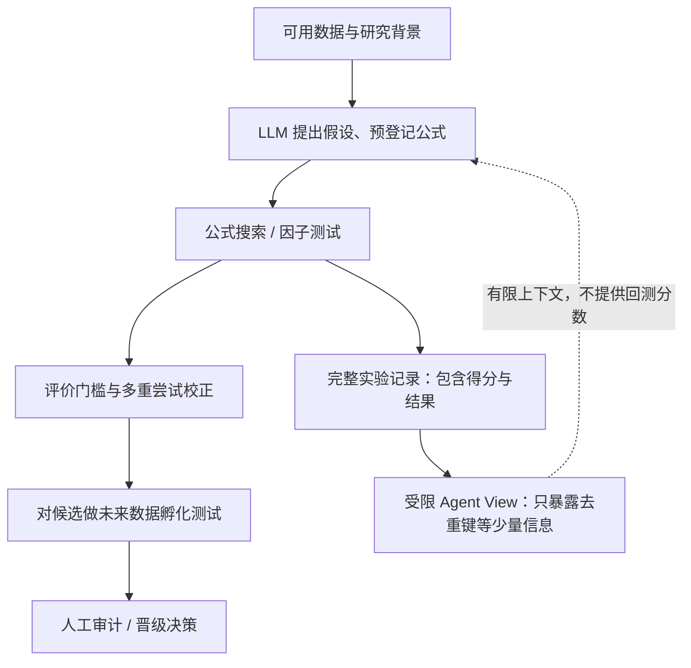

# G001｜Sharpen / Crucible（GitHub 工程项目）

**类型**：可追溯的开源 GitHub 代码与工程研究记录；**不是新增论文**。  
**来源**：[bigcan/sharpen](https://github.com/bigcan/sharpen) · [Crucible 使用说明](https://github.com/bigcan/sharpen/blob/main/docs/guides/crucible.md) · [研究 Agent 约束](https://github.com/bigcan/sharpen/blob/main/CLAUDE.md)

**研究范围**：重点核对仓库内的 `sharpen/crucible/` 自动 Alpha 挖掘机制，不把整个交易执行 / RL 技术栈误当作因子挖掘算法。

## 初步核实的工程骨架（不代表效果验证）

仓库主张提案器不读取先前回测得分或 verdict，具体实现见 [LLM proposer](https://github.com/bigcan/sharpen/blob/main/sharpen/crucible/agentic/llm_proposer.py) 和 [trial ledger](https://github.com/bigcan/sharpen/blob/main/sharpen/crucible/ledger.py)。这里记录**可核查的代码结构**，尚未运行实验或确认架构对收益/新因子质量的真实作用。

## 认领与后续研究状态

**2026-10-21：已认领；README、Crucible 文档及关键 Python 源码已初步检查；系统理解与实现核对继续进行。**

待进一步理解：为什么隔离反馈评分、这种取舍在项目代码中如何执行、哪些记忆信息仍可进入下一轮、已有负面实验记录如何利用。这些是**待研究问题**，不是已审批的创新点、局限或 Delta 卡。**贡献及特化不足先在对话中与研究者讨论、审批，通过严格语义去重后方可归档。**

**证据边界**：项目自述和已查看的代码不等同于第三方复现；GitHub Public 仓库仅存来源链接与我们自己的简洁理解，不复制项目代码或内部资料。
