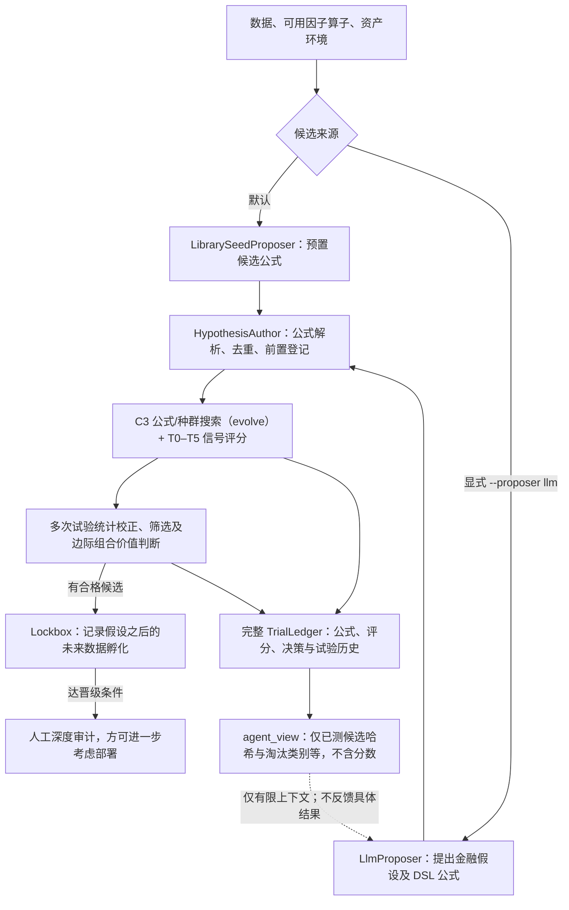

# G001｜Sharpen / Crucible：自动 Alpha 挖掘工程项目

**材料类型**：真实 GitHub 开源代码与工程记录，**不是论文**。  
**原仓库**：[bigcan/sharpen](https://github.com/bigcan/sharpen) · [Crucible 官方使用说明](https://github.com/bigcan/sharpen/blob/main/docs/guides/crucible.md) · [核心代码目录](https://github.com/bigcan/sharpen/tree/main/sharpen/crucible)

> **本文件只记录已核对的系统骨架与运行边界**；项目的特色创新、与已入库 Delta 的真实差异及特化不足，仍须与研究者讨论获批，并严格语义去重后才能上云。

## 一句话骨架

**先提出并锁定可检验的因子假设 → 程序搜索与多重检验筛选 → 有希望的因子交给未来数据检验 → 人工审核。**  
独特的控制流事实：**LLM 提案器看不到历史回测分数或完整评判，只能取得去重标识及有限的已淘汰类别信息**；评分发生在提案器之外。

## 自绘流程图（按实际源代码调用核对）

## 三个关键理解

1. **LLM 只是可选的“提出候选的人”**：输出金融假设、预期方向、候选类型、经济解释和 DSL 因子公式。默认用**离线预置公式库**；只有设置 `--proposer llm` 且提供对应密钥才真正调用 LLM。[证据：orchestrator 启动参数及 proposer 选择](https://github.com/bigcan/sharpen/blob/main/scripts/research/crucible_orchestrator.py)。
2. **提案与评价刻意隔离**：`HypothesisAuthor` 从 `TrialLedger.agent_view()` 构造上下文，提前验证、去重，并在测试前锁定候选及时间戳；LLM 的 `ProposalContext` **没有 IC、Sharpe、判定分数、holdout 表现**。**程序的挖掘/筛选引擎仍可以使用评分**；不能把“LLM 看不到分数”误说成“全系统不看分数”。[证据：HypothesisAuthor](https://github.com/bigcan/sharpen/blob/main/sharpen/crucible/agentic/hypothesis.py) · [Agent View](https://github.com/bigcan/sharpen/blob/main/sharpen/crucible/ledger.py) · [LLM proposer](https://github.com/bigcan/sharpen/blob/main/sharpen/crucible/agentic/llm_proposer.py)。
3. **验证不等于找到可交易因子**：`run_hypothesis_loop` 调用 `evolve` 搜索/计分，试验记入账本并考虑多次尝试；符合门槛者进入 Lockbox，用**提案之后出现的数据**继续积累证据，之后还须**人工审核**。[证据：核心执行循环](https://github.com/bigcan/sharpen/blob/main/sharpen/crucible/agentic/loop.py) · [Lockbox](https://github.com/bigcan/sharpen/blob/main/sharpen/crucible/lockbox/__init__.py)。

## 运行边界（来自代码与配置，不是我们的创新评价）

- `--proposer` **默认为 `library`**，不是 `llm`；运行配置 `generation.enabled` 默认关闭，不带 `--force` 时可能无事发生并正常退出；需要检查 `mined`，不能将 `promising=0` 理解成搜索真的失败。[使用说明](https://github.com/bigcan/sharpen/blob/main/docs/guides/crucible.md)。
- **反馈有选择地隔离**：候选哈希、语义/统计去重键及有限淘汰类别可能参与下一轮生成，但具体评分/胜出因子不通过此接口回传给 LLM。曾经/当前有多少有效淘汰类别要看实际数据与运行配置，不能预设必然生效。
- **不宣称已跑通或复现收益**：目前核对了 README、Crucible 使用指南、proposer/author/ledger/loop/orchestrator/lockbox 关键代码；尚未独立安装、运行回测或核对仓库声明的收益数字。
- `sharpen/agents/` 的深度强化学习交易执行工具属于另一套功能，不与 Crucible 因子挖掘控制流混为一谈。

**研究进度（2026-10-21）**：核心实现骨架已核对并更新；特色贡献、机制专属的不足、与 P001–P004 的 Delta 仍只在对话中讨论，不直接更新知识库。
