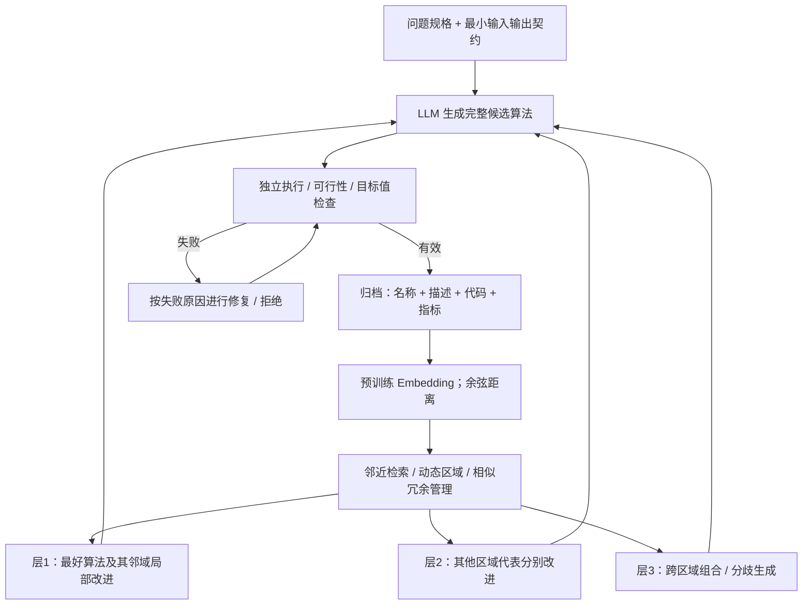

# P011｜ATLAS：Embedding 引导的 Quality-Diversity 算法搜索（跨领域方法参考）

**来源身份**：2026 arXiv 预印本，原始研究任务是组合优化算法设计，**不是金融 Alpha 研究，也未证明金融收益**。[原文与核验范围](PAPER.md)。

**一句话**：通过预训练文本 Embedding 将算法名称、描述与代码映射到可比较的空间，维护多个相异区域的高质量算法，并结合最优区域改进、其他区域改进、跨区域合成三条搜索路径。

## 原文架构简图（据 §III 与 Algorithm 1 自绘）

## 具体机制（仅作者方法）

- **表示与距离**：每份算法对象含 name / description / source code；作者使用 mGTE-large-en-v1.5 预训练嵌入，距离为 `1 - cosine`。检索、聚类、相似性去重共用该表示（§III-B）。
- **Archive**：只保留有效算法；靠相似性去重、容量裁剪维持多区域覆盖，而不是只按全局质量保留单个最好候选（§III-C）。
- **搜索三层**：最优邻域强化、不同非最优区域代表分别改善、跨区域综合 / Diverge；在验证后更新 Archive（§III-F）。
- **检查**：外部评测器独立检查接口、运行与可行性并重新计算目标；某次实现失败不等于可计分的有效方案（§III-D，附录）。
- **作者实验**：四种 NP-hard 组合优化任务；报告在对照基线上取得改善并保留多个结构不同的方案（§IV）。这些都是作者实验，不是本项目复现。

**证据边界**：原文使用的“semantic”指模型嵌入意义下的邻近关系，**不自动证明聚类是可验证的真实机制家族**；原文也不证明算法之间在金融因子数值或 OOS 上独立。本文只作 A 方向搜索方法的跨领域参考；贡献评价、独立风险与 Delta 尚未由研究者审批。

[arXiv 原文](https://arxiv.org/abs/2608.15546) · [全文 HTML](https://arxiv.org/html/2608.15546)
